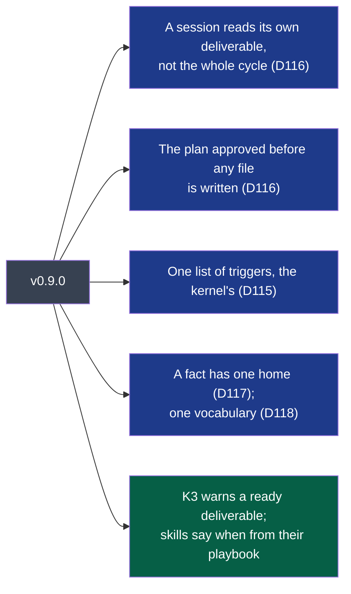
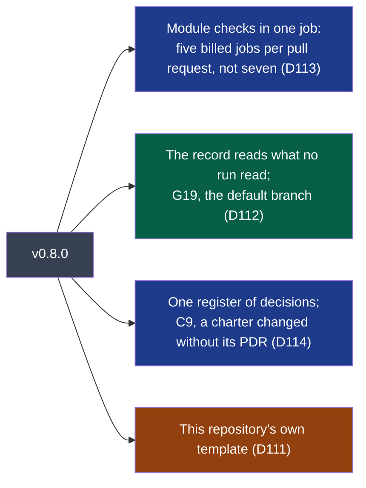
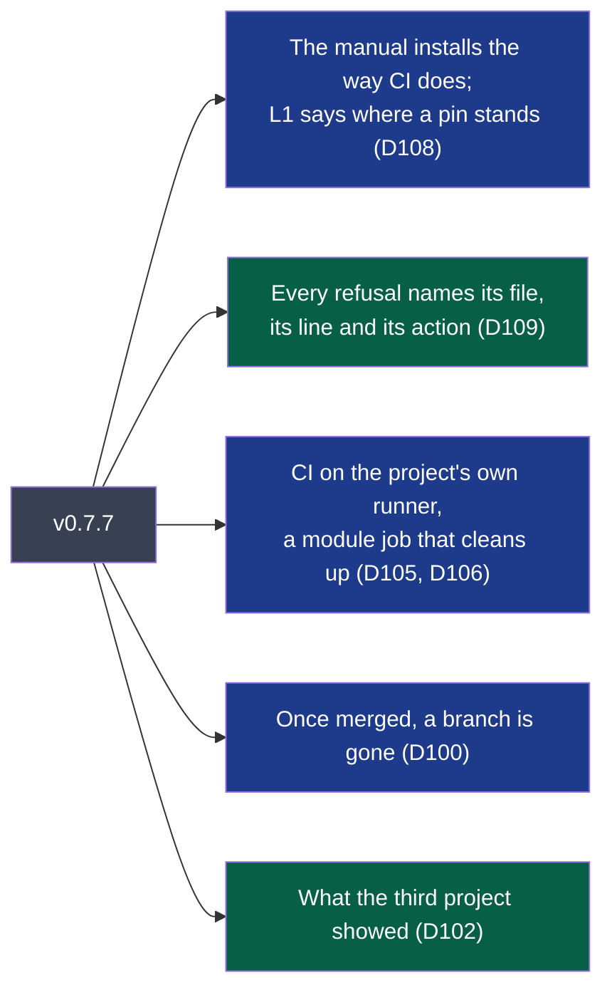
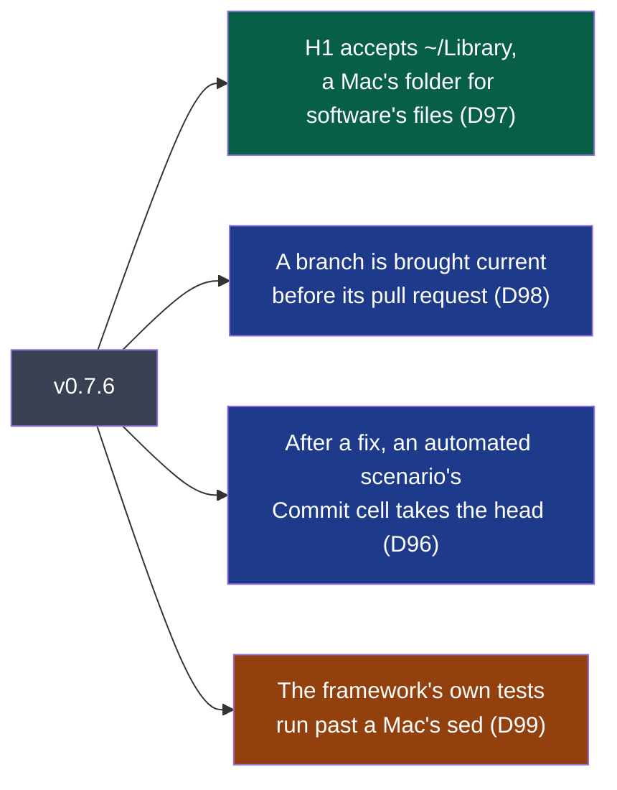
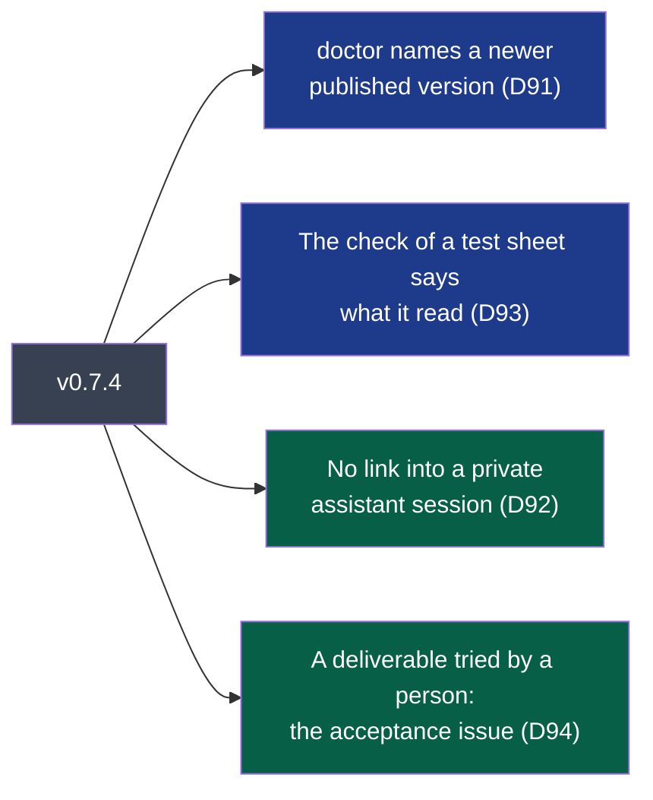
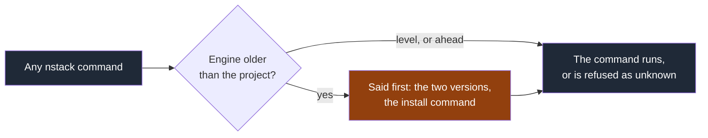
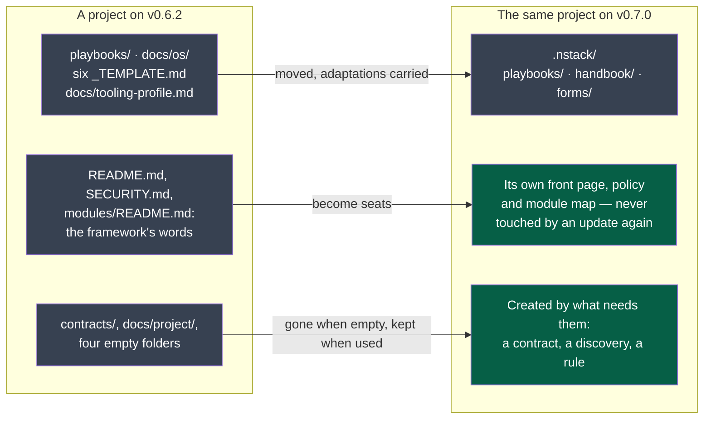

# Changelog

What each published version changes, and what it costs to take it.

Every entry separates two things, because they are installed differently and **only one of
them is in the published package**:

- **In the engine** — what `uv tool install napkinstack==X.Y.Z` brings. This is what the wheel
  and the source archive on PyPI contain.
- **In your project** — what `nstack update` merges into the files your project owns. This comes
  from the skeleton, which Copier reads **from this repository at the tag** (ADR-0001), and
  which the published package does not carry. Comparing two releases of the package cannot show
  it; this section is the only place it is written down.

A **Migration** paragraph appears whenever taking the version costs more than reading it.

Format: inspired by [Keep a Changelog](https://keepachangelog.com), dates are the tag's. There
is no `Unreleased` section: what `main` holds beyond the last tag is written up in the version's
own section, in its version pull request, and the release refuses a tag without it.
Versions are [semantic](https://semver.org): a version that turns a green project red is never
a patch.

---

## v0.16.0 — 2026-10-24

This version holds three workstreams:

- **D150**: the forge allows no credential that administers a repository without being able to commit to it. PDR-0008 is clarified, and the decider chose that a person runs the apply mode.
- **D151**: `nstack settings --apply`.
- **D152**: `doctor` reads the rules of the default branch.

It also takes D144's second step: the e2e audit, which reported a run it read nothing of since v0.15.0, now judges it.

It is a minor version because it adds a command option and can turn a green project red.

**In the engine**

- **`nstack settings --apply`** (D151, PDR-0008): the settings in one gesture of the person who holds administration, never delegated.
  - **What it does.**
    - It makes the calls the print mode shows, under the person's `GH_TOKEN` (else `GITHUB_TOKEN`).
    - It prints each call with the forge's answer. A refusal is named, and the remaining calls are still made.
    - When at least one call was made, `nstack doctor` then reads the result back and the person is told to revoke the credential. The exit code is 1 when a call was refused, otherwise `doctor`'s own (0, 1 or 2).
    - With nothing to make, it says so and exits 0.
  - **When it refuses.**
    - Before any call: in CI, without a token, and when the token it would use is a GitHub App's (`ghs_`, `ghu_`).
    - Before any write: when a rule within the plan's reach could not be read.
  - **What it changes.** It adds and strengthens:
    - it deletes or rewrites no ruleset: a ruleset name already taken gets a free one;
    - it adds no bypass actor;
    - it never turns on Actions that are disabled;
    - it never follows a redirect on a write.

    The one setting it changes rather than adds is G19: it renames the default branch to `main` when it is not, which moves open pull requests and clones' upstream to the new name.
  - **When the forge refuses a ruleset** that holds the required checks, whatever the reason, it is tried again without them, and G4 is named as the step left. The forge may refuse a check it has never seen run (D26).
- **`nstack settings`, print mode.** It now reads the rulesets in place and plans a free name. It no longer plans G7 and G8 when Actions are disabled, and says why.
- **`nstack doctor` and `nstack settings` read the rules of the repository's default branch** (D152), where the checklist's ruleset applies. On a repository whose default branch is not yet `main`, that ruleset was never seen in place.
- **The e2e audit judges a silent run** (D144).
  - **Where it applies:** a module that declares `evidence.provoked`, whose command exits 0.
  - **What makes a run silent:** it left in `$NSTACK_EVIDENCE` no `.log` or `.jsonl` file holding a line whose level the engine reads. The engine reads JSON level keys, a leading level word, GLib's `Domain-WARNING`, `level=`, or the module's own `evidence.levels`. Neither the command's output (`output.txt`) nor a link counts.
  - **When it fails:** for a project whose history recorded v0.15.x and that is now at v0.16.x, starting with the update's own pull request.
  - **When it is only reported:** for a project that jumps from v0.14 or earlier, or was made at v0.16. Such a project is judged from v0.17.
  - **Unchanged:** a run that exits non-zero already failed, and a run that exits 77 is still recorded *not run*.

**In your project** — 2 files

- **`.nstack/handbook/INSTALL.md`**:
  - on GitHub, the gesture: `nstack settings --apply` in your own terminal, never through your agent's session, the token read without echo (`read -rs GH_TOKEN`) and unset afterwards;
  - on every forge, the command list names `--apply`.
- **`.copier-answers.yml`**: `_commit`.

**Migration**

- **Before taking v0.16.0, for each module that declares `evidence.provoked`:**
  - every path where the e2e cannot run on the machine ends with `exit 77`, not `exit 0`;
  - a run that does run writes its logs into `$NSTACK_EVIDENCE` (subfolders included) as `.log` or `.jsonl`, in lines whose level the engine reads. A module that writes only to its output, or in a format of its own, declares `evidence.levels`. The v0.15 run already lists a file whose lines carry no level as *not read*;
  - the e2e command never exits 77 on a real failure: a 77 passes `nstack e2e` whatever its logs say.
- **`nstack settings --apply` is optional.** The printed calls and the checklist by hand stay valid.

---

## v0.15.1 — 2026-10-24

Four workstreams, D146 to D149, all found by the third project.

This is a patch version: it turns no green project red.

**In the engine**

- **`attest` and `pr-check` take a pull request's labels the same way** (D147, #244).
  - **`--labels`** now works on both commands.
  - **`PR_LABELS`** is read by both when the option is not given, so v0.13.0's `PR_LABELS=out-of-cycle nstack attest` works again: v0.14.0 recorded it 4 of 5.
  - **A failed `attest` step says why.** It prints its `FAIL` lines and the action under each. A step that prints no `FAIL` line shows its last eight lines.
- **`nstack claim` makes no second work branch** (D149, #232).
  - **Any existing `d<n>-…` branch is the work**, the way the hold already counts it. The claim takes the one checked out, else the remote's, else this checkout's.
  - **A branch that exists here only** is said, with the push that keeps the hold fresh.

**In your project** — 5 files, for a project on GitHub

- **`.github/workflows/pull-request.yml`** (D146, #248): a later event of a pull request cancels the earlier event's run (`concurrency`). The verdict shown is therefore the last event's, never a stale one that finished last.
- **`.nstack/playbooks/verification.md`** (D148, #243): a new *Mutants* section.
  - The language's tool first: `cargo-mutants`, `mutmut`, Stryker or PIT.
  - By hand, each run under `timeout`; a timeout counts as killed.
  - The source restored on every exit.
  - The counts reported: killed, survived, timed out.
- **`.nstack/handbook/INSTALL.md`**: `pr-check` and `attest` are shown with `--labels`.
- **`.nstack/handbook/project.md`**: `claim` makes the work branch *unless one exists*.
- **`.copier-answers.yml`**: `_commit`.

**Migration**: nothing to do. A cancelled run of *Test sheet and cycle* shows as *cancelled*; the run of the later event gives the verdict.

---

## v0.15.0 — 2026-10-24

Five workstreams:

- **D141** (PDR-0018, ADR-0010): git is required and the forge is the project's choice;
- **D142**: `attest` never publishes an unknown identity;
- **D143**: the ignore list keeps source code in;
- **D144**: the e2e audit, before it judges;
- **D145**: an update from v0.14 keeps the lines a project added under `.github/`.

A minor version, because it turns some green projects red:

- **The audit judges.** The e2e audit brought by v0.14.0 now judges, for a project whose history recorded v0.14.
- **The identity is checked.** `attest` refuses an identity the project's history does not show.

**In the engine**

- **The forge is named once** (D141).
  - **The `forge` answer.**
    - `nstack init --forge github|gitlab|forgejo|gitea|other|none`, GitHub by default.
    - `--github-repo` is asked only on GitHub, `--repository` at a named forge (not for `none`).
  - **What a project off GitHub gets:**
    - checks `attested` by default;
    - no GitHub workflow;
    - the ownership file at the root;
    - the pull request form where its forge reads it.
  - **Every command says what it cannot verify or show off GitHub:**
    - `doctor` reads no G rule, lists what the forge should refuse (read by no version yet), says the repository is unguarded and that the record of commits on main does not run, and exits on the workstation's rules alone;
    - `settings` says it has nothing to apply — it writes GitHub's settings only;
    - the hold's display, `board` and the attested status say *not shown — forge <name>*;
    - `pr-check` says how T2 compared the verifier;
    - `landed` does not run.

    GitHub Enterprise Server is read through `github_repo` and `GITHUB_API_URL`.
  - **`nstack update --forge <name>`** moves a project to another forge at its own version, on a branch.
    - The ownership file, the pull request form and `SECURITY.md` are carried, the project's lines kept and a conflict marked.
    - Leaving GitHub turns `checks: forge` into `attested`.
    - A `forge` changed by hand is refused by `update` and reported as gap L9.
    - `--forge` is refused with `--ref`, and `--github-repo` or `--repository` without `--forge`.
- **`nstack attest` records only an identity the project already shows** (D142).
  - **Before any check**, the identity it would record is compared with the addresses in the project's history, up to its base.
  - **An unknown identity is refused**, naming it and the remote it would reach, unless `--accept-identity` is passed (a new contributor's first record).
  - **Never refused:**
    - GitHub's noreply addresses, matched whole;
    - a checkout with no remote, where nothing travels.
- **The e2e audit judges** (D140, PDR-0017).
  - **When.** A project whose history recorded v0.14.x and is now at v0.15.x is at the judging step.
  - **What fails:**
    - an undeclared error line;
    - from criticality `high`, an undeclared warning line — and for a module whose criticality is missing or unknown, judged as `critical`.
  - **A project from v0.13 or earlier** reports in this version and is judged from the next minor.
- **A run the audit read nothing of** (D144).
  - **It is now said.** A module that declares `evidence.provoked` but whose run left no readable log in `$NSTACK_EVIDENCE` is *silent*.
  - **It is reported in this version and fails from the next minor.**
  - **Exit 77**, Automake's and Meson's skip code, is a run's own *not run here*: the audit records `not run`, nothing is judged, and `nstack e2e` passes, pointing at the output.
  - **Nothing read:** a declaration is no longer said to have *matched nothing* when no log was read.

**In your project** — 12 files, for a project on GitHub

- **The update itself** (D145, `copier.yml`): a project made before the `forge` question keeps the lines it added under `.github/`. Without it, the third project's `CODEOWNERS` came back in conflict.
- **`.copier-answers.yml`**: `_commit`, and `forge: github` written for a project made before the question.
- **`.gitignore`**: `secrets.*` becomes `secrets.env`, `.json`, `.yaml`, `.yml`, `.toml`, `.ini` and `.txt` (D143). Where git ignores case, as on macOS, the old pattern left `Secrets.swift` out of commits.
- **`.nstack/playbooks/tests.md`**:
  - a provoked line is declared even when its scenario asserts it;
  - a run that cannot run here exits 77;
  - a module that declares lines and whose run wrote no log the audit reads fails when judged.
- **`.nstack/playbooks/verification.md`**: a `not run` audit verified nothing.
- **`AGENTS.md`**, **`.nstack/handbook/README.md`**, `05-workflow.md` and `glossary.md` (*Forge*): forge-neutral wording.
- **`.nstack/handbook/07-governance.md`**:
  - what being off GitHub means;
  - the identity `attest` records.
- **`.nstack/handbook/RULES.md`**: L6 where no forge reads the ownership file, L8 (`checks: forge` off GitHub), L9 (a `forge` answer the files were not written for); the G rules read on GitHub only.
- **`.nstack/handbook/09-platform.md`**: the `e2e` row says exit 77; the layout says where the ownership file sits off GitHub.
- **`.pre-commit-config.yaml`**: its comment says Dependabot is GitHub's and which hooks are skipped off GitHub.
- **Unchanged on GitHub:** `CONTRIBUTING.md` and `INSTALL.md` are now templates but render as before, and `SECURITY.md` stays the project's own.

**Migration**

- **The audit judges your e2e runs from this version** if your project took v0.14.
  - **Before updating**, run `nstack e2e` on v0.14 for each module that has an `e2e` command.
  - **Every undeclared line it lists** goes into the module's `evidence.provoked`, written as the line shows, or the run is fixed.
  - **Declare a provoked line even when the scenario asserts it.**
- **A run that cannot run on a machine exits 77, not 0.**
  - **In this version**, a module that declares lines and leaves no log in `$NSTACK_EVIDENCE` is reported.
  - **From the next minor it fails**, and so does such a module's run that skips itself with exit 0.
- **Exit 77 now passes `nstack e2e`**, locally and in CI, where v0.14 failed any non-zero exit. Check that your `e2e` command never exits 77 on a real failure — some tools use 77 for a refused permission.
- **The `.gitignore`.** After the update, run `git status`:
  - **a source file named `secrets.*`** that was ignored now shows: commit it;
  - **a file of secrets in another format** (`.cfg`, `.conf`, `.properties`, `.tfvars`) is no longer ignored: add it to the project's own lines in `.gitignore`.
- **`nstack attest` checks the identity first.**
  - Under an address the base's history does not show, it is refused until a commit of that address is on the base: pass `--accept-identity` on each attest until your first change lands, after checking that the address is the one meant to be public.
  - A base that cannot be found is now refused before any check, with no record written.
- **A GitHub project keeps its pull request form at `.github/pull_request_template.md`.** The forge the files were written for is read from where that form is: a GitHub project holding it only elsewhere gets L9 from `doctor`, and `update` refuses.

---

## v0.14.0 — 2026-10-21

One workstream — D140 (PDR-0017, ADR-0009): a change's end-to-end runs show what their logs said
— and a wording of D139's display. A minor version: a new manifest rule, M12, and an audit that
**only reports** in this version; the project's next minor version of NapkinStack judges.

**In the engine**

- **`nstack e2e` keeps what the run said** (D140): each run gets its folder, `NSTACK_EVIDENCE`
  (`<module>/.evidence/e2e/`, refused if a link, a second run refused while one lives), and its
  output is kept there as `output.txt` — live, in bytes, a traceback included, a child left
  holding the output said after two seconds, an interrupt passed on.
- **The audit**, whatever the command's exit code: the `.log` and `.jsonl` files the run wrote
  there are read — each line's level from JSON keys (words, or pino's 40/50/60), a leading level
  word after colour codes and timestamps, GLib's `Domain-WARNING/CRITICAL`, `level=` (logfmt), or
  the module's own `evidence.levels`. A warning or an error the module did not declare is quoted
  with `file:line` and a declaration, ready to paste, that matches it again. **In this version
  every verdict is reported**; from the project's next minor version an undeclared error fails
  the run, and an undeclared warning from criticality `high`. A declaration nothing matched, and a
  file whose lines say no level, are said.
- **M12** in `nstack manifests`: an `evidence` section that checks something — known keys, text
  patterns that compile and accept no empty line, a level, a scenario.
- **`nstack attest`** records each module's audit of the commit (`evidence`), folders relative,
  ten undeclared lines at most.
- **`nstack new-module`**'s manifest shows a commented `evidence` section.
- **`nstack board`** says *updated* — it cannot tell the plan moving from a hand edit — and once
  what an update means.

**In your project** — 6 files

- `.nstack/playbooks/tests.md`: *What the run said* — write logs and screenshots to
  `$NSTACK_EVIDENCE`, log a page's errors there, declare what the scenarios provoke, assert what
  they expect — never both.
- `.nstack/playbooks/verification.md`: for a visible change, read the run's screenshots and logs
  and cite them.
- `.nstack/handbook/RULES.md`: M12. `.nstack/handbook/09-platform.md`: the `e2e` line.
- `.nstack/handbook/project.md`: *On the forge* says an update may be the plan moving.
- `.copier-answers.yml`: `_commit`.

**Migration** — none to take it: the audit reports only. Before the next minor version, a module
with an `e2e` command writes its logs into `$NSTACK_EVIDENCE` and declares, in its manifest, the
warnings and errors its scenarios provoke — each run lists them, ready to paste. What changes for
an `e2e` command now:

- its output is a pipe, not a terminal — standard error merged into standard output: a script
  that tests for a terminal (colour, a progress bar, a prompt) sees none;
- `.evidence/e2e/` is emptied before each run: what a module kept there from an earlier run is
  removed — keep it elsewhere;
- the run is refused when `.evidence` or `.evidence/e2e` is a link or a file, when another run of
  the module is in progress, or when a file there cannot be removed — each said, with its action;
- a declaration that cannot be read stops the run even while the audit only reports: run
  `nstack manifests` (M12) after writing one; an undeclared or unknown criticality is judged as
  `critical`.

---

## v0.13.0 — 2026-10-21

Two workstreams — D138 and D139 (PDR-0016, ADR-0008): a cycle's progress said in one line, and
shown on the forge where the decider looks — one way, the cycle files staying the only plan. A
minor version: K2 now refuses delivery work on the cycle's end date itself, and a new workflow
writes issues and milestones.

**In the engine**

- **`nstack plan` says the accepted cycle in one line** (D138): deliverables accepted of those
  that count, in progress, ready, proposed, deferred, other — a dropped one counts in nothing —
  and the day of the appetite with the days left, or the circuit breaker fallen. Read from the
  front matter, never written. The holds' header counts held, of which stale. A cycle whose
  `deliverables` is not a list is reported (C4), never a crash.
- **K2 refuses from the end date** — the first day the cycle is over, as the cycle form always
  defined `end`; it let that day through.
- **`nstack board [--dry-run]`** (D139): each accepted, closed or stopped cycle as a milestone —
  keyed on its number, titled by its heading, due on its end date, its counts in the description —
  and each deliverable as an issue in it — keyed on its identifier: acceptance criteria as a
  checklist, module, state, holder (assigned when the repository can), the pull requests naming
  it; closed *completed* when accepted, *not planned* when dropped, deferred or left by a closed
  cycle. Its own objects found by a marker in their body; a person's never touched; a person's
  milestone holding a title, or a person's items in a milestone, said; existing labels used in
  any case. A hand edit put back and said; writes paced; whatever is not shown said in the output,
  the job's summary and a warning — the run always succeeds.
- **The holds are read in CI** with the job's token for that one fetch, masked; never on a
  workstation.

**In your project** — 5 files

- `.github/workflows/plan-on-the-forge.yml` (new): `nstack board` on every merge to `main` — as
  every workflow of the skeleton watches it (G19) —, once a day (holders), and by hand; `issues: write`, `pull-requests: read`,
  `contents: read` at its one job.
- `.nstack/handbook/project.md`: *A cycle's progress* and *On the forge*.
- `.nstack/handbook/RULES.md`: K2 "from the cycle's end date — its first day over".
- `.nstack/handbook/INSTALL.md`: the commands `claim` and `board`.
- `.copier-answers.yml`: `_commit`.

**Migration** — none to take it. The first run of *Plan on the forge*, after the update merges,
creates an issue per deliverable of the accepted, closed and stopped cycles — about sixty writes
on a project with thirty deliverables — and the repository's watchers get a notification for each.
On the cycle's end date, delivery work is now refused until the decider decides (K2).

---

## v0.12.0 — 2026-10-21

One workstream — D137, PDR-0015 and ADR-0007: several contributors, each with the agent of their
choice, take a deliverable before its first change, and nobody delivers it twice. A minor
version: rule K5 can turn a pull request red, and `nstack doctor` reports a new gap, G20.

**In the engine**

- **`nstack claim D<n> [--session S] [--person @you] [--take-over]`** takes a ready or
  in-progress deliverable of the accepted cycle. The hold is a branch of the shared remote,
  `nstack/hold/<cycle>/<id>`, whose empty commits are its events (claim, renew, take-over,
  release; person and session as trailers): pushed without force, so the remote takes the first
  of two claims and refuses the second, which is told who won. The holder claiming again renews;
  a hold with no work — no event, no commit on a branch `d<n>-…` — for `hold_days` is stale and
  may be taken over, recorded with whom it was taken from, their branches untouched. The first
  work branch `d<n>-<slug>` is made from the remote's default branch.
- **`nstack unclaim D<n>`** gives a hold back: its holder, the charter's decider, or anyone once
  stale.
- **On GitHub with a token**, a claim opens a draft pull request from its first work branch,
  naming the deliverable; a claim that makes no new branch — a take-over, or a claim after a
  release — comments the new holder on the open pull requests of the deliverable's branches. No
  token, or a refusal: said; the hold, git's, stands.
- **`nstack plan`** says, after its rules, each deliverable of the accepted cycle free, held
  (person, session, since, last worked on) or stale — never a failure; `nstack fitness` stays
  offline.
- **K5** in `pr-check`: delivery work for a deliverable someone holds comes from one of the
  hold's sessions, or its person — a commit's author or committer, or the opener's account. Nobody
  holds it: nothing is asked. The holds unreadable: a warning. Lifted by `out-of-cycle`, silent
  when unframed, as K1 to K3.
- **G20** in `doctor` and `nstack settings`: forced pushes and deletion refused on
  `refs/heads/nstack/hold/**/*`, by a ruleset of its own, `nstack-holds`, nobody on its bypass
  list. Out of reach on a private repository without a paid plan, as G17 and G18.
- **`hold_days`**, a new answer of the project (7 at init and at update), the decider's.

**In your project** — 9 files

- `CONTRIBUTING.md`: *Working with several contributors* — the work shared by module and its
  owner, a deliverable taken first, any agent reading `AGENTS.md`, joining, who checks whom; its
  first step takes the deliverable.
- `AGENTS.md`: *Hold* — take the deliverable before the first change, with the person's forge
  handle, asked once; stop on someone else's hold, never force a hold's branch; a stopping rule.
- `.nstack/handbook/project.md`: *Who holds a deliverable*, and the pull request check's K5.
- `.nstack/handbook/05-workflow.md`: the Definition of Ready asks the deliverable held.
- `.nstack/handbook/09-platform.md`: the newcomer's step 6 takes it.
- `.nstack/handbook/RULES.md`: K5, G20; the cycle rules "K1 to K3 and K5".
- `.nstack/handbook/glossary.md`: *Hold · stale*.
- `.nstack/handbook/INSTALL.md`: the checklist's second ruleset, on `nstack/hold/**/*` — and why
  not `**`.
- `.copier-answers.yml`: `hold_days: 7`; its header names it beside `checks`.

**Migration** — none to take it. To be protected, a project claims its deliverables
(`nstack claim`); until it does, K5 asks nothing. `nstack doctor` reports G20 until the holds'
ruleset exists: `nstack settings` plans it.

---

## v0.11.1 — 2026-10-20

One workstream — D136. A patch: nothing green turns red.

**In the engine**

- **A contributor's checkout is `SOURCES`, not a gap** (D136): `nstack doctor` run from an
  editable checkout of the framework that holds the project's version — the tag known and an
  ancestor of the checkout's head — says `SOURCES [L1]`: the workstation judges with rules ahead
  of CI's, and the line gives the command to judge as CI does. A checkout that does not hold
  the project's version stays `FAIL [L1]`, saying why (behind, another branch, no tags) and how
  to fix it. The first line of every judging command still says *UNPUBLISHED* (PDR-0005).

**In your project** — 1 file

- `.nstack/handbook/glossary.md`: *Sources*.

**Migration** — none.

---

## v0.11.0 — 2026-10-20

Four workstreams — D131, D133, D134, D135. A minor version: a pull request that changes only
the page of a contract version a module consumes now owes its test sheet (D133).

**In the engine**

- **A contract's page is the contract once someone relies on it** (D133): the page of a version
  a module consumes, or that holds a schema, is a change of the module holding it — `pr-scope`
  counts it, `pr-check` asks that module's test sheet. A version nobody relies on yet keeps its
  page a description (PDR-0012).
- **`nstack update --session <id>`** (D135): the commit an update makes carries an agent's
  `Agent-Session` trailer.
- **A judging command that fails** ends with where its codes and words are explained (D131).
- The contracts module's template (new contracts modules) says a consumed version's page is
  reviewed as the contract.

**In your project** — 12 files

- `.nstack/handbook/glossary.md` (new): the framework's words in plain sentences, where you
  meet them, an example (D131); `00-overview.md` §6 points to it; the handbook's index.
- `AGENTS.md`: *Words* — use these words facing a person, explain one at first mention.
- `.nstack/forms/` (adr, charter, cycle, discovery, pdr): a pointer to the glossary.
- `.copier-answers.yml`: its header tells Copier's lines from the project's answers — `checks`
  is the decider's, changed by hand in a pull request (D134); `.yamllint.yaml`'s comment agrees.
- `.nstack/handbook/INSTALL.md`: an agent passes `--session` to `nstack update`.

**Migration** — none. One pull request may turn red where it passed: one changing only a
consumed contract's page now asks the contracts module's test sheet and a deliverable — what the
contracts module's own instructions already asked.

---

## v0.10.0 — 2026-10-20

Four workstreams — D128, D129, D130, D132 — and the framing of a fifth, D131. A minor version:
`nstack doctor` turns G11 into a gap until the issue templates' labels exist.

**In the engine**

- **`nstack attest`** (D129, PDR-0013, ADR-0006): when the forge cannot run a pull request's
  checks, the team runs them where it works. The command runs the CI's own checks — one list,
  bound to the skeleton's workflows by a test — on a clean head, every one even after a
  failure, and appends the run to the commit's note under `refs/notes/nstack/checks`, one JSON
  line per run (who, which engine, the session, each step's exit code and output, the whole
  output hashed). The note is merged line by line and pushed with the branch's remote; with a
  token it is shown on GitHub as `nstack / local checks`, a name no CI job has.
- **`checks: forge | attested`**, a new answer of the project (`forge` at init). Where it is
  `attested`, `pr-check` requires a complete, passed record of the head: **A1** none, **A2** a
  check missing or failed. Elsewhere a record is shown as information. Under GitHub Actions the
  A rules do not judge: CI's checkout cannot fetch the notes. Run by `nstack attest` itself, `pr-check`
  does not ask for the record being made (D132, found rehearsing this version).
- **G11** (D128) asks for the five labels the issue templates declare — `request`, `bug`,
  `architecture`, `debt`, `acceptance` — beside the three exceptions; `nstack settings` creates
  them, each meaning its template's own words.
- **`--root`** (D130): with none given, the engine takes the nearest folder holding the
  project's answers, this one or above — run from inside a module, a command finds its project.

**In your project** — 5 files

- `.copier-answers.yml`: `checks: forge`, written by the update.
- `.nstack/handbook/07-governance.md` §7: *And when the forge cannot run the checks*.
- `.nstack/handbook/RULES.md`: family A (A1, A2); G11's line.
- `.nstack/handbook/INSTALL.md`: the checklist's labels.
- `AGENTS.md`: *Done* names the record where the checks are attested.

**Migration** — `nstack doctor` reports G11 until the five issue labels exist (`bug` usually
does): run `nstack settings` and the calls it prints, or create them under Issues → Labels.
Nothing a pull request needs turns red: G11 is not blocking, and `checks: forge` keeps the
forge as the judge.

---

## v0.9.6 — 2026-10-18

One workstream, D127: what ships is assembled from release artefacts, never from another
module's folder.

**In the engine**

- **`nstack release [module]`** runs each module's `commands.release` with `NSTACK_DIST` naming
  its own folder of the project's `dist/`, emptied first; what follows a named module goes to its
  command (a platform, a target). With no module named, each runs after what it assembles; a
  named module without the verb fails, the run of all skips it.
- **`assembles: [<module>, …]`** in a manifest: the modules whose artefacts this one's release
  reads, in `$NSTACK_DIST/../<module>/`. **M11** refuses one naming no module, itself, or a loop;
  **B9** refuses another module's artefacts read without it — in its files or its manifest's
  commands; what is left of such a line is still B2's.
- A `dist` or `dist/<module>` that is a link or a file is refused, never emptied through.

- New modules' manifests (`nstack new-module`) carry `assembles` and `release`, commented.

**In your project** — 3 files

- `.nstack/handbook/09-platform.md` §2: the verb, the folder, assembling, one target through the
  environment; `02-modules.md` §8: artefacts as a declared channel; `RULES.md`: M11, B9.

**Migration** — none. Nothing green turns red: no module declares `assembles` yet, and B9 reads
only `$NSTACK_DIST/../<module>` and relative paths landing in the project's `dist/`.

---

## v0.9.5 — 2026-10-18

One workstream, D126: a push from a linked worktree was refused by the fitness functions.

**In the engine**

- **A push from a linked worktree is judged on that worktree's project** (D126): git hands a
  hook of a linked worktree its `GIT_DIR`, and the engine's own git calls followed it — the
  `pre-push` fitness hook said a module held the whole repository, and refused the push. The
  engine now drops the variables by which git names a repository when it starts; it names its
  project with `--root`.

**In your project** — nothing.

---

## v0.9.4 — 2026-10-18

Four workstreams, D122 to D125: what the third project's cycle 03 met, the maintainer's question
on how an agent spends its context, and four dependency updates.

**In the engine**

- **An editable engine says the version its checkout is at** (D122): an install made with `-e`
  reads its checkout's `pyproject.toml`, where its metadata, written once at install, fell
  behind — every command told a contributor's workstation it was behind a project it was level
  with. The warning, `--version`, the first line of each judging run, `doctor`'s L1 and the ref
  `init` and `update` default to all follow. Any other install is unchanged.
- `uv_build` accepted up to 0.13 (#179); the built package is unchanged.

**In your project** — 11 files

- **A command's output is context** (`.nstack/handbook/04-ai-context.md` §3): its quiet form when
  it has one, a failure read in full, the filtering tool the workstation's or the project's rules'
  — the framework requires none. **One session, one task**: when the task changes, write what the
  next one needs and start a fresh session. The kernel's summary leads with the result
  (`AGENTS.md` §8).
- **What a comparator guards** (`.nstack/handbook/03-contracts.md` §3): consumers, not a version's
  exact shape, which its tests hold, nor its page's promises. A promise reversed is breaking when
  a consumer relied on it; the pull-request template's *additive* box names it.
- **Stacked pull requests after a squash** (`.nstack/handbook/05-workflow.md`): note the merged
  branch's last commit, `git rebase --onto`, push with `--force-with-lease`, which dismisses an
  approval already given.
- **A change with a shape is drawn** in a pull request's description
  (`.github/pull_request_template.md`).
- **A self-hosted runner** (`.nstack/handbook/INSTALL.md`): it needs each module's toolchain;
  a stopped one keeps its queued runs, cancelled by whoever holds Actions: write.
- **A push runs its own hooks** (`.pre-commit-config.yaml`): `default_stages: [pre-commit]`, and
  three hooks whose own definition added the push pinned to the commit; the fitness functions
  alone run at push.
- Actions updated in the workflows: `astral-sh/setup-uv` v10.3.0, `actions/upload-artifact`
  v7.0.2.

**Migration** — pre-commit 3.2.0 or later (`minimum_pre_commit_version`), the first that knows
the stage names; `pre-commit --version` says it. Nothing else; nothing green turns red.

---

## v0.9.3 — 2026-10-17

One workstream, D121: a drawing the decider spent their eye on lived outside the project.

**In the engine** — nothing.

**In your project** — 2 files

- **A spike's drawing is kept in the project** (`.nstack/playbooks/framing.md` §2): when a
  spike's product is a drawing — the screens, the journey the user will see — it is committed
  under `docs/project/drawings/<deliverable>-<name>/` with its date, and frozen. What the decider
  accepts in it becomes criteria; once built, the product and its screenshots are the truth. A
  new round is a new folder.
- **A drawing of a screen is no diagram** (`.nstack/playbooks/documentation.md`): it is an image,
  frozen; diagrams stay text.

**Migration** — none; nothing green turns red.

---

## v0.9.2 — 2026-10-17

One workstream, D120: four frictions the third project's agent work met in one day.

**In the engine** — nothing.

**In your project** — 4 files

- **The fitness functions run before a push** (`.pre-commit-config.yaml`): a `pre-push` hook runs
  `nstack manifests`, `boundaries`, `plan` and `hygiene` — the checks CI runs on every pull
  request — so a contract used and not declared, or a path from a home directory, is seen before
  the push, with its rule, file and line. The skills are left to CI: what they are generated into
  follows the engine's version. Where nstack is not installed, the hook says so and lets the push
  go. `pre-push` joins `default_install_hook_types`.
- **The verifier's own ground** (`.nstack/playbooks/verification.md`): a copy of one's own;
  shared state put back after each run, also on failure; what one starts stopped by its process
  number, nothing left running; the pull request's description fetched again just before it is
  written.
- **A spike's imitation checked first** (`.nstack/handbook/05-workflow.md`): a spike that
  measures a step through an imitation of what it sends first shows it sends the same, byte for
  byte.
- **A deliverable added mid-cycle** (`.nstack/playbooks/framing.md` §4): the decider may add one
  that fits what is left of the appetite, the end date unchanged; its section says on whose word
  and on what it entered.

**Migration** — run `pre-commit install` once in each clone: an install made before this version
put no `pre-push` hook in place. Nothing else; nothing green turns red.

---

## v0.9.1 — 2026-10-15

One workstream, D119, found by the first project to take v0.9.0.

**In the engine** — nothing.

**In your project** — 1 file

- **`.nstack/install-engine.sh` reads the registry afresh for the engine** (D119): it installs a
  published version with `--refresh-package napkinstack`. A self-hosted runner keeps uv's cache
  across jobs, and a page of the registry read before a release said the version did not exist —
  every job of an update pull request failed, minutes after v0.9.0 was published, until the cached
  page expired. Hosted runners are untouched.

**Migration** — none.

---

## v0.9.0 — 2026-10-15

Four workstreams, D115 to D118: what an agent reads before its first line of work, when it asks
for approval, and the words the method uses — one list each.

**Legend** — green: in the engine · blue: in your project.

**In the engine** — 2 files, and the module templates

- **`pr-check` K3 warns** a delivery pull request whose deliverable is still `ready`: set it
  `in-progress` in the cycle, in that pull request (D116). A warning: the state is the decider's.
- **`nstack skills` takes a skill's "when" from its playbook's trigger** — the kernel's words —
  and appends it to the description `skills.yaml` gives, which now says only what the playbook
  holds (D115).
- `nstack new-module` writes a page and local instructions that point at the manifest for the
  responsibility, the owner and the criticality, and one line per known trap (D116, D117).

**In your project** — 20 files

- **The kernel** (234 lines, as before):
  - a session reads the charter, and of the current cycle **its front matter and its own
    deliverable's section** — not the whole cycle;
  - **before writing any file**, the plan — steps 1 to 3, the oracle to write, the size — goes to
    whoever gave the task, who may waive it for that task; no project rule waives it; *trivial*
    has a criterion;
  - a defect of the framework is reported to the decider, who assigns its fix; a flaky test is
    quarantined, never disabled;
  - **the trigger table is the only list** of when a playbook loads — a new dependency now loads
    security; a deployment and a call to another system, operations; a pull request's description,
    documentation (D115, D116).
- **Each playbook's header** says its trigger in the kernel's words (D115).
- **The cycle's form** gives each deliverable its own section, and sends what was tried, what it
  cost and what was refuted to the project's log issue (D116).
- **The documentation standard has a fifth rule: a fact has one home** — the file a check or a
  command reads; every other document links to it (D117).
- **One vocabulary** (D118): one list of standard verbs; who provides and consumes a contract is
  `nstack modules --with-contract-sides` and B6, where a "generated matrix" was promised; the
  manual's commands say what each runs and name `--user-facing`; layering and budgets are the
  project's to build.
- `05-workflow.md` §2's diagram, `04-ai-context.md`, `09-platform.md`, `framing.md`,
  `skills.yaml`, `RULES.md` follow.

**Migration**

1. **Move your cycle's prose.** What each deliverable tried, cost and refuted goes to the project's
   log issue; give each deliverable a `### D<n>` section holding what binds it. Until then a
   session reads only its own deliverable's section, and the rest of the prose is not read.
2. **Set the deliverables in progress** that are: K3 now says so on their next pull request.
3. **A playbook header or a skill description you adapted** meets a conflict on that line: keep
   your words in the kernel's table too, or the header and the table say two things again.
4. Copies of a module's owner, criticality or responsibility already written in your module pages
   or your module map are yours: the fifth rule says to link instead.
5. **An update that crosses several versions** — a project still on v0.7.x taking this one —
   changes about thirty framework files and passes the review budget: label its pull request
   `over-budget`, a mechanical migration.

---

## v0.8.0 — 2026-10-15

Four workstreams, D111 to D114: the CI bills less without judging less, the record of commits
on main has no gap, and decisions have one register the agent knows how to fill.

**Legend** — green: in the engine · blue: in your project · orange: in this repository only.

**In the engine** — 5 files, and the module template

- **`nstack landed` reads from the last commit it recorded** (D112): a push whose run never
  started — CI out of minutes, a runner down — is read by the next run that does, which says how
  many commits no run had read. A record that never succeeded reads the push alone.
- **`doctor` G19**: a default branch other than `main`, which no workflow watches, is a gap; read
  on the repository's own object, any plan, no Administration permission. `nstack settings` plans
  the rename (D112).
- **`pr-check` C9, a warning**: a pull request that changes an accepted charter and carries no
  decision record is told so (D114).
- **`nstack new-module` writes no register of decisions in the module**: its page points at the
  project's `docs/adr/` and `docs/pdr/`, with `Scope: module <name>` (D114).

**In your project** — 9 files

- **`Module checks` is one job** (D113, ADR-0005), running the new `.nstack/check-modules.sh`: each
  changed module in turn — bootstrap, check, test; compat even after a failure; e2e on a green
  module; clean on a self-hosted runner. A failure does not stop the next module; the job fails at
  the end, naming them. The required name is unchanged, so no ruleset moves; the run on `main` and
  every verdict are kept. A pull request changing one module bills five jobs instead of seven, and
  a self-hosted runner needs `git` alone. The pull request's page shows one line for the modules;
  read a failure in the job's log groups. The evidence is one archive, a folder per module.
- **`Commits on main` reads its own past runs** (`actions: read`, still read only) (D112).
- **INSTALL**: the checklist's nineteenth line, the default branch; a runner needs `git`; what a
  pull request costs (D112, D113).
- **`framing.md` says when a decision is due** — an accepted charter changes through a PDR, a
  framing choice is an ADR, a cycle's closure reads again the decisions anchored to it or past their
  date — and the charter's form sends open questions to the cycle (D114).
- `RULES.md` (G19, C9, W1), `06-decisions.md` (one register), `09-platform.md` (the module tree, the
  module checks' cleaning).

**Migration**

1. **The first run of *Commits on main* after the update may be red**: it reads back to the last
   commit it recorded, and names any commit that reached `main` outside a pull request while no run
   could start. Read each one; it is the record keeping its promise late.
2. **A default branch other than `main`** is now a gap (G19): rename it — `nstack settings` prints
   the call.
3. **A module that keeps a `docs/adr/` of its own** keeps it: an update never touches a module. To
   have one register, move its records into the project's `docs/adr/`, numbered there, with
   `Scope: module <name>`.
4. A script that read a job of the matrix by its module's name (`evidence-<module>`, a job per
   module) reads `Module checks` and the `evidence` archive now.

**In this repository only**

- The pull request template is a workstream's, and holds the only definition of done (D111).

---

## v0.7.7 — 2026-10-15

Ten workstreams, D100 to D110 (D103 and D104 stay open); most of them found by a third project
and a contributor's private one, in their first week.

**Legend** — green: in the engine · blue: in your project.

**In the engine** — 5 files, and the module and contracts templates

- **`doctor` L1 says where an unpublished pin stands** (D108). A fix may be pinned while it is
  reviewed; its squash then gives the framework's default branch another commit and leaves the
  pinned one on no branch. L1 now says when the framework's default branch does not hold the
  pinned commit, with the gesture that moves the pin once it is merged, asking the forge without
  a token; when the forge is silent, it says what it said before. L1 stays a gap. Its first
  wording called a commit still in review "left behind by its squash"; corrected before the tag
  (D110).
- **An action never names a version no installer accepts** (D108): for a project pinned to a
  commit, `doctor` says `bash .nstack/install-engine.sh`, not `napkinstack==<version>-<n>-g<commit>`.
- **`nstack --version` says where the engine came from**; `--ref` is documented as a tag or a
  commit (D108).
- **Every manifest refusal names its file, its line and its action** (D109): M2 to M10 named the
  module and not the place, and six of them offered no action.
- **`nstack run <module> <arguments>`** passes the arguments to the module's command (D102).
- **The manifests check warns (V1)** when contracts are consumed and the contracts module declares
  no comparator — the moment it can still be met (D102). A warning: no exit code moves.
- **The hygiene check says how many files it did not read** because they are not yet added (D102).
- **`commands.clean`**, an optional standard verb: `nstack clean <module>` (D106). The module
  template names it.

**In your project** — 17 files

- **`.nstack/handbook/INSTALL.md`'s first command is `bash .nstack/install-engine.sh`**, the script
  CI runs (D108): for a project pinned to a commit, the old line asked for a version no installer
  accepts. The manual now says, like the contributing guide, that a fix may be pinned while it is
  reviewed, and that the pin moves once it is merged.
- **`.nstack/install-engine.sh` reads the answers file without a YAML tool** (D108): a runner with
  the wrong one was told its source was "a path on one machine".
- **Every job runs on `vars.NSTACK_RUNS_ON`** (D105) — GitHub's hosted Ubuntu when the variable is
  unset, so nothing changes for a project that sets nothing. INSTALL says what a self-hosted runner
  needs, and why never on a public repository.
- **A module job starts clean and ends clean on a self-hosted runner** (D106): `clean: true` on its
  checkout, and the module's `clean` verb as its last step, even after a failure. Hosted runners
  are untouched.
- **The kernel's working loop ends with *Close*** (D100): once merged, the branch is gone — on the
  forge, on the workstation, and its worktree.
- **The security playbook's rules are `SEC1` to `SEC5`** (D109), so that `S1` means the skills rule
  of `RULES.md` only; `RULES.md` marks M4 and V1's notice as warnings.
- Pages corrected where they no longer agreed with the engine or with each other (D101); the
  handbook says that expand/contract holds for a version's name in a consumer's tests (D102).

**Migration** — none for a project on a published version: no rule turns a green project red.
A project pinned to a commit of a pull request that has since merged moves to this version:
`nstack update --ref v0.7.7`.

---

## v0.7.6 — 2026-10-14

Four workstreams, three of them found by a second contributor's first days: D96 to D99.

**Legend** — green: in the engine · blue: in your project · orange: in this repository only,
shipped to nobody.

**In the engine** — 1 file

- **H1 accepts `~/Library`** (D97). The hygiene check refused the folder every Mac keeps
  software's own files in — where a macOS app documents its storage — while it accepted the
  dot-directories, its Linux counterpart. A project building a macOS app went red on its
  design document. A real folder of the home directory — downloads, the desktop — is
  still refused, and so is a name that only begins with `Library`. Nothing a green project
  had turns red.

**In your project** — 5 files

- **A branch is brought current before its pull request** (D98). Two pull requests each took
  the next number of a register on the same morning; the second conflicted after it had been
  approved, and was settled by someone who had not written it. The kernel's working loop has
  a step for it, and the handbook says why:

| | |
|---|---|
| Before the pull request | Merge the default branch into yours; a conflict is settled there, by its author |
| What is numbered in sequence | A decision record, a register's row: takes its number then, not when the work started |
| While it waits | A conflict the forge shows is its author's to settle again. No check asks for a branch to be current |

- **After a fix, an automated scenario's Commit cell takes the head** (D96). The handbook said
  so; the pull request template and the verification playbook — what a verifier reads — did
  not, and a verifier wrote the head in `Confirmed` for an automated scenario, which
  `pr-check` refused. The three texts now say the same: an automated scenario is run again
  and its Commit cell takes the head, never confirmed; an explored one keeps its commit and
  is confirmed.
- The handbook's paragraph on H1 names `~/Library` (D97).

**In this repository only**

- `platform/tests/run.sh` edits files in place through one function that both GNU's sed and
  a Mac's take (D99): the oracle stopped on a Mac at its first `sed -i`. Not verified on a
  Mac.

**Migration**

None. Measured on a copy of a project running the v0.7.5 skeleton: `nstack update` merged
without a conflict, 7 files — the five above, the manual's version line and the recorded
version; fitness green afterwards. A project whose `AGENTS.md` was adapted around the working
loop may have that one step to place by hand.

## v0.7.5 — 2026-10-13

**In the engine** — nothing

`src/napkinstack/` is unchanged since v0.7.4.

**In your project** — 2 files

- **An acceptance issue is one trial, closed when it is answered** (D95). The form shipped in
  v0.7.4 said what an acceptance issue holds, and nothing of when it is closed: the first one
  stayed open with every step answered, waiting for a deliverable that needed a second module
  and two other systems. The form and the handbook now say it:

| | |
|---|---|
| One issue | One trial: a person, a system, a set of steps |
| Closed | When each step has its answer — met or not — by whoever ran it, or by the pull request that records the last one |
| The deliverable's state | In the cycle, never read from an issue being open or closed |

**Migration**

None. Measured on a copy of a project running the v0.7.4 skeleton: `nstack update` merged
without a conflict, 2 files, the manual's version line and the recorded version; checks green
afterwards. An acceptance issue left open "until the deliverable is accepted" can be closed
once its steps are answered.

## v0.7.4 — 2026-10-13

Four workstreams, each found by using the framework on a project: D91 to D94.

**Legend** — blue: in the engine · green: in your project.

**In the engine**

- **`nstack doctor` names a newer published version** (D91). Nothing told a project that a
  version had been published. The command that already reads the network, on demand, asks the
  registry one question, without a token:

| The registry answers | `nstack doctor` says |
|---|---|
| A version newer than the project's | `NEWER VERSION`, with the address of its notes and the way to take it, at a cycle's boundary |
| The project's version, or an older one | `LATEST` |
| Nothing | `NOT READ` |

  It is information, never a gap: no exit code moves. **No other command opens a
  connection.** `NSTACK_REGISTRY_URL` names another registry than `https://pypi.org`.

- **`nstack pr-check` says what it read of a test sheet** (D93): the scenarios by result, the
  verifier, what it was compared with. It notes, before anyone verifies, a change whose agent
  commits name no session — one only a person could sign — and its refusal names the two ways
  out. **A sheet's commit stands when the head holds exactly the same files**: a merge of the
  default branch that brings nothing no longer sends every automated scenario back.

**In your project** — 9 files

- **No link into a private assistant session** (D92), in a file or in a commit message: one
  hook, `no-session-link`, and one step of the "Hooks and secrets" job that reads again the
  commit messages of a pull request and its description, where a hook cannot be bypassed. Only
  a session, a conversation or a share is refused; a link to an assistant's site is a link, and
  a co-author line stays.
- **A deliverable tried by a person has a place** (D94): an **Acceptance** issue form. It
  tracks a deliverable, copies none of its criteria and sets none of its state — both stay in
  the cycle. The handbook's sources of truth and the test sheet's rules name it; the framing
  playbook says what *accepted* means when several pull requests deliver one deliverable.
- **Verifying a library** (D93): the verification playbook names the `test` verb where a
  module declares no `e2e`, and what a module with nothing to start does. The pull request
  template gains a line, **`Verifier's remarks:`**, under the sheet.
- **Pull requests that sit on one another** (D93): the handbook says what the first merge costs
  the next one.

**Migration**

1. **Run `pre-commit install` once more** in each checkout: the new hook also reads the commit
   message, and that stage is installed by the same command.
2. **A commit message or a tracked file that holds a link into an assistant's session is
   refused from now on.** CI reads the messages of a pull request's own commits, never the
   history before it: nothing already merged turns red.
3. Nothing else. Measured on a copy of a project running the v0.7.2 skeleton, crossing v0.7.3:
   `nstack update` merged without a conflict, 9 files and the recorded version; the guardrails
   and the new hook, run on every file, passed afterwards. A project that adapted its pull
   request template near the test sheet, or its hooks' configuration, may conflict there.

## v0.7.3 — 2026-10-12

**In the engine**

- **An engine older than its project says so, on every command** (D90). Once a teammate's
  update is merged, every other workstation is behind: a command the project's manual names
  answered `invalid choice`, and a verdict came from rules the project had left. Every command
  now says first, on the error stream, the two versions and the install command — a command
  this engine does not know included. An engine ahead of its project says nothing: an update
  starts there.

**Legend** — grey: the command, unchanged · orange: the new line.

An engine already installed cannot learn this: the line appears on workstations at this
version or later, when the project moves past them.

**In your project** — 1 file

- The manual, `.nstack/handbook/INSTALL.md`, says under *Receiving a new version* that everyone
  else installs the same version once the update's pull request is merged.

**Migration**

None. Measured on a copy of a project running the v0.7.2 skeleton: `nstack update` merged
without a conflict, 1 file and the recorded version, checks green afterwards. A project that
adapted its copy of the manual near *Receiving a new version* may conflict there.

## v0.7.2 — 2026-10-12

**In the engine** — nothing

`src/napkinstack/` is unchanged since v0.7.0.

**In your project** — 2 files

- **A defect of the framework has a way back to the framework** (D89). The kernel gains one
  stopping rule: when the framework itself is wrong — a message, a check, a page — stop, say
  so, never a workaround.
- The manual, `.nstack/handbook/INSTALL.md`, gains the section *When the framework is wrong*:
  clone the framework's sources beside the project, judge the project with them, propose the
  fix there. A private project is described, never named.

**Migration**

None. Measured on a copy of a project running the v0.7.0 skeleton: `nstack update` merged
without a conflict, 2 files and the recorded version, checks green afterwards. A project that
adapted its copy of the manual near *Receiving a new version* may conflict there.

## v0.7.1 — 2026-10-12

**In the engine** — nothing

`src/napkinstack/` is unchanged since v0.7.0. What changes is the page the registry shows:
v0.7.0 was published with a front page still saying *"Status: v0.6.2"*, and that page is
frozen at the tag. This version carries the right one, and a version can no longer be
prepared with a front page naming another.

**In your project** — nothing

`skeleton/` is unchanged since v0.7.0. `nstack update` lays down a branch that bumps the
recorded version and merges no file, so it cannot conflict.

**Migration**

None from v0.7.0. **Coming from v0.6.2 or below, read the v0.7.0 section**: it moves the
framework's files and carries its own migration.

## v0.7.0 — 2026-10-12

The framework charges what a failure costs, and nothing more (PDR-0011); a project's tree is
the project's (PDR-0010, PDR-0012).

**Legend** — grey: the framework's files · green: the project's.

**In the engine**

- **Four criticality values, four regimes.** `prototype` joins `standard`, `high` and
  `critical`. A test sheet is owed at `high` and `critical`, and at `standard` only for a module
  a user sees; a runbook from `high`. Every refusal names the value that produced it and what
  the value below would change. `nstack new-module --help` says what each value means, and the
  command prints what the chosen one costs before it creates anything.
- **A fix costs a confirmation, not a round** (T4). An automated scenario is green at the head;
  an explored or human one keeps the commit its evidence was produced on, with the verifier's
  line confirming it at the head. At `critical`, every scenario is confirmed.
- **A deliverable nobody can meet is shown its two doors** (C4): a spike, whose refuted result
  is a delivered one, or a dependency with a date.
- **A project that has framed nothing is *unframed*, not in violation.** The cycle rules (K1 to
  K3) apply from an accepted charter; `fitness`, `doctor` and `pr-check` say which state they
  judged.
- **A document is due at its moment** (C8): one sentence on the front page at a discovery's
  *go*, the whole front page at an accepted charter, the module map at a module's first code.
- **`nstack doctor`**: G14 to G18 — auto-merge, squash only, head branch deleted, default branch
  neither deleted nor rewritten. It exits 1 on a gap and 2 when nothing could be read.
- **`nstack settings`** prints the forge calls that would close each gap, and changes nothing.
- **`nstack new-contract <name>`** writes a contract's first version and, the first time, the
  module that holds them all.
- **`nstack update`** starts from the default branch or refuses (D74); carries what a project
  adapted in a file the framework moved (D84); rewrites the old addresses the project wrote in
  its own pages (D85) and **leaves a module's code as written, naming it** (D88); keeps the
  contracts module of a project that holds a contract.
- A page at any depth of a module is description: changing it changes no module.

**In your project** — 65 files, most of them moved

- **One folder for the framework: `.nstack/`.** `playbooks/` → `.nstack/playbooks/`, `docs/os/`
  → `.nstack/handbook/`, each `_TEMPLATE.md` → `.nstack/forms/`, `docs/tooling-profile.md` →
  `.nstack/tooling-profile.md`. The installation manual leaves the front page for
  `.nstack/handbook/INSTALL.md`.
- **Seats.** `README.md`, `SECURITY.md`, `modules/README.md` and the two decision indexes are
  created once as forms and belong to the project: an update never writes in them again.
- **Nothing created empty.** `contracts/` and four placeholder folders leave the skeleton.
- **The project's own rules have a place**: `docs/project/rules/<subject>.md`, read with the
  playbook of the same name, and `always.md`. A new playbook, `documentation.md`: a diagram and
  its legend before the text.
- The handbook's matrix (`05-workflow.md` §7) gains `prototype` and says of each row who judges
  it, a check or a human. The pull request template's sheet gains the `Confirmed` column.
- Issue forms: `01-request.yml` replaces `01-feature.yml`; the spike form is gone;
  `05-debt.yml` becomes `04-debt.yml`.
- A CI step that printed a sentence and could not fail is removed from `module-checks.yml`.

**Migration**

Written from the update run on a fresh copy of each of the two projects created before this
version, on 2026-10-12 — not predicted from the diff (D73).

| | A project with two modules, no contract (v0.6.2) | A project with two modules and a contract (v0.6.0) |
|---|---|---|
| `nstack update` | **1 conflict**, in `.nstack/handbook/project.md` | merged, no conflict |
| Size of its pull request | 74 files | 69 files |
| Modules it changes | 0 | 0 |
| Test sheet owed | no | no |
| `fitness` afterwards | green | green |

1. **Run it from the default branch, at a cycle's boundary.** It changes the rules a running
   cycle is judged by.
2. **A page you had adapted in a moved file can conflict**, as above: the project had added a
   row to a table the framework rewrote. The conflict is marked; keep both rows.
3. **Read the list the update prints.** The old addresses in your own pages are rewritten, in
   the same pull request. Those in a module's code — a comment naming `docs/os/…` — are listed
   and left: each is a one-line change for that module's next pull request.
4. **The pull request is far over the review budget** (P2, a warning): add the `over-budget`
   label. It is a mechanical migration, which is what the label is for.
5. **`nstack doctor` turns red on both projects**: each allows merge commits and keeps merged
   branches (G15, G16), and neither has auto-merge (G14). `nstack settings` prints the calls
   that close them; the settings are yours to change.
6. **Your front page is now yours**: the update no longer writes in it. If it still carries
   the framework's installation manual, that copy stops following the framework; the current
   one is `.nstack/handbook/INSTALL.md`. No check asks you to remove it — both projects stay
   green with theirs.

Not measured: the update's pull request running on either project's real CI. Both take the
version themselves, and what they meet is recorded in this repository.

## v0.6.2 — 2026-09-23

**In the engine**

- **What a version changes is published.** This file is the source: the release workflow refuses
  to publish a version whose section is missing, then posts that section as the tag's release
  page. `nstack update` names where to read it once the branch is laid down (D62).
- Every entry separates **what changes in the engine** from **what changes in your project**,
  because the published package carries `src/napkinstack/` and not `skeleton/`: comparing two
  releases of the package is structurally blind to what `nstack update` merges (D63).
- Those notes name **every version crossed**, not the target alone. One update can cross several
  versions, and the change that conflicts with your own files may come from any of them; a
  release page holds one version and cannot answer for the others (D66).
- A refusal carrying an `errno` names the filesystem and says to read what it names, instead of
  reporting every `OSError` as *"Template unreachable"* with an action about `--source`, `--ref`
  and the network (D65).

**In your project** — nothing

`skeleton/` is unchanged since v0.6.1. `nstack update` lays down a branch that bumps the
recorded version and merges no file, so it cannot conflict.

**Migration**

None from v0.6.1. **Coming from v0.6.0 or below, read the sections above your own version**:
v0.6.1 changes `.gitignore` and carries its own migration note — which is exactly the case D66
exists for.

## v0.6.1 — 2026-09-22

**In the engine**

- A refusal caused by something local names the line git wrote, instead of guessing which local
  cause it was (D55).
- `nstack init` refusing a folder that is not empty now names what fills it — usually hidden
  files left by an editor or an agent — and offers, as a command to copy, the folder inside
  (D56).

**In your project** — 1 file

- `.gitignore` ignores what an agent's runtime writes as it runs: `.mcp.json`, and the
  per-machine files under `.claude/`. `.claude/settings.json` and `.claude/hooks/` stay
  **tracked**, because a team shares its project-level settings and hooks on purpose (D58).

**Migration**

A project that already wrote its own ignore rules for its agent **will conflict on
`.gitignore`**: the same lines changed on both sides. The conflict is marked and left to the
team, which keeps whichever version it prefers — they are nearly identical.

## v0.6.0 — 2026-09-20

**In the engine**

- A document still holding its template's words is refused: the charter's success criteria
  (C2), a deliverable's title and acceptance criteria (C4), a discovery's challenger (C7), a
  module's responsibility (M2). For a module the rule waits until its first file of code, so a
  freshly generated module stays green (D51).
- Every consumer of a deprecated module is named, with the producer's removal date — a warning;
  M5 is what turns red (D52, rule B8).
- `nstack modules --with-contract-sides`: a change to a contract version also lists the module
  that provides it and every module that declares it in `consumes` (D53).
- A Copier refusal keeps every `error:` and `fatal:` line git wrote, instead of the last one
  alone (D54).

**In your project** — 8 files

- The module workflow asks for the contract's sides, so a pull request touching `contracts/`
  now runs the producer's and the consumers' checks — the two sides `03-contracts.md` §5 has
  always promised.
- The handbook: `02-modules.md` §6 names the rule behind each of its four verdicts,
  `03-contracts.md` §5 says what the CI actually runs, `09-platform.md` says the skeleton ships
  fitness functions 1 to 9 rather than 1 to 3, `05-workflow.md` says where the review budget is
  set, and a reference to a file no project holds is gone.
- The module template loses its `review_budget` block: nothing has ever read it.

**Migration**

`nstack update`, then fill in whatever the new rules name. A project whose `docs/project/` or
module manifests still hold the template's words turns red on its next run: that is the rule
working. Measured on the validation project, which was already right: nothing fired.

## v0.5.0 — 2026-09-20

**In the engine**

- The contract proof runs in the **base's tree**, so a change cannot rewrite what judges it; of
  the change it is handed exactly one file, the document judged (D44).
- V1 says *"did not prove the change compatible"* instead of asserting a break it may not have
  seen, and names the command once (D45).
- `nstack doctor` answers **guarded** or **unguarded**, keeps what a plan forbids apart from
  what is not yet done, and stops reporting a project as faulty for what its plan forbids
  (PDR-0006).
- `nstack landed` (rule W1): a commit that reached the default branch outside a pull request is
  recorded. It records, it never refuses, and it needs no write access.

**In your project** — 5 files

- A new workflow, `commits-on-main.yml`, which runs the record above.
- The `compat` step runs even when an earlier step failed, so a pull request that breaks a
  frozen version *and* its tests hears about both at once (D46).

## v0.4.0 — 2026-09-19

**In the engine**

- The boundaries read the contracts a module's files use, and refuse any reference to another
  module's code (D29, rules B1 to B7).
- `nstack compat` (rule V1): a contract version someone consumes, or its producer marks stable,
  changes only with the project's own merged comparator (D30).
- A verifier is compared with the change's authors (D32, rule T2); an approval is dismissed by
  a new push (D31, checklist rule G13); the module checks become a required check (D35).
- Every verdict names the framework that gave it, and a project may run an unpublished fix
  without being judged by it in silence (PDR-0005).

**In your project** — 17 files

- The module workflow gains its `compat` step and the `Module checks` job that the ruleset can
  require; the checklist gains G13.

## v0.3.1 — 2026-09-17

**In the engine**

- A module is touched when a change goes beyond its description — its manifest, `AGENTS.md`,
  `README.md`, `docs/`. A NapkinStack update is therefore neither delivery work nor a reason
  for a test sheet (D24).

**In your project** — 3 files

## v0.3.0 — 2026-09-17

**In the engine**

- The test sheet, read from the pull request's description: scenarios written before the code
  and run by a verifier who is not the author (`nstack pr-check`, PDR-0003).
- The framing: `nstack discover`, `nstack plan`, a charter and bounded cycles with an appetite
  and a circuit breaker (PDR-0002).

**In your project** — 29 files

- `docs/project/` and its templates, the `Test sheet and cycle` workflow, the pull request
  template's sheet, and the playbooks for discovery, framing and verification.

## v0.2.0 — 2026-09-16

**In the engine**

- English throughout — code, identifiers, machine values, messages (ADR-0003).

**In your project** — 60 files

- The whole skeleton, translated. Lifecycle and criticality values change with it.

## v0.1.0 — 2026-09-15

The first published version: `nstack init`, `update`, `doctor`, `new-module`, the module verbs
and the first fitness functions, distributed on PyPI with a provenance attestation (PDR-0001,
ADR-0001, ADR-0002).
