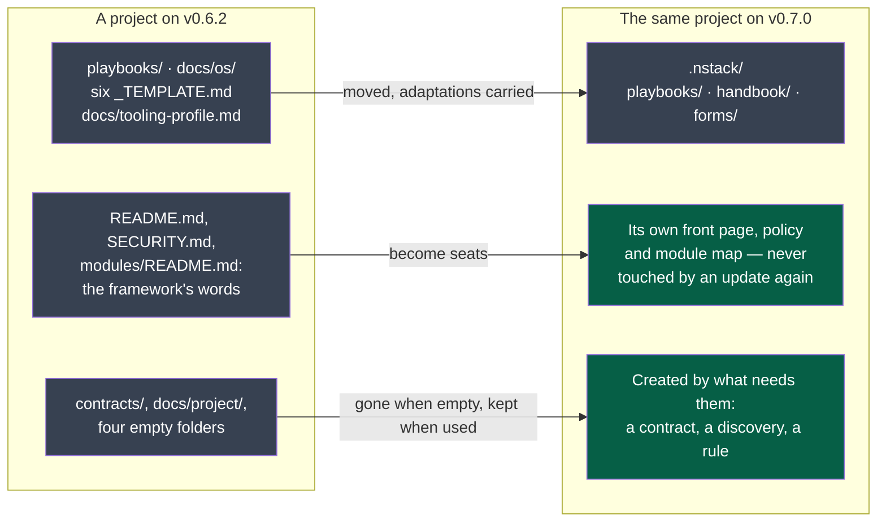

# Changelog

What each published version changes, and what it costs to take it.

Every entry separates two things, because they are installed differently and **only one of
them is in the published package**:

- **In the engine** — what `uv tool install napkinstack==X.Y.Z` brings. This is what the wheel
  and the source archive on PyPI contain.
- **In your project** — what `nstack update` merges into the files your project owns. This comes
  from the skeleton, which Copier reads **from this repository at the tag** (ADR-0001), and
  which the published package does not carry. Comparing two releases of the package cannot show
  it; this section is the only place it is written down.

A **Migration** paragraph appears whenever taking the version costs more than reading it.

Format: inspired by [Keep a Changelog](https://keepachangelog.com), dates are the tag's. There
is no `Unreleased` section: what `main` holds beyond the last tag is written up in the version's
own section, in its version pull request, and the release refuses a tag without it.
Versions are [semantic](https://semver.org): a version that turns a green project red is never
a patch.

---

## v0.7.2 — 2026-10-12

**In the engine** — nothing

`src/napkinstack/` is unchanged since v0.7.0.

**In your project** — 2 files

- **A defect of the framework has a way back to the framework** (D89). The kernel gains one
  stopping rule: when the framework itself is wrong — a message, a check, a page — stop, say
  so, never a workaround.
- The manual, `.nstack/handbook/INSTALL.md`, gains the section *When the framework is wrong*:
  clone the framework's sources beside the project, judge the project with them, propose the
  fix there. A private project is described, never named.

**Migration**

None. Measured on a copy of a project running the v0.7.0 skeleton: `nstack update` merged
without a conflict, 2 files and the recorded version, checks green afterwards. A project that
adapted its copy of the manual near *Receiving a new version* may conflict there.

## v0.7.1 — 2026-10-12

**In the engine** — nothing

`src/napkinstack/` is unchanged since v0.7.0. What changes is the page the registry shows:
v0.7.0 was published with a front page still saying *"Status: v0.6.2"*, and that page is
frozen at the tag. This version carries the right one, and a version can no longer be
prepared with a front page naming another.

**In your project** — nothing

`skeleton/` is unchanged since v0.7.0. `nstack update` lays down a branch that bumps the
recorded version and merges no file, so it cannot conflict.

**Migration**

None from v0.7.0. **Coming from v0.6.2 or below, read the v0.7.0 section**: it moves the
framework's files and carries its own migration.

## v0.7.0 — 2026-10-12

The framework charges what a failure costs, and nothing more (PDR-0011); a project's tree is
the project's (PDR-0010, PDR-0012).

**Legend** — grey: the framework's files · green: the project's.

**In the engine**

- **Four criticality values, four regimes.** `prototype` joins `standard`, `high` and
  `critical`. A test sheet is owed at `high` and `critical`, and at `standard` only for a module
  a user sees; a runbook from `high`. Every refusal names the value that produced it and what
  the value below would change. `nstack new-module --help` says what each value means, and the
  command prints what the chosen one costs before it creates anything.
- **A fix costs a confirmation, not a round** (T4). An automated scenario is green at the head;
  an explored or human one keeps the commit its evidence was produced on, with the verifier's
  line confirming it at the head. At `critical`, every scenario is confirmed.
- **A deliverable nobody can meet is shown its two doors** (C4): a spike, whose refuted result
  is a delivered one, or a dependency with a date.
- **A project that has framed nothing is *unframed*, not in violation.** The cycle rules (K1 to
  K3) apply from an accepted charter; `fitness`, `doctor` and `pr-check` say which state they
  judged.
- **A document is due at its moment** (C8): one sentence on the front page at a discovery's
  *go*, the whole front page at an accepted charter, the module map at a module's first code.
- **`nstack doctor`**: G14 to G18 — auto-merge, squash only, head branch deleted, default branch
  neither deleted nor rewritten. It exits 1 on a gap and 2 when nothing could be read.
- **`nstack settings`** prints the forge calls that would close each gap, and changes nothing.
- **`nstack new-contract <name>`** writes a contract's first version and, the first time, the
  module that holds them all.
- **`nstack update`** starts from the default branch or refuses (D74); carries what a project
  adapted in a file the framework moved (D84); rewrites the old addresses the project wrote in
  its own pages (D85) and **leaves a module's code as written, naming it** (D88); keeps the
  contracts module of a project that holds a contract.
- A page at any depth of a module is description: changing it changes no module.

**In your project** — 65 files, most of them moved

- **One folder for the framework: `.nstack/`.** `playbooks/` → `.nstack/playbooks/`, `docs/os/`
  → `.nstack/handbook/`, each `_TEMPLATE.md` → `.nstack/forms/`, `docs/tooling-profile.md` →
  `.nstack/tooling-profile.md`. The installation manual leaves the front page for
  `.nstack/handbook/INSTALL.md`.
- **Seats.** `README.md`, `SECURITY.md`, `modules/README.md` and the two decision indexes are
  created once as forms and belong to the project: an update never writes in them again.
- **Nothing created empty.** `contracts/` and four placeholder folders leave the skeleton.
- **The project's own rules have a place**: `docs/project/rules/<subject>.md`, read with the
  playbook of the same name, and `always.md`. A new playbook, `documentation.md`: a diagram and
  its legend before the text.
- The handbook's matrix (`05-workflow.md` §7) gains `prototype` and says of each row who judges
  it, a check or a human. The pull request template's sheet gains the `Confirmed` column.
- Issue forms: `01-request.yml` replaces `01-feature.yml`; the spike form is gone;
  `05-debt.yml` becomes `04-debt.yml`.
- A CI step that printed a sentence and could not fail is removed from `module-checks.yml`.

**Migration**

Written from the update run on a fresh copy of each of the two projects created before this
version, on 2026-10-12 — not predicted from the diff (D73).

| | A project with two modules, no contract (v0.6.2) | A project with two modules and a contract (v0.6.0) |
|---|---|---|
| `nstack update` | **1 conflict**, in `.nstack/handbook/project.md` | merged, no conflict |
| Size of its pull request | 74 files | 69 files |
| Modules it changes | 0 | 0 |
| Test sheet owed | no | no |
| `fitness` afterwards | green | green |

1. **Run it from the default branch, at a cycle's boundary.** It changes the rules a running
   cycle is judged by.
2. **A page you had adapted in a moved file can conflict**, as above: the project had added a
   row to a table the framework rewrote. The conflict is marked; keep both rows.
3. **Read the list the update prints.** The old addresses in your own pages are rewritten, in
   the same pull request. Those in a module's code — a comment naming `docs/os/…` — are listed
   and left: each is a one-line change for that module's next pull request.
4. **The pull request is far over the review budget** (P2, a warning): add the `over-budget`
   label. It is a mechanical migration, which is what the label is for.
5. **`nstack doctor` turns red on both projects**: each allows merge commits and keeps merged
   branches (G15, G16), and neither has auto-merge (G14). `nstack settings` prints the calls
   that close them; the settings are yours to change.
6. **Your front page is now yours**: the update no longer writes in it. If it still carries
   the framework's installation manual, that copy stops following the framework; the current
   one is `.nstack/handbook/INSTALL.md`. No check asks you to remove it — both projects stay
   green with theirs.

Not measured: the update's pull request running on either project's real CI. Both take the
version themselves, and what they meet is recorded in this repository.

## v0.6.2 — 2026-09-23

**In the engine**

- **What a version changes is published.** This file is the source: the release workflow refuses
  to publish a version whose section is missing, then posts that section as the tag's release
  page. `nstack update` names where to read it once the branch is laid down (D62).
- Every entry separates **what changes in the engine** from **what changes in your project**,
  because the published package carries `src/napkinstack/` and not `skeleton/`: comparing two
  releases of the package is structurally blind to what `nstack update` merges (D63).
- Those notes name **every version crossed**, not the target alone. One update can cross several
  versions, and the change that conflicts with your own files may come from any of them; a
  release page holds one version and cannot answer for the others (D66).
- A refusal carrying an `errno` names the filesystem and says to read what it names, instead of
  reporting every `OSError` as *"Template unreachable"* with an action about `--source`, `--ref`
  and the network (D65).

**In your project** — nothing

`skeleton/` is unchanged since v0.6.1. `nstack update` lays down a branch that bumps the
recorded version and merges no file, so it cannot conflict.

**Migration**

None from v0.6.1. **Coming from v0.6.0 or below, read the sections above your own version**:
v0.6.1 changes `.gitignore` and carries its own migration note — which is exactly the case D66
exists for.

## v0.6.1 — 2026-09-22

**In the engine**

- A refusal caused by something local names the line git wrote, instead of guessing which local
  cause it was (D55).
- `nstack init` refusing a folder that is not empty now names what fills it — usually hidden
  files left by an editor or an agent — and offers, as a command to copy, the folder inside
  (D56).

**In your project** — 1 file

- `.gitignore` ignores what an agent's runtime writes as it runs: `.mcp.json`, and the
  per-machine files under `.claude/`. `.claude/settings.json` and `.claude/hooks/` stay
  **tracked**, because a team shares its project-level settings and hooks on purpose (D58).

**Migration**

A project that already wrote its own ignore rules for its agent **will conflict on
`.gitignore`**: the same lines changed on both sides. The conflict is marked and left to the
team, which keeps whichever version it prefers — they are nearly identical.

## v0.6.0 — 2026-09-20

**In the engine**

- A document still holding its template's words is refused: the charter's success criteria
  (C2), a deliverable's title and acceptance criteria (C4), a discovery's challenger (C7), a
  module's responsibility (M2). For a module the rule waits until its first file of code, so a
  freshly generated module stays green (D51).
- Every consumer of a deprecated module is named, with the producer's removal date — a warning;
  M5 is what turns red (D52, rule B8).
- `nstack modules --with-contract-sides`: a change to a contract version also lists the module
  that provides it and every module that declares it in `consumes` (D53).
- A Copier refusal keeps every `error:` and `fatal:` line git wrote, instead of the last one
  alone (D54).

**In your project** — 8 files

- The module workflow asks for the contract's sides, so a pull request touching `contracts/`
  now runs the producer's and the consumers' checks — the two sides `03-contracts.md` §5 has
  always promised.
- The handbook: `02-modules.md` §6 names the rule behind each of its four verdicts,
  `03-contracts.md` §5 says what the CI actually runs, `09-platform.md` says the skeleton ships
  fitness functions 1 to 9 rather than 1 to 3, `05-workflow.md` says where the review budget is
  set, and a reference to a file no project holds is gone.
- The module template loses its `review_budget` block: nothing has ever read it.

**Migration**

`nstack update`, then fill in whatever the new rules name. A project whose `docs/project/` or
module manifests still hold the template's words turns red on its next run: that is the rule
working. Measured on the validation project, which was already right: nothing fired.

## v0.5.0 — 2026-09-20

**In the engine**

- The contract proof runs in the **base's tree**, so a change cannot rewrite what judges it; of
  the change it is handed exactly one file, the document judged (D44).
- V1 says *"did not prove the change compatible"* instead of asserting a break it may not have
  seen, and names the command once (D45).
- `nstack doctor` answers **guarded** or **unguarded**, keeps what a plan forbids apart from
  what is not yet done, and stops reporting a project as faulty for what its plan forbids
  (PDR-0006).
- `nstack landed` (rule W1): a commit that reached the default branch outside a pull request is
  recorded. It records, it never refuses, and it needs no write access.

**In your project** — 5 files

- A new workflow, `commits-on-main.yml`, which runs the record above.
- The `compat` step runs even when an earlier step failed, so a pull request that breaks a
  frozen version *and* its tests hears about both at once (D46).

## v0.4.0 — 2026-09-19

**In the engine**

- The boundaries read the contracts a module's files use, and refuse any reference to another
  module's code (D29, rules B1 to B7).
- `nstack compat` (rule V1): a contract version someone consumes, or its producer marks stable,
  changes only with the project's own merged comparator (D30).
- A verifier is compared with the change's authors (D32, rule T2); an approval is dismissed by
  a new push (D31, checklist rule G13); the module checks become a required check (D35).
- Every verdict names the framework that gave it, and a project may run an unpublished fix
  without being judged by it in silence (PDR-0005).

**In your project** — 18 files

- The module workflow gains its `compat` step and the `Module checks` job that the ruleset can
  require; the checklist gains G13.

## v0.3.1 — 2026-09-17

**In the engine**

- A module is touched when a change goes beyond its description — its manifest, `AGENTS.md`,
  `README.md`, `docs/`. A NapkinStack update is therefore neither delivery work nor a reason
  for a test sheet (D24).

**In your project** — 3 files

## v0.3.0 — 2026-09-17

**In the engine**

- The test sheet, read from the pull request's description: scenarios written before the code
  and run by a verifier who is not the author (`nstack pr-check`, PDR-0003).
- The framing: `nstack discover`, `nstack plan`, a charter and bounded cycles with an appetite
  and a circuit breaker (PDR-0002).

**In your project** — 29 files

- `docs/project/` and its templates, the `Test sheet and cycle` workflow, the pull request
  template's sheet, and the playbooks for discovery, framing and verification.

## v0.2.0 — 2026-09-16

**In the engine**

- English throughout — code, identifiers, machine values, messages (ADR-0003).

**In your project** — 60 files

- The whole skeleton, translated. Lifecycle and criticality values change with it.

## v0.1.0 — 2026-09-15

The first published version: `nstack init`, `update`, `doctor`, `new-module`, the module verbs
and the first fitness functions, distributed on PyPI with a provenance attestation (PDR-0001,
ADR-0001, ADR-0002).
