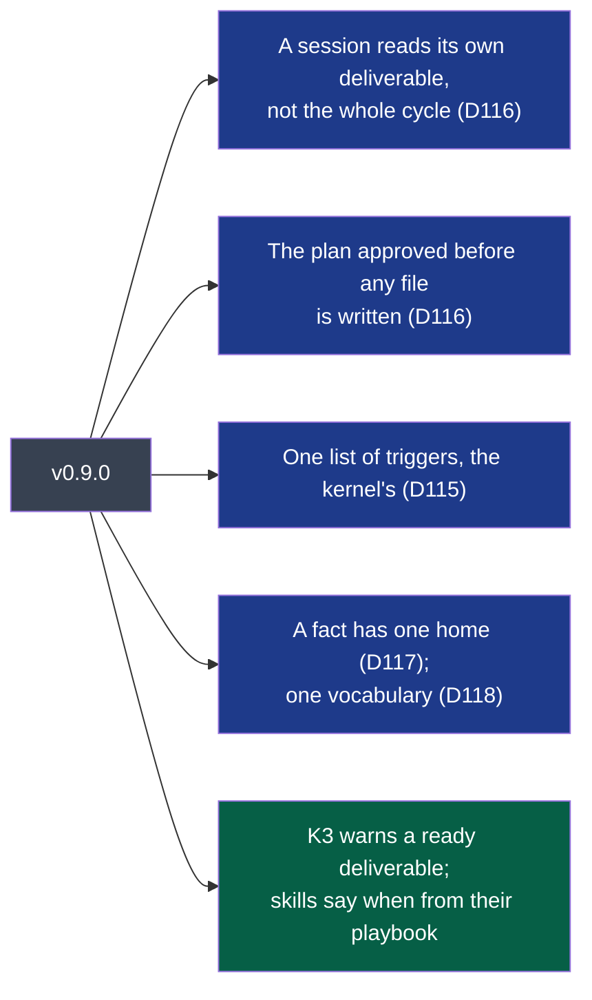
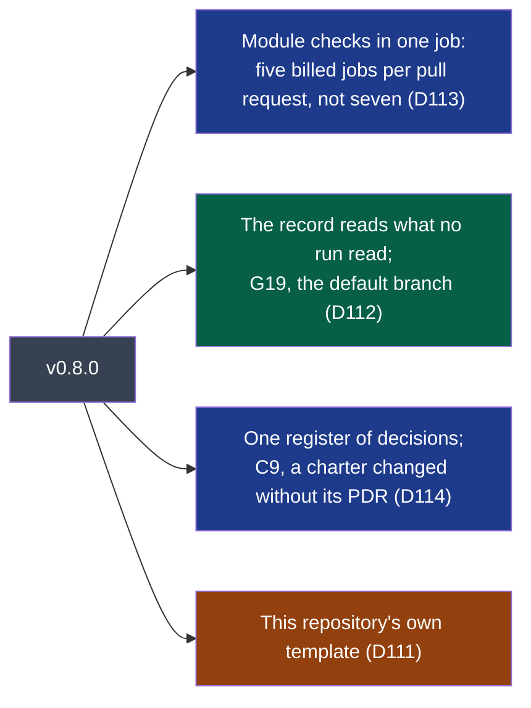
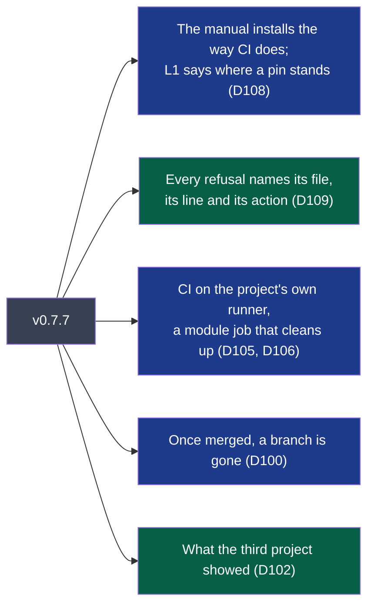
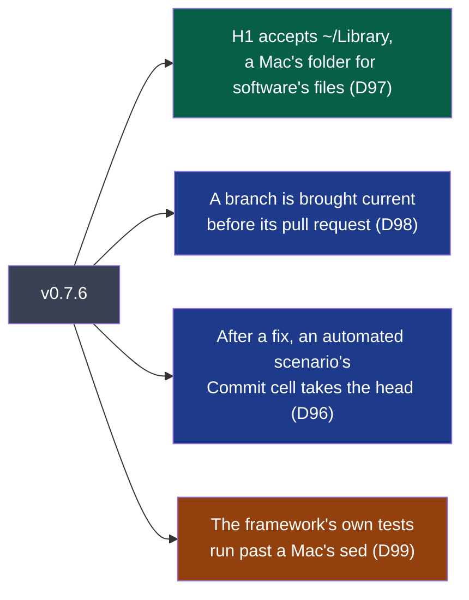
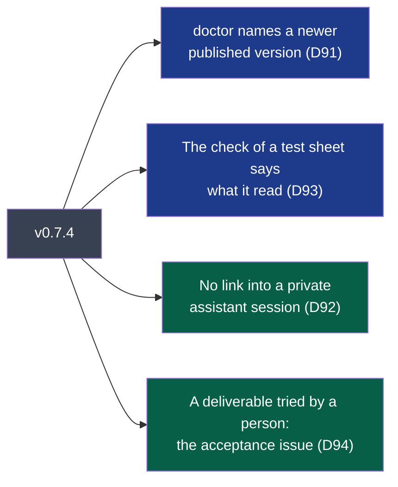
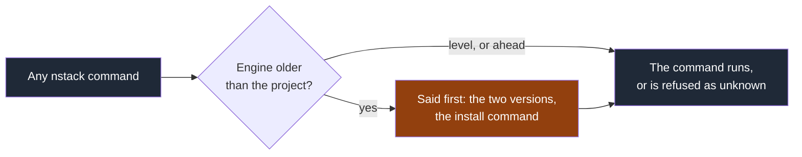
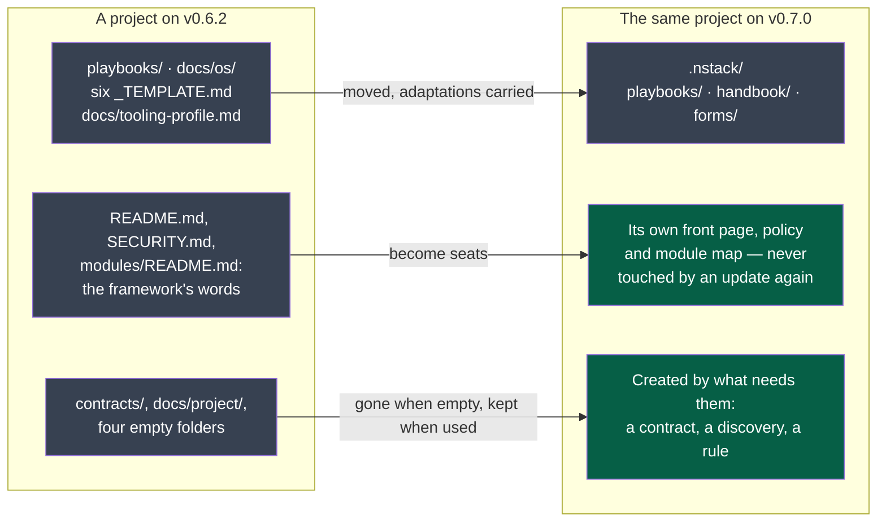

# Changelog

What each published version changes, and what it costs to take it.

Every entry separates two things, because they are installed differently and **only one of
them is in the published package**:

- **In the engine** — what `uv tool install napkinstack==X.Y.Z` brings. This is what the wheel
  and the source archive on PyPI contain.
- **In your project** — what `nstack update` merges into the files your project owns. This comes
  from the skeleton, which Copier reads **from this repository at the tag** (ADR-0001), and
  which the published package does not carry. Comparing two releases of the package cannot show
  it; this section is the only place it is written down.

A **Migration** paragraph appears whenever taking the version costs more than reading it.

Format: inspired by [Keep a Changelog](https://keepachangelog.com), dates are the tag's. There
is no `Unreleased` section: what `main` holds beyond the last tag is written up in the version's
own section, in its version pull request, and the release refuses a tag without it.
Versions are [semantic](https://semver.org): a version that turns a green project red is never
a patch.

---

## v0.9.3 — 2026-10-17

One workstream, D121: a drawing the decider spent their eye on lived outside the project.

**In the engine** — nothing.

**In your project** — 2 files

- **A spike's drawing is kept in the project** (`.nstack/playbooks/framing.md` §2): when a
  spike's product is a drawing — the screens, the journey the user will see — it is committed
  under `docs/project/drawings/<deliverable>-<name>/` with its date, and frozen. What the decider
  accepts in it becomes criteria; once built, the product and its screenshots are the truth. A
  new round is a new folder.
- **A drawing of a screen is no diagram** (`.nstack/playbooks/documentation.md`): it is an image,
  frozen; diagrams stay text.

**Migration** — none; nothing green turns red.

---

## v0.9.2 — 2026-10-17

One workstream, D120: four frictions the third project's agent work met in one day.

**In the engine** — nothing.

**In your project** — 4 files

- **The fitness functions run before a push** (`.pre-commit-config.yaml`): a `pre-push` hook runs
  `nstack manifests`, `boundaries`, `plan` and `hygiene` — the checks CI runs on every pull
  request — so a contract used and not declared, or a path from a home directory, is seen before
  the push, with its rule, file and line. The skills are left to CI: what they are generated into
  follows the engine's version. Where nstack is not installed, the hook says so and lets the push
  go. `pre-push` joins `default_install_hook_types`.
- **The verifier's own ground** (`.nstack/playbooks/verification.md`): a copy of one's own;
  shared state put back after each run, also on failure; what one starts stopped by its process
  number, nothing left running; the pull request's description fetched again just before it is
  written.
- **A spike's imitation checked first** (`.nstack/handbook/05-workflow.md`): a spike that
  measures a step through an imitation of what it sends first shows it sends the same, byte for
  byte.
- **A deliverable added mid-cycle** (`.nstack/playbooks/framing.md` §4): the decider may add one
  that fits what is left of the appetite, the end date unchanged; its section says on whose word
  and on what it entered.

**Migration** — run `pre-commit install` once in each clone: an install made before this version
put no `pre-push` hook in place. Nothing else; nothing green turns red.

---

## v0.9.1 — 2026-10-15

One workstream, D119, found by the first project to take v0.9.0.

**In the engine** — nothing.

**In your project** — 1 file

- **`.nstack/install-engine.sh` reads the registry afresh for the engine** (D119): it installs a
  published version with `--refresh-package napkinstack`. A self-hosted runner keeps uv's cache
  across jobs, and a page of the registry read before a release said the version did not exist —
  every job of an update pull request failed, minutes after v0.9.0 was published, until the cached
  page expired. Hosted runners are untouched.

**Migration** — none.

---

## v0.9.0 — 2026-10-15

Four workstreams, D115 to D118: what an agent reads before its first line of work, when it asks
for approval, and the words the method uses — one list each.

**Legend** — green: in the engine · blue: in your project.

**In the engine** — 2 files, and the module templates

- **`pr-check` K3 warns** a delivery pull request whose deliverable is still `ready`: set it
  `in-progress` in the cycle, in that pull request (D116). A warning: the state is the decider's.
- **`nstack skills` takes a skill's "when" from its playbook's trigger** — the kernel's words —
  and appends it to the description `skills.yaml` gives, which now says only what the playbook
  holds (D115).
- `nstack new-module` writes a page and local instructions that point at the manifest for the
  responsibility, the owner and the criticality, and one line per known trap (D116, D117).

**In your project** — 20 files

- **The kernel** (234 lines, as before):
  - a session reads the charter, and of the current cycle **its front matter and its own
    deliverable's section** — not the whole cycle;
  - **before writing any file**, the plan — steps 1 to 3, the oracle to write, the size — goes to
    whoever gave the task, who may waive it for that task; no project rule waives it; *trivial*
    has a criterion;
  - a defect of the framework is reported to the decider, who assigns its fix; a flaky test is
    quarantined, never disabled;
  - **the trigger table is the only list** of when a playbook loads — a new dependency now loads
    security; a deployment and a call to another system, operations; a pull request's description,
    documentation (D115, D116).
- **Each playbook's header** says its trigger in the kernel's words (D115).
- **The cycle's form** gives each deliverable its own section, and sends what was tried, what it
  cost and what was refuted to the project's log issue (D116).
- **The documentation standard has a fifth rule: a fact has one home** — the file a check or a
  command reads; every other document links to it (D117).
- **One vocabulary** (D118): one list of standard verbs; who provides and consumes a contract is
  `nstack modules --with-contract-sides` and B6, where a "generated matrix" was promised; the
  manual's commands say what each runs and name `--user-facing`; layering and budgets are the
  project's to build.
- `05-workflow.md` §2's diagram, `04-ai-context.md`, `09-platform.md`, `framing.md`,
  `skills.yaml`, `RULES.md` follow.

**Migration**

1. **Move your cycle's prose.** What each deliverable tried, cost and refuted goes to the project's
   log issue; give each deliverable a `### D<n>` section holding what binds it. Until then a
   session reads only its own deliverable's section, and the rest of the prose is not read.
2. **Set the deliverables in progress** that are: K3 now says so on their next pull request.
3. **A playbook header or a skill description you adapted** meets a conflict on that line: keep
   your words in the kernel's table too, or the header and the table say two things again.
4. Copies of a module's owner, criticality or responsibility already written in your module pages
   or your module map are yours: the fifth rule says to link instead.
5. **An update that crosses several versions** — a project still on v0.7.x taking this one —
   changes about thirty framework files and passes the review budget: label its pull request
   `over-budget`, a mechanical migration.

---

## v0.8.0 — 2026-10-15

Four workstreams, D111 to D114: the CI bills less without judging less, the record of commits
on main has no gap, and decisions have one register the agent knows how to fill.

**Legend** — green: in the engine · blue: in your project · orange: in this repository only.

**In the engine** — 5 files, and the module template

- **`nstack landed` reads from the last commit it recorded** (D112): a push whose run never
  started — CI out of minutes, a runner down — is read by the next run that does, which says how
  many commits no run had read. A record that never succeeded reads the push alone.
- **`doctor` G19**: a default branch other than `main`, which no workflow watches, is a gap; read
  on the repository's own object, any plan, no Administration permission. `nstack settings` plans
  the rename (D112).
- **`pr-check` C9, a warning**: a pull request that changes an accepted charter and carries no
  decision record is told so (D114).
- **`nstack new-module` writes no register of decisions in the module**: its page points at the
  project's `docs/adr/` and `docs/pdr/`, with `Scope: module <name>` (D114).

**In your project** — 9 files

- **`Module checks` is one job** (D113, ADR-0005), running the new `.nstack/check-modules.sh`: each
  changed module in turn — bootstrap, check, test; compat even after a failure; e2e on a green
  module; clean on a self-hosted runner. A failure does not stop the next module; the job fails at
  the end, naming them. The required name is unchanged, so no ruleset moves; the run on `main` and
  every verdict are kept. A pull request changing one module bills five jobs instead of seven, and
  a self-hosted runner needs `git` alone. The pull request's page shows one line for the modules;
  read a failure in the job's log groups. The evidence is one archive, a folder per module.
- **`Commits on main` reads its own past runs** (`actions: read`, still read only) (D112).
- **INSTALL**: the checklist's nineteenth line, the default branch; a runner needs `git`; what a
  pull request costs (D112, D113).
- **`framing.md` says when a decision is due** — an accepted charter changes through a PDR, a
  framing choice is an ADR, a cycle's closure reads again the decisions anchored to it or past their
  date — and the charter's form sends open questions to the cycle (D114).
- `RULES.md` (G19, C9, W1), `06-decisions.md` (one register), `09-platform.md` (the module tree, the
  module checks' cleaning).

**Migration**

1. **The first run of *Commits on main* after the update may be red**: it reads back to the last
   commit it recorded, and names any commit that reached `main` outside a pull request while no run
   could start. Read each one; it is the record keeping its promise late.
2. **A default branch other than `main`** is now a gap (G19): rename it — `nstack settings` prints
   the call.
3. **A module that keeps a `docs/adr/` of its own** keeps it: an update never touches a module. To
   have one register, move its records into the project's `docs/adr/`, numbered there, with
   `Scope: module <name>`.
4. A script that read a job of the matrix by its module's name (`evidence-<module>`, a job per
   module) reads `Module checks` and the `evidence` archive now.

**In this repository only**

- The pull request template is a workstream's, and holds the only definition of done (D111).

---

## v0.7.7 — 2026-10-15

Ten workstreams, D100 to D110 (D103 and D104 stay open); most of them found by a third project
and a contributor's private one, in their first week.

**Legend** — green: in the engine · blue: in your project.

**In the engine** — 5 files, and the module and contracts templates

- **`doctor` L1 says where an unpublished pin stands** (D108). A fix may be pinned while it is
  reviewed; its squash then gives the framework's default branch another commit and leaves the
  pinned one on no branch. L1 now says when the framework's default branch does not hold the
  pinned commit, with the gesture that moves the pin once it is merged, asking the forge without
  a token; when the forge is silent, it says what it said before. L1 stays a gap. Its first
  wording called a commit still in review "left behind by its squash"; corrected before the tag
  (D110).
- **An action never names a version no installer accepts** (D108): for a project pinned to a
  commit, `doctor` says `bash .nstack/install-engine.sh`, not `napkinstack==<version>-<n>-g<commit>`.
- **`nstack --version` says where the engine came from**; `--ref` is documented as a tag or a
  commit (D108).
- **Every manifest refusal names its file, its line and its action** (D109): M2 to M10 named the
  module and not the place, and six of them offered no action.
- **`nstack run <module> <arguments>`** passes the arguments to the module's command (D102).
- **The manifests check warns (V1)** when contracts are consumed and the contracts module declares
  no comparator — the moment it can still be met (D102). A warning: no exit code moves.
- **The hygiene check says how many files it did not read** because they are not yet added (D102).
- **`commands.clean`**, an optional standard verb: `nstack clean <module>` (D106). The module
  template names it.

**In your project** — 17 files

- **`.nstack/handbook/INSTALL.md`'s first command is `bash .nstack/install-engine.sh`**, the script
  CI runs (D108): for a project pinned to a commit, the old line asked for a version no installer
  accepts. The manual now says, like the contributing guide, that a fix may be pinned while it is
  reviewed, and that the pin moves once it is merged.
- **`.nstack/install-engine.sh` reads the answers file without a YAML tool** (D108): a runner with
  the wrong one was told its source was "a path on one machine".
- **Every job runs on `vars.NSTACK_RUNS_ON`** (D105) — GitHub's hosted Ubuntu when the variable is
  unset, so nothing changes for a project that sets nothing. INSTALL says what a self-hosted runner
  needs, and why never on a public repository.
- **A module job starts clean and ends clean on a self-hosted runner** (D106): `clean: true` on its
  checkout, and the module's `clean` verb as its last step, even after a failure. Hosted runners
  are untouched.
- **The kernel's working loop ends with *Close*** (D100): once merged, the branch is gone — on the
  forge, on the workstation, and its worktree.
- **The security playbook's rules are `SEC1` to `SEC5`** (D109), so that `S1` means the skills rule
  of `RULES.md` only; `RULES.md` marks M4 and V1's notice as warnings.
- Pages corrected where they no longer agreed with the engine or with each other (D101); the
  handbook says that expand/contract holds for a version's name in a consumer's tests (D102).

**Migration** — none for a project on a published version: no rule turns a green project red.
A project pinned to a commit of a pull request that has since merged moves to this version:
`nstack update --ref v0.7.7`.

---

## v0.7.6 — 2026-10-14

Four workstreams, three of them found by a second contributor's first days: D96 to D99.

**Legend** — green: in the engine · blue: in your project · orange: in this repository only,
shipped to nobody.

**In the engine** — 1 file

- **H1 accepts `~/Library`** (D97). The hygiene check refused the folder every Mac keeps
  software's own files in — where a macOS app documents its storage — while it accepted the
  dot-directories, its Linux counterpart. A project building a macOS app went red on its
  design document. A real folder of the home directory — downloads, the desktop — is
  still refused, and so is a name that only begins with `Library`. Nothing a green project
  had turns red.

**In your project** — 5 files

- **A branch is brought current before its pull request** (D98). Two pull requests each took
  the next number of a register on the same morning; the second conflicted after it had been
  approved, and was settled by someone who had not written it. The kernel's working loop has
  a step for it, and the handbook says why:

| | |
|---|---|
| Before the pull request | Merge the default branch into yours; a conflict is settled there, by its author |
| What is numbered in sequence | A decision record, a register's row: takes its number then, not when the work started |
| While it waits | A conflict the forge shows is its author's to settle again. No check asks for a branch to be current |

- **After a fix, an automated scenario's Commit cell takes the head** (D96). The handbook said
  so; the pull request template and the verification playbook — what a verifier reads — did
  not, and a verifier wrote the head in `Confirmed` for an automated scenario, which
  `pr-check` refused. The three texts now say the same: an automated scenario is run again
  and its Commit cell takes the head, never confirmed; an explored one keeps its commit and
  is confirmed.
- The handbook's paragraph on H1 names `~/Library` (D97).

**In this repository only**

- `platform/tests/run.sh` edits files in place through one function that both GNU's sed and
  a Mac's take (D99): the oracle stopped on a Mac at its first `sed -i`. Not verified on a
  Mac.

**Migration**

None. Measured on a copy of a project running the v0.7.5 skeleton: `nstack update` merged
without a conflict, 7 files — the five above, the manual's version line and the recorded
version; fitness green afterwards. A project whose `AGENTS.md` was adapted around the working
loop may have that one step to place by hand.

## v0.7.5 — 2026-10-13

**In the engine** — nothing

`src/napkinstack/` is unchanged since v0.7.4.

**In your project** — 2 files

- **An acceptance issue is one trial, closed when it is answered** (D95). The form shipped in
  v0.7.4 said what an acceptance issue holds, and nothing of when it is closed: the first one
  stayed open with every step answered, waiting for a deliverable that needed a second module
  and two other systems. The form and the handbook now say it:

| | |
|---|---|
| One issue | One trial: a person, a system, a set of steps |
| Closed | When each step has its answer — met or not — by whoever ran it, or by the pull request that records the last one |
| The deliverable's state | In the cycle, never read from an issue being open or closed |

**Migration**

None. Measured on a copy of a project running the v0.7.4 skeleton: `nstack update` merged
without a conflict, 2 files, the manual's version line and the recorded version; checks green
afterwards. An acceptance issue left open "until the deliverable is accepted" can be closed
once its steps are answered.

## v0.7.4 — 2026-10-13

Four workstreams, each found by using the framework on a project: D91 to D94.

**Legend** — blue: in the engine · green: in your project.

**In the engine**

- **`nstack doctor` names a newer published version** (D91). Nothing told a project that a
  version had been published. The command that already reads the network, on demand, asks the
  registry one question, without a token:

| The registry answers | `nstack doctor` says |
|---|---|
| A version newer than the project's | `NEWER VERSION`, with the address of its notes and the way to take it, at a cycle's boundary |
| The project's version, or an older one | `LATEST` |
| Nothing | `NOT READ` |

  It is information, never a gap: no exit code moves. **No other command opens a
  connection.** `NSTACK_REGISTRY_URL` names another registry than `https://pypi.org`.

- **`nstack pr-check` says what it read of a test sheet** (D93): the scenarios by result, the
  verifier, what it was compared with. It notes, before anyone verifies, a change whose agent
  commits name no session — one only a person could sign — and its refusal names the two ways
  out. **A sheet's commit stands when the head holds exactly the same files**: a merge of the
  default branch that brings nothing no longer sends every automated scenario back.

**In your project** — 9 files

- **No link into a private assistant session** (D92), in a file or in a commit message: one
  hook, `no-session-link`, and one step of the "Hooks and secrets" job that reads again the
  commit messages of a pull request and its description, where a hook cannot be bypassed. Only
  a session, a conversation or a share is refused; a link to an assistant's site is a link, and
  a co-author line stays.
- **A deliverable tried by a person has a place** (D94): an **Acceptance** issue form. It
  tracks a deliverable, copies none of its criteria and sets none of its state — both stay in
  the cycle. The handbook's sources of truth and the test sheet's rules name it; the framing
  playbook says what *accepted* means when several pull requests deliver one deliverable.
- **Verifying a library** (D93): the verification playbook names the `test` verb where a
  module declares no `e2e`, and what a module with nothing to start does. The pull request
  template gains a line, **`Verifier's remarks:`**, under the sheet.
- **Pull requests that sit on one another** (D93): the handbook says what the first merge costs
  the next one.

**Migration**

1. **Run `pre-commit install` once more** in each checkout: the new hook also reads the commit
   message, and that stage is installed by the same command.
2. **A commit message or a tracked file that holds a link into an assistant's session is
   refused from now on.** CI reads the messages of a pull request's own commits, never the
   history before it: nothing already merged turns red.
3. Nothing else. Measured on a copy of a project running the v0.7.2 skeleton, crossing v0.7.3:
   `nstack update` merged without a conflict, 9 files and the recorded version; the guardrails
   and the new hook, run on every file, passed afterwards. A project that adapted its pull
   request template near the test sheet, or its hooks' configuration, may conflict there.

## v0.7.3 — 2026-10-12

**In the engine**

- **An engine older than its project says so, on every command** (D90). Once a teammate's
  update is merged, every other workstation is behind: a command the project's manual names
  answered `invalid choice`, and a verdict came from rules the project had left. Every command
  now says first, on the error stream, the two versions and the install command — a command
  this engine does not know included. An engine ahead of its project says nothing: an update
  starts there.

**Legend** — grey: the command, unchanged · orange: the new line.

An engine already installed cannot learn this: the line appears on workstations at this
version or later, when the project moves past them.

**In your project** — 1 file

- The manual, `.nstack/handbook/INSTALL.md`, says under *Receiving a new version* that everyone
  else installs the same version once the update's pull request is merged.

**Migration**

None. Measured on a copy of a project running the v0.7.2 skeleton: `nstack update` merged
without a conflict, 1 file and the recorded version, checks green afterwards. A project that
adapted its copy of the manual near *Receiving a new version* may conflict there.

## v0.7.2 — 2026-10-12

**In the engine** — nothing

`src/napkinstack/` is unchanged since v0.7.0.

**In your project** — 2 files

- **A defect of the framework has a way back to the framework** (D89). The kernel gains one
  stopping rule: when the framework itself is wrong — a message, a check, a page — stop, say
  so, never a workaround.
- The manual, `.nstack/handbook/INSTALL.md`, gains the section *When the framework is wrong*:
  clone the framework's sources beside the project, judge the project with them, propose the
  fix there. A private project is described, never named.

**Migration**

None. Measured on a copy of a project running the v0.7.0 skeleton: `nstack update` merged
without a conflict, 2 files and the recorded version, checks green afterwards. A project that
adapted its copy of the manual near *Receiving a new version* may conflict there.

## v0.7.1 — 2026-10-12

**In the engine** — nothing

`src/napkinstack/` is unchanged since v0.7.0. What changes is the page the registry shows:
v0.7.0 was published with a front page still saying *"Status: v0.6.2"*, and that page is
frozen at the tag. This version carries the right one, and a version can no longer be
prepared with a front page naming another.

**In your project** — nothing

`skeleton/` is unchanged since v0.7.0. `nstack update` lays down a branch that bumps the
recorded version and merges no file, so it cannot conflict.

**Migration**

None from v0.7.0. **Coming from v0.6.2 or below, read the v0.7.0 section**: it moves the
framework's files and carries its own migration.

## v0.7.0 — 2026-10-12

The framework charges what a failure costs, and nothing more (PDR-0011); a project's tree is
the project's (PDR-0010, PDR-0012).

**Legend** — grey: the framework's files · green: the project's.

**In the engine**

- **Four criticality values, four regimes.** `prototype` joins `standard`, `high` and
  `critical`. A test sheet is owed at `high` and `critical`, and at `standard` only for a module
  a user sees; a runbook from `high`. Every refusal names the value that produced it and what
  the value below would change. `nstack new-module --help` says what each value means, and the
  command prints what the chosen one costs before it creates anything.
- **A fix costs a confirmation, not a round** (T4). An automated scenario is green at the head;
  an explored or human one keeps the commit its evidence was produced on, with the verifier's
  line confirming it at the head. At `critical`, every scenario is confirmed.
- **A deliverable nobody can meet is shown its two doors** (C4): a spike, whose refuted result
  is a delivered one, or a dependency with a date.
- **A project that has framed nothing is *unframed*, not in violation.** The cycle rules (K1 to
  K3) apply from an accepted charter; `fitness`, `doctor` and `pr-check` say which state they
  judged.
- **A document is due at its moment** (C8): one sentence on the front page at a discovery's
  *go*, the whole front page at an accepted charter, the module map at a module's first code.
- **`nstack doctor`**: G14 to G18 — auto-merge, squash only, head branch deleted, default branch
  neither deleted nor rewritten. It exits 1 on a gap and 2 when nothing could be read.
- **`nstack settings`** prints the forge calls that would close each gap, and changes nothing.
- **`nstack new-contract <name>`** writes a contract's first version and, the first time, the
  module that holds them all.
- **`nstack update`** starts from the default branch or refuses (D74); carries what a project
  adapted in a file the framework moved (D84); rewrites the old addresses the project wrote in
  its own pages (D85) and **leaves a module's code as written, naming it** (D88); keeps the
  contracts module of a project that holds a contract.
- A page at any depth of a module is description: changing it changes no module.

**In your project** — 65 files, most of them moved

- **One folder for the framework: `.nstack/`.** `playbooks/` → `.nstack/playbooks/`, `docs/os/`
  → `.nstack/handbook/`, each `_TEMPLATE.md` → `.nstack/forms/`, `docs/tooling-profile.md` →
  `.nstack/tooling-profile.md`. The installation manual leaves the front page for
  `.nstack/handbook/INSTALL.md`.
- **Seats.** `README.md`, `SECURITY.md`, `modules/README.md` and the two decision indexes are
  created once as forms and belong to the project: an update never writes in them again.
- **Nothing created empty.** `contracts/` and four placeholder folders leave the skeleton.
- **The project's own rules have a place**: `docs/project/rules/<subject>.md`, read with the
  playbook of the same name, and `always.md`. A new playbook, `documentation.md`: a diagram and
  its legend before the text.
- The handbook's matrix (`05-workflow.md` §7) gains `prototype` and says of each row who judges
  it, a check or a human. The pull request template's sheet gains the `Confirmed` column.
- Issue forms: `01-request.yml` replaces `01-feature.yml`; the spike form is gone;
  `05-debt.yml` becomes `04-debt.yml`.
- A CI step that printed a sentence and could not fail is removed from `module-checks.yml`.

**Migration**

Written from the update run on a fresh copy of each of the two projects created before this
version, on 2026-10-12 — not predicted from the diff (D73).

| | A project with two modules, no contract (v0.6.2) | A project with two modules and a contract (v0.6.0) |
|---|---|---|
| `nstack update` | **1 conflict**, in `.nstack/handbook/project.md` | merged, no conflict |
| Size of its pull request | 74 files | 69 files |
| Modules it changes | 0 | 0 |
| Test sheet owed | no | no |
| `fitness` afterwards | green | green |

1. **Run it from the default branch, at a cycle's boundary.** It changes the rules a running
   cycle is judged by.
2. **A page you had adapted in a moved file can conflict**, as above: the project had added a
   row to a table the framework rewrote. The conflict is marked; keep both rows.
3. **Read the list the update prints.** The old addresses in your own pages are rewritten, in
   the same pull request. Those in a module's code — a comment naming `docs/os/…` — are listed
   and left: each is a one-line change for that module's next pull request.
4. **The pull request is far over the review budget** (P2, a warning): add the `over-budget`
   label. It is a mechanical migration, which is what the label is for.
5. **`nstack doctor` turns red on both projects**: each allows merge commits and keeps merged
   branches (G15, G16), and neither has auto-merge (G14). `nstack settings` prints the calls
   that close them; the settings are yours to change.
6. **Your front page is now yours**: the update no longer writes in it. If it still carries
   the framework's installation manual, that copy stops following the framework; the current
   one is `.nstack/handbook/INSTALL.md`. No check asks you to remove it — both projects stay
   green with theirs.

Not measured: the update's pull request running on either project's real CI. Both take the
version themselves, and what they meet is recorded in this repository.

## v0.6.2 — 2026-09-23

**In the engine**

- **What a version changes is published.** This file is the source: the release workflow refuses
  to publish a version whose section is missing, then posts that section as the tag's release
  page. `nstack update` names where to read it once the branch is laid down (D62).
- Every entry separates **what changes in the engine** from **what changes in your project**,
  because the published package carries `src/napkinstack/` and not `skeleton/`: comparing two
  releases of the package is structurally blind to what `nstack update` merges (D63).
- Those notes name **every version crossed**, not the target alone. One update can cross several
  versions, and the change that conflicts with your own files may come from any of them; a
  release page holds one version and cannot answer for the others (D66).
- A refusal carrying an `errno` names the filesystem and says to read what it names, instead of
  reporting every `OSError` as *"Template unreachable"* with an action about `--source`, `--ref`
  and the network (D65).

**In your project** — nothing

`skeleton/` is unchanged since v0.6.1. `nstack update` lays down a branch that bumps the
recorded version and merges no file, so it cannot conflict.

**Migration**

None from v0.6.1. **Coming from v0.6.0 or below, read the sections above your own version**:
v0.6.1 changes `.gitignore` and carries its own migration note — which is exactly the case D66
exists for.

## v0.6.1 — 2026-09-22

**In the engine**

- A refusal caused by something local names the line git wrote, instead of guessing which local
  cause it was (D55).
- `nstack init` refusing a folder that is not empty now names what fills it — usually hidden
  files left by an editor or an agent — and offers, as a command to copy, the folder inside
  (D56).

**In your project** — 1 file

- `.gitignore` ignores what an agent's runtime writes as it runs: `.mcp.json`, and the
  per-machine files under `.claude/`. `.claude/settings.json` and `.claude/hooks/` stay
  **tracked**, because a team shares its project-level settings and hooks on purpose (D58).

**Migration**

A project that already wrote its own ignore rules for its agent **will conflict on
`.gitignore`**: the same lines changed on both sides. The conflict is marked and left to the
team, which keeps whichever version it prefers — they are nearly identical.

## v0.6.0 — 2026-09-20

**In the engine**

- A document still holding its template's words is refused: the charter's success criteria
  (C2), a deliverable's title and acceptance criteria (C4), a discovery's challenger (C7), a
  module's responsibility (M2). For a module the rule waits until its first file of code, so a
  freshly generated module stays green (D51).
- Every consumer of a deprecated module is named, with the producer's removal date — a warning;
  M5 is what turns red (D52, rule B8).
- `nstack modules --with-contract-sides`: a change to a contract version also lists the module
  that provides it and every module that declares it in `consumes` (D53).
- A Copier refusal keeps every `error:` and `fatal:` line git wrote, instead of the last one
  alone (D54).

**In your project** — 8 files

- The module workflow asks for the contract's sides, so a pull request touching `contracts/`
  now runs the producer's and the consumers' checks — the two sides `03-contracts.md` §5 has
  always promised.
- The handbook: `02-modules.md` §6 names the rule behind each of its four verdicts,
  `03-contracts.md` §5 says what the CI actually runs, `09-platform.md` says the skeleton ships
  fitness functions 1 to 9 rather than 1 to 3, `05-workflow.md` says where the review budget is
  set, and a reference to a file no project holds is gone.
- The module template loses its `review_budget` block: nothing has ever read it.

**Migration**

`nstack update`, then fill in whatever the new rules name. A project whose `docs/project/` or
module manifests still hold the template's words turns red on its next run: that is the rule
working. Measured on the validation project, which was already right: nothing fired.

## v0.5.0 — 2026-09-20

**In the engine**

- The contract proof runs in the **base's tree**, so a change cannot rewrite what judges it; of
  the change it is handed exactly one file, the document judged (D44).
- V1 says *"did not prove the change compatible"* instead of asserting a break it may not have
  seen, and names the command once (D45).
- `nstack doctor` answers **guarded** or **unguarded**, keeps what a plan forbids apart from
  what is not yet done, and stops reporting a project as faulty for what its plan forbids
  (PDR-0006).
- `nstack landed` (rule W1): a commit that reached the default branch outside a pull request is
  recorded. It records, it never refuses, and it needs no write access.

**In your project** — 5 files

- A new workflow, `commits-on-main.yml`, which runs the record above.
- The `compat` step runs even when an earlier step failed, so a pull request that breaks a
  frozen version *and* its tests hears about both at once (D46).

## v0.4.0 — 2026-09-19

**In the engine**

- The boundaries read the contracts a module's files use, and refuse any reference to another
  module's code (D29, rules B1 to B7).
- `nstack compat` (rule V1): a contract version someone consumes, or its producer marks stable,
  changes only with the project's own merged comparator (D30).
- A verifier is compared with the change's authors (D32, rule T2); an approval is dismissed by
  a new push (D31, checklist rule G13); the module checks become a required check (D35).
- Every verdict names the framework that gave it, and a project may run an unpublished fix
  without being judged by it in silence (PDR-0005).

**In your project** — 17 files

- The module workflow gains its `compat` step and the `Module checks` job that the ruleset can
  require; the checklist gains G13.

## v0.3.1 — 2026-09-17

**In the engine**

- A module is touched when a change goes beyond its description — its manifest, `AGENTS.md`,
  `README.md`, `docs/`. A NapkinStack update is therefore neither delivery work nor a reason
  for a test sheet (D24).

**In your project** — 3 files

## v0.3.0 — 2026-09-17

**In the engine**

- The test sheet, read from the pull request's description: scenarios written before the code
  and run by a verifier who is not the author (`nstack pr-check`, PDR-0003).
- The framing: `nstack discover`, `nstack plan`, a charter and bounded cycles with an appetite
  and a circuit breaker (PDR-0002).

**In your project** — 29 files

- `docs/project/` and its templates, the `Test sheet and cycle` workflow, the pull request
  template's sheet, and the playbooks for discovery, framing and verification.

## v0.2.0 — 2026-09-16

**In the engine**

- English throughout — code, identifiers, machine values, messages (ADR-0003).

**In your project** — 60 files

- The whole skeleton, translated. Lifecycle and criticality values change with it.

## v0.1.0 — 2026-09-15

The first published version: `nstack init`, `update`, `doctor`, `new-module`, the module verbs
and the first fitness functions, distributed on PyPI with a provenance attestation (PDR-0001,
ADR-0001, ADR-0002).
