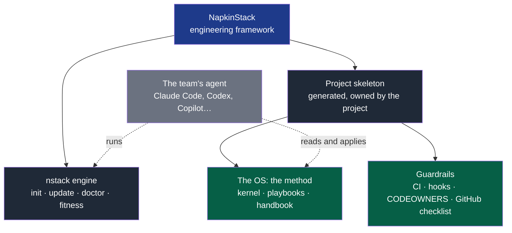
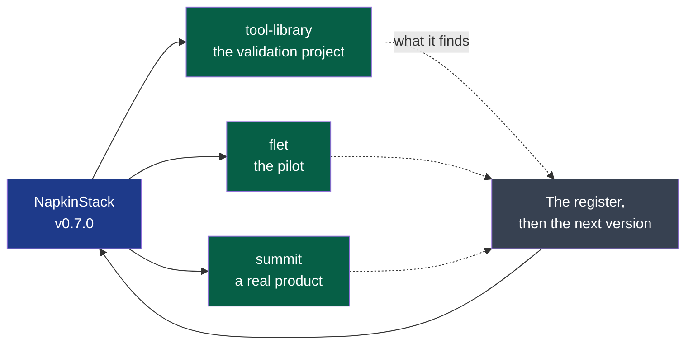

# PRODUCT — NapkinStack

> **This file has no place in a client project.** If it is present in a project created by
> `nstack init`, that is an installation error: delete it. `nstack doctor` reports it.
>
> It describes what the product is and how to work **on** NapkinStack, not **with** it.
> To be read first by any human or agent contributing here.

---

## 1. What NapkinStack is, and this repository's double role

NapkinStack is an **engineering framework**, on the Django or Rails model: one command
creates the project, which then owns its skeleton and receives new versions on demand
(PDR-0001). It is **not** an application framework: no language, no database, no internal
architecture is imposed.

**Legend** — blue: the product · dark grey: what it ships · green: the skeleton's content ·
light grey, dotted: the team's agent, which uses the framework; NapkinStack embeds no AI.

| Term | Meaning, everywhere in this repository |
|---|---|
| **Framework** | NapkinStack: the engine and the skeleton, versioned together |
| **Engine** | The `nstack` command, a dependency the project pins |
| **Skeleton** | What `nstack init` generates (`skeleton/` here); the project owns it |
| **OS** | The method: kernel, playbooks, handbook; generic and unbranded (P2, P7) |
| **Foundation** | A project's shared rules and guardrails, carried by its foundation team |
| **Guardrail** | A check that refuses an invalid state, in CI or in a hook |
| **Workstream** | The unit of batch in this repository; elsewhere, read "module" |
| **Contract** | The only channel between two modules: API, event, schema, versioned |
| **Standard verb** | `bootstrap`, `check`, `test`, `run`: the same names in every module |
| **Fitness function** | An automated test that fails when the architecture drifts |

This repository develops NapkinStack; it is also its **first user**. A foundation that
does not hold its own rules will hold nowhere.

Hence a disambiguation rule to keep in mind at all times:

| When you read… | Understand… |
|---|---|
| `skeleton/AGENTS.md`, `skeleton/.nstack/playbooks/`, `skeleton/.nstack/handbook/`, the skeleton's CI and hooks | The **deliverable**. What every project receives. It is edited the way a product is edited. |
| `src/napkinstack/`, `copier.yml`, `platform/`, `.github/` | The **tooled product**. NapkinStack's code. |
| This file, `docs/governance/` | The **working context**. It never goes to the client. |

An agent working here is therefore **not** in the nominal case the kernel describes ("you
work in a single module"). There are no modules yet. The rules that actually apply to you
are in §5.

---

## 2. What NapkinStack sells

**The client's problem.** Agents make writing code nearly free. Three costs do not come
down: understanding, verifying, coordinating. A team that plugs an agent into a repository
with no boundaries does not produce faster — it produces, faster, something nobody can
review.

**The promise.** Several teams, and their agents, work in parallel on different modules
with no synchronisation meeting, and without quality depending on anyone's vigilance.

**The mechanism.** Three ideas, and only these:

1. The **module** is the unit of parallelism. Two modules know each other only through
   their contract.
2. The **prompt is a transit zone**. Every automatable rule moves down into CI and leaves
   the prompt.
3. The **oracle before the generation**. The success criterion is executable before the
   first line.

**What it does not sell.** No stack, no application framework, no internal architecture,
no list of tools, no embedded AI: the team's agent uses the framework. NapkinStack
provides the layer that lets **the client's stack** hold up across several teams.

**And not speed on day one.** NapkinStack costs on day one and pays from the first module
someone else must review. Measured in the field, an agent speeds up simple greenfield work by
35 to 40 % and complex existing code by under 10 % (Stanford, via DORA's 2026 report): on a
three-day greenfield prototype, plain iterative prompting is faster, and we do not claim
otherwise. What the framework buys is that the second person, the second team and the
second month do not pay for the first one's speed — and PDR-0011 is how the first day costs
what its consequences cost, and no more.

---

## 3. The users

| User | What they must be able to do | Success criterion |
|---|---|---|
| **A tech lead** starting a project | Create a compliant repository, frame it and start a first cycle | The repository in under 30 min, the framing in one session of two hours **of effective work** — the wall clock recorded beside it (PDR-0002, clarified 2026-09-19) — without reading the whole handbook |
| **A developer** joining a team | Contribute usefully | With no spoken conversation |
| **An AI agent** on a task | Work bounded, be blocked when it drifts | An unmergeable PR rather than debt in `main` |
| **A second team** arriving | Move forward without blocking the first | Zero synchronisation meetings |
| **One person with their agents**, before there is a product — often on a repository the forge cannot guard | Build the first module without paying for bounds they have no one to share with | Their first delivery pull request merges with no charter, no cycle and no justified label, while another rule still refuses something; and the diagnosis states exactly what their forge enforces, never a violation for what their plan forbids (PDR-0006, PDR-0007, PDR-0011) |

These five criteria are the product's acceptance tests. A change that degrades one of them
is a failure, however elegant.

---

## 4. Product invariants

Non-negotiable. A pull request that violates one is refused, even when everything else is
green.

| # | Invariant | Why |
|---|---|---|
| P1 | **No stack imposed on the modules** — no language, no framework, no database. NapkinStack's own tooling (uv, which provides Python and pre-commit) has its own prerequisites, isolated from the project's code | The platform orchestrates, it knows no stack. Any ecosystem-specific logic in the engine is a bug; a preset delegates to the official generator. |
| P2 | **Portability of the rules** — the skeleton's rules (`skeleton/AGENTS.md`, `skeleton/.nstack/playbooks/`, `skeleton/.nstack/handbook/`) stay in generic markdown | A client must be able to use the OS with an agent other than Claude. A tool is an adapter, never a foundation. |
| P3 | **Enforcement stays in CI** — never in a hook, never in a plugin | A hook is bypassable. Mistaking it for a guarantee postpones the real check. |
| P4 | **Kernel within budget** — 250 lines | Without a ceiling it grows back at every incident and turns into the unreadable document it replaces. |
| P5 | **Every check has a test that proves it fails** | A guardrail that cannot fail guards nothing. |
| P6 | **Explanatory failure message** — rule, file, line, action | A check that says "violation" will be worked around. |
| P7 | **Branding at the periphery** — `platform/`, the CLI and the distribution carry the brand; the rules stay generic | Nobody adopts a way of working that carries a vendor's name in every file. |

---

## 5. How to work on this repository

The kernel `skeleton/AGENTS.md` stays your reference for **method** — oracle first,
minimal change, five-block summary, stop on a high-risk action. Four adaptations, and
what does not judge here:

**"A module" reads "a workstream".** There are no modules here. The unit of batch is the
workstream listed in `docs/governance/workstreams.md`. One workstream, one pull request, one
commit. Never two workstreams together.

**A plan lives as long as its work.** A workstream that needs one writes it in
`docs/governance/plans/`; when the work is merged the plan is deleted in the same pull request.
What it decided is in a record, what it changed is in the `CHANGELOG`, and git keeps the file.

**The oracle, here, is `platform/tests/run.sh`** (`uv run bash platform/tests/run.sh`),
which also runs the pytest cases for rules M, B, S, P and H
(`platform/tests/test_guardrails.py`). For every new check, first write the case that
proves it fails when the rule is broken, and watch it fail. The pattern exists in both
files: a fitness function rule gains a parameterised case there, a command behaviour gains
a block of `run.sh`.

**Three of the five required checks run here.** `Fitness functions`, `PR scope and review
budget` and `Hooks and secrets` judge this repository. `Test sheet and cycle` does not: there is
no `docs/project/` here, and `platform/` is of criticality `high`, so T1 would ask for a test
sheet on almost every pull request of a repository whose deliverable is the framework itself.
`Module checks` does not either: there are no modules here. Nor does the record of `Commits on
main`, which is not a required check: the ruleset refuses a direct push, which is the barrier
that record exists to compensate for. These are exemptions, not oversights; PDR-0007 makes the
cycle half of the first one a state read from the repository.

**The records are corrected in place, until v1.0.** `06-decisions.md` says a replaced
decision is superseded by a new one, never rewritten. Here, until the framework has a
version an outside user depends on, this repository's own ADRs and PDRs are **corrected in
place** — a status, a sentence proven wrong, a clarification dated and signed in the record —
because a record nobody outside reads is worth more true than intact. The history stays in
git and in the `CHANGELOG`. **From v1.0, the rule of
`06-decisions.md` applies here as everywhere.** A project generated by `nstack init` gets the
rule, never this exemption.

**The "client" is fictional but demanding.** Before every change, ask which of the five
users of §3 benefits, and how we will know. An improvement that serves none of them is not
an improvement.

## 6. Out of product scope

Do not build, do not propose:

- a reference stack, an example module, an application architecture;
- a stack preset that no real project uses yet;
- a Claude Code plugin or marketplace — enforcement stays in CI (P3);
- fitness functions beyond the current workstream — the next ones are prioritised in
  `skeleton/.nstack/handbook/07-governance.md` §3, and their need is not demonstrated;
- abstraction or configuration for a single use;
- a web interface, a dashboard, a service;
- an AI embedded in `nstack` (an API key, a model call): the team's agent uses the
  framework, and its proposals go through the same guardrails as everything else.

## 7. Current state

**v0.7.0 is published on PyPI (2026-10-12)**, with a provenance attestation
(ADR-0002). Every check has a test that proves its failure. This repository's agent works
under its own GitHub App, behind the maintainer's approval, and its session reaches none of
the maintainer's credentials (ADR-0004).

**Legend** — blue: the framework · green: a project running on it · grey: where a project's
findings land. Solid line: a version; dotted: a finding.

| Project | What it is for | How it is run |
|---|---|---|
| `tool-library`, public | An invented subject, to rehearse a team's cycle and attack the barriers | By this repository's sessions |
| `flet`, public | The pilot: a real subject, updates taken at its own cycle boundaries | By a session that knows nothing of this repository — observed, never coached |
| `summit`, private | A real product, framed with the maintainer as decider | Beside the framework: a defect it meets is fixed here and proven there |

**Open**: applying the forge's settings in one gesture, once a probe on the real forge has
answered (PDR-0008); the conformance suite, every barrier attacked at each release (M12); the
merge record (PDR-0009, M13). The list, with every open defect:
[`docs/governance/workstreams.md`](docs/governance/workstreams.md). Beyond that, usage
dictates: nothing is built before it has served once.

**Where the past is**: what each version changed, in [`CHANGELOG.md`](CHANGELOG.md); why, in
`docs/pdr/` and `docs/adr/`; the rest in git. This file says what is true today.
