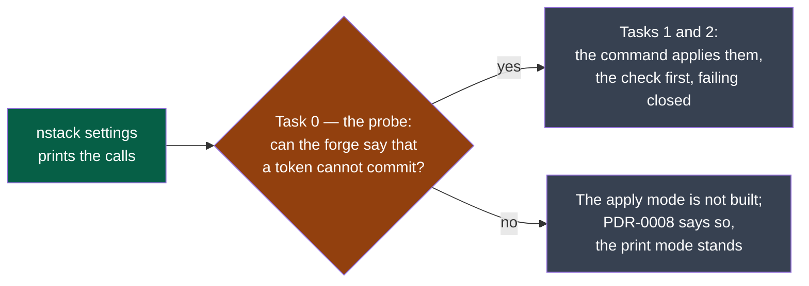

# M11r — the forge's settings applied, once the forge has answered

> **Location:** `docs/governance/plans/`. A plan lives as long as its work (`PRODUCT.md` §5):
> this file is deleted by the pull request that closes M11r.

What is left of M11, published as v0.7.0. Decision: [PDR-0008](../../pdr/0008-configure-the-repository-in-one-gesture.md),
criteria 2, 3 and 7; its section *As built, and what is not* says why the work stopped here.

**Legend** — green: published · orange: the question a probe answers · grey: to do, one or
the other.

- [ ] **Task 0 — the probe, with the maintainer's own tokens.** A fine-grained token with
      Administration write and no Contents access, and a second one that can also push: what
      does the forge answer to each on the repository object, on a settings call, on a harmless
      write to the code? **Exit**: if nothing tells the two apart without attempting a write,
      the apply mode is not built and PDR-0008 says so.
- [ ] **Task 1.** The check, first and failing closed; then the calls; then the diagnosis.
      Criteria 2, 3 and 7. The test first, seen red.
- [ ] **Task 2 — D57.** The kernel's *"never with a human's credentials"* and the one
      exception PDR-0008 makes, in the place the probe shows it belongs.

**Also left of M11i**, and not this plan's work: `tool-library` and the pilot take v0.7.0
themselves — the pilot at its cycle boundary — and what they meet is recorded in the register.
The pilot's `screening` module is declared `high`: whether it revises that, now that the matrix
says what each value buys, is a measurement, not an instruction.
