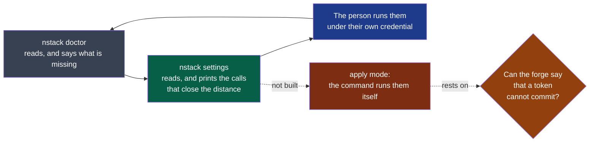
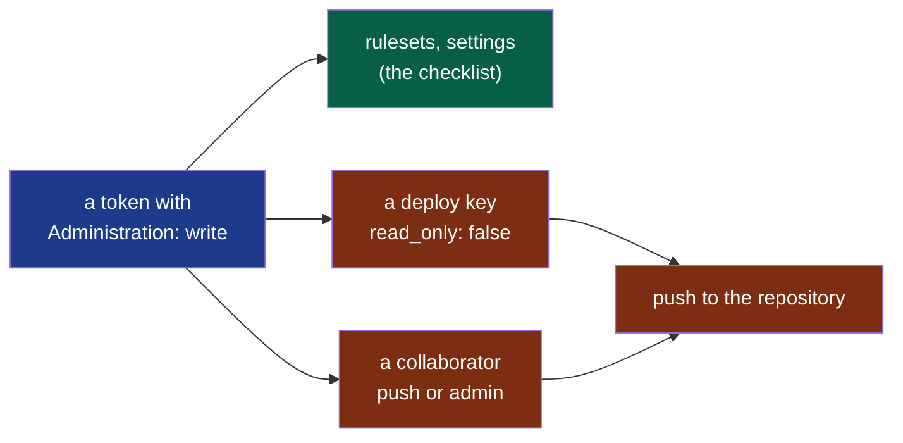

# PDR-0008 — Configure the repository in one gesture, without handing over the keys

- **Status**: Accepted (2026-09-22, by the maintainer; the success criterion is observed
  before 2027-03-31). **Built**: the checklist's additions (M11f: G14 to G16), the command's
  print mode with five of the eight criteria (**M11k, 2026-10-12**), and the apply mode run by
  the person (**D151, 2026-10-24**), the last three. **Clarified 2026-10-24 (D150)**: the forge's own permission table shows that the
  check the apply mode rests on cannot hold — *What the forge's permissions say*, below. **The
  decider chose option 3 the same day**: the apply mode is run by the person, never delegated
- **Date**: 2026-09-20
- **Decision makers**: NapkinStack maintainers (`@NapkinStack/maintainers`)
- **Modules affected**: `nstack` (a new command beside `doctor`), the skeleton's README and
  checklist, ADR-0004

> The PDR describes **what the product must do and why**, never its implementation.
> The how belongs to the implementation plan and, where structuring, to an ADR.

---

## User problem

The framework's barriers are the forge's settings, and the forge's settings are not copied
with a project. So every new project starts with **thirteen settings applied by hand**, from a
checklist printed by `nstack init` and checked read-only by `nstack doctor`. Measured on
2026-09-20: that list is the largest manual block of the whole journey, and it is the only one
an agent cannot take off the person's hands — by ADR-0004, the agent holds no administration
right at all.

Three consequences, all observed rather than supposed.

**It is slow where slowness buys nothing.** Thirteen settings, in four different pages of the
forge's interface, repeated at every new project. Nothing about them is a decision: they are
the same list every time, and `doctor` already knows what each one should be.

**One of them cannot even be done at the right moment.** D26, found in M9: GitHub offers a
status check as *required* only once it has seen it run, so a fresh repository cannot select
the five checks the framework needs. The documented workaround is to open a first pull request
for nothing, wait for the checks, then come back and select them.

**And on some plans, part of the list is impossible** — seven of the thirteen on a private
repository with no paid plan (PDR-0006). A person applying the list by hand discovers that one
setting at a time.

The person who wants their agent to do this cannot let it: the credential that configures a
repository is the credential that can *unconfigure* it, and an agent that can remove the rule
that constrains it is not constrained.

## Goal

The forge's settings become one gesture that is reliable, aware of the repository's visibility
and plan, and safe enough that a person may let their agent perform it — without any moment
where the agent can both weaken a rule and merge under it.

## Out of scope

- **Making this mandatory.** The checklist stays valid applied by hand, and `doctor` stays the
  read-only reference. Nothing in the framework depends on this command having been run.
- **Keeping settings in sync over time**, reverting drift, or watching the repository. This is
  a setup gesture, not an agent that holds a permanent right.
- **Giving the framework's own agent an administration right.** ADR-0004 is unchanged: the
  session that writes code never holds administration.
- **Forges other than GitHub**, and anything that costs money on the user's behalf.

---

## Prior art

> **Mandatory section.** Minimum two named references.
> (`skeleton/.nstack/handbook/06-decisions.md` §2)

**How is this problem solved elsewhere?**

| Product / reference | Solution chosen | What we keep from it |
|---|---|---|
| [github/safe-settings](https://github.com/github/safe-settings) | *"Policy-as-Code for GitHub Organizations… Centrally manage and enforce repository settings, branch protections, teams"*, from a settings file, applied by an App | **That settings belong in a file and are applied by a tool**, not typed into a form once per project |
| [Terraform's GitHub provider](https://registry.terraform.io/providers/integrations/github/latest/docs) | Repository settings and rulesets declared as code, applied with the operator's own credential | **The separation we need**: the description of the desired state travels with the project; the right to apply it stays with a human |
| [Allstar](https://github.com/ossf/allstar) | Policies with actions `log`, `issue`, `fix` — where `fix` *"reverts the setting"* | **The limit we do not cross.** Continuous correction needs a permanent right; we take the one-shot and leave the standing power alone |
| [Minder](https://github.com/mindersec/minder) | Remediation as *"a REST call flipping a repo setting"* or *"creating a pull request with a proposed fix"*, with `ActionOpt` = On / Off / **DryRun** | **The dry run as the default**, and remediation as an explicit opt-in rather than a background behaviour |
| Separation of duties, as [SLSA](https://slsa.dev/spec/v1.2/source-requirements) and the [OSPS Baseline](https://baseline.openssf.org/versions/2026-02-19.html) state it for review | The party that performs an action is not the party that authorises it | **The rule of this decision**, moved one level down: the identity that configures the barrier is not the identity that works behind it |

**The convention the user already knows:** a tool shows you the plan, then applies it —
`terraform plan` before `terraform apply`, `--dry-run` before the real thing.

**Why depart from it:** the tools above hold a standing credential and keep a repository in
its declared state forever. That is right for infrastructure and wrong here, because the thing
being configured is the barrier that constrains the very agent that would hold the credential.
So the gesture is **one-shot, scoped and self-checking**, and the standing state is verified by
a read-only diagnosis that needs no power at all.

---

## Options considered

| Option | What the user experiences | Cost | Chosen? |
|---|---|---|---|
| Do nothing | Thirteen settings by hand per project, a pull request opened for nothing to unlock D26, and a plan's limits discovered one at a time | 0 | No. Measured as the journey's largest manual block |
| A. Print the exact calls | The tool prints what to apply; the person pastes it into their own shell | Very low | **Yes, as the default.** No credential goes anywhere near the agent |
| **B. A, plus an apply mode with a credential that cannot commit** | The person may let their agent run it, with a temporary administration-only credential the tool refuses to use if it can also push code | Low | **Yes, as an opt-in** |
| C. A GitHub App of ours that configures repositories | One click, a standing right, nothing to paste | High, and it is a service to run | No. A permanent administration right on other people's repositories, held by us, for a gesture that happens once |
| D. Give the framework's agent administration | The agent does everything | Low | No. It is the cage-and-key problem: an agent that can remove the rule that constrains it is not constrained (ADR-0004) |

## Decision

**Options A and B: one command, two modes, and a rule that makes the second one safe.**

**The command computes a difference and applies it, never a rewrite.** It reads the
repository's current settings, compares them with the checklist `doctor` already knows,
and produces the smallest set of changes that closes the distance. It **adds and
strengthens**; it never deletes a ruleset, never removes a required check, never adds a bypass
actor, and never lowers a setting that is already stricter than the checklist asks. A
repository that is already compliant gets no change at all.

**It is aware of the plan and of the visibility.** What the repository's plan cannot enforce is
not attempted and not reported as a failure: it is named, with its cost, in PDR-0006's words.
A private repository on a free plan is configured as far as it can be, told it is unguarded,
and told the two exits.

**Print is the default; applying is a choice.** By default the command prints exactly what
would be done, in a form the person can run themselves with their own credential — nothing
enters the agent's session. A person who prefers may let the command apply it, and then:

> **The identity that configures the repository may never commit to it, and the command
> verifies this before acting.**

The credential it is given must be able to administer the repository and must **not** be able
to push to it. The command reads the calling identity's own permissions on the repository and
**refuses to act** when that identity can also write code. This is not a promise in prose: it
is a check, run first, that fails closed. So there is no moment at which one identity can both
weaken a barrier and merge under it — which is the only reason the standing rule of ADR-0004
can safely have an exception at all.

**The right is temporary by construction.** The command stores nothing, logs no credential,
and ends by telling the person to revoke what they granted. Nothing in the framework asks for
that credential again; the read-only diagnosis needs none of it.

**And it proves what it did.** It prints the changes it made, then runs the diagnosis, so the
end state is established by the same read-only check anyone else can run — not by the command's
own account of itself.

---

## Expected behaviour

**Nominal journey, by hand.** After `nstack init`, the person runs the command. It prints the
calls that would bring the repository to the checklist, marks what their plan cannot reach, and
they paste it into their shell. The diagnosis then reports the repository compliant, or
unguarded with the settings that are out of reach named.

**Nominal journey, delegated.** The person creates a short-lived credential that can administer
the repository and cannot push, hands it to their agent, and asks for the setup. The command
verifies the credential's shape, applies the difference, prints it, runs the diagnosis, and
reminds them to revoke. The agent never held a right to change code.

**Edge cases and degraded states.** A credential that can also push: refused before anything is
attempted, naming what to change *(as built, D151: a credential that is not a person's — an
App's token, a run in CI — since the forge has none that administers and cannot push)*. A
credential that cannot administer: refused, naming the
permission. A setting the plan forbids: not attempted, named with its cost. A required check
the forge refuses to name before it has run (D26): applied if the forge accepts it, and
otherwise named as the one step that remains, with its reason. A repository already stricter
than the checklist: left alone, and said so. A partial failure: what succeeded is printed,
what failed is named with the forge's own error, and the diagnosis reports the real state.

**Business rules.**

- Nothing is ever lowered, removed, or bypassed.
- The configuring identity cannot be a committing identity, and this is checked, not assumed.
- Print is the default; applying is explicit.
- The end state is established by the read-only diagnosis, never by the command's own claim.

**Permissions:** the framework's own agent keeps no administration right (ADR-0004). The
credential used by this command is the user's, supplied for one run, and the command refuses it
if it carries the power to write code.

**Acceptance criteria** *(testable)*:

- [x] Given a repository and no credential, when the command runs, then it prints the calls
      that would close the distance to the checklist, and changes nothing.
- [x] Given a credential that is not a person's — an App's installation token, or a run in
      CI — when the command is asked to apply, then it refuses before any call, and names what
      to change. *(Clarified 2026-10-24, D150: the forge has no credential that administers and
      cannot push, so the refusal is drawn where the forge can draw it.)*
- [x] Given the person's own credential, when the command is asked to apply, then the
      repository's settings reach the checklist, and the diagnosis says so.
- [x] Given a repository already compliant, when the command runs, then it makes no call and
      reports that nothing was needed.
- [x] Given a repository whose ruleset is stricter than the checklist, when the command runs,
      then that setting is left as it is.
- [x] Given a private repository on a plan that enforces nothing, when the command runs, then
      it applies what the plan allows, names the rest as out of reach with its cost, and never
      reports the repository as guarded.
- [x] Given a run that applied changes, when it ends, then it prints each change made and
      reminds the person to revoke the credential.
- [x] Given any run, then no credential appears in its output or in any file it writes.

### As built, and what is not (M11k, 2026-10-12)

*Kept as it was written on 2026-10-12. The apply mode it calls not built was built on
2026-10-24 (D151), as the decider chose it after D150: run by the person, never delegated. A
credential that cannot administer is not refused up front: the reads pass, and each write the
forge refuses is named with its answer.*

**Legend** — grey: existed · green: built here · blue: the person's own gesture · red: decided
and not built · orange: the question that holds it.

**Built — `nstack settings`**, print mode only. It reads with `doctor`'s own checks and prints
the smallest set of calls, in the forge's own command line. It never plans to rewrite a
ruleset: the missing rules go into one ruleset of their own, with nobody on its bypass list —
rulesets layer and the strictest wins, so adding cannot lower. A setting stricter than the
checklist is left and said; an existing bypass list is a step by hand; what a plan cannot
enforce is named with its cost and the repository is said to stay unguarded.

**Not built — the apply mode.** The decision rests it on one check: *the command reads the
calling identity's own permissions and refuses when that identity can also write code*. Read
at the forge's documentation on 2026-10-12: the repository object's `permissions` field is
not described as the token's, the settings endpoints name no fine-grained permission, and no
endpoint describes a fine-grained token's own permissions. A check that cannot be shown to
hold is the removal condition of this very mode. So it is not written until a probe, with a
real administration-only token, shows what the forge answers — M11r.

**Three things the decision did not foresee:**

- A ruleset cannot be created on a private repository without a paid plan, and without a
  token the command cannot know the visibility: it says so rather than plan it silently.
- D26 is not solved here: the plan names every required check, and says the forge may refuse
  one it has never seen run.
- The checklist gained two lines on the way (D78): the main branch cannot be deleted, and its
  history cannot be rewritten.

### What the forge's permissions say (D150, 2026-10-24)

The apply mode rests on one check: *the identity that configures the repository may never
commit to it*. The forge's table of what a fine-grained token's permissions allow (*Permissions
required for fine-grained personal access tokens*, read 2026-10-24) answers the question the
probe was waiting for, before any probe. **Administration: write** — the permission every
setting of the checklist needs — also allows two endpoints:

- `POST /repos/{owner}/{repo}/keys` creates a deploy key, which can write when `read_only` is
  false;
- `PUT /repos/{owner}/{repo}/collaborators/{username}` adds a collaborator, with up to `push` or
  `admin`.

So an identity that can administer a repository can always give itself, or an account it
holds, the right to push. Since it also holds the rulesets, it can then merge under rules it
weakened. A credential "that can administer and cannot commit" does not exist on this forge:
reading the token's own permissions would pass and prove nothing, and so would probing a write
it cannot make. That is the removal condition of the apply mode, met before the mode was written.

**Legend** — blue: the credential the checklist needs · green: what it is for · red: what it
also allows, which the decision's check was meant to rule out.

The options left are the decider's to choose from:

| Option | The safety then rests on | What the person does |
|---|---|---|
| **1. Print only.** The apply mode is removed, as its removal condition says | Nothing new: the person runs the printed calls | Pastes the calls, as today |
| **2. One script, run by the person.** `nstack settings` also writes the plan as one script, which the person runs under their own credential | The person's gesture, as for a tag: the agent never holds the credential | One command, under a short-lived token they then revoke |
| **3. An apply mode run by the person.** `nstack settings --apply` reads the credential from the person's own environment and is refused in CI | The person's gesture, as in option 2. The diagnosis runs afterwards and each change is printed | One command |
| 4. The apply mode delegated to the agent, as decided | Nothing: the check cannot hold | Not offered |

**Chosen by the decider, 2026-10-24: option 3.** Criteria 2 and 3 read accordingly: the
command refuses a credential that is not a person's (an App's installation token, a run in CI),
and the person who runs it is the one who holds administration.

Options 2 and 3 keep every other rule of the decision:

- add and strengthen only;
- aware of the plan;
- print by default;
- nothing stored;
- the end state established by `nstack doctor`.

They drop only the delegation to an agent, which the forge offers no way to make safe.

### Manual steps on the forge (D150, 2026-10-24)

What the method leaves to a person's hands on GitHub, as `INSTALL.md` lists it:

| Step | Today | Could be | Why |
|---|---|---|---|
| Create the repository and push the first commit | By hand, after `nstack init` | Automatable by the person, with the forge's command line named in `init`'s next steps | The person's own account; nothing to decide |
| The checklist, G1 to G20 | Printed by `nstack settings`, then pasted | One gesture of the person: `nstack settings --apply` (option 3, built in D151) | Administration is the person's (ADR-0004) |
| D26: a required check the forge has not yet seen run | A first pull request, then the checks selected | To be observed on the first real run of `--apply`: the interface refuses a check it has never seen, the rulesets API may accept it; if it refuses, `--apply` puts the ruleset in without them and names G4 as the one step left | The first run under a person's credential |
| `owner_team`, the team `CODEOWNERS` names | By hand, in the organisation | Automatable by an organisation owner, in the same script | Who belongs to the team is a human decision |
| The agents' GitHub App: created, installed, its key stored | By hand, through the forge's pages | Reduced to one confirmation by the App manifest flow, never fully automated | Creating an identity and holding its key is a person's act (ADR-0004) |
| An approval on a pull request | By hand | **Necessarily human** | It is what the barrier is for (PDR-0003) |
| A tag, and a deployment's approval | By hand | **Necessarily human** | The decider's word (PDR-0005) |
| An acceptance issue answered | By hand | **Necessarily human** | A person tried it (PDR-0004) |
| A setup credential revoked | By hand | Necessarily human; said at the end of the gesture | Only its owner can revoke it |

---

## Success criterion

> **Mandatory section.** Without a date nobody comes back to check, and the decision folder
> becomes a graveyard.

> We will consider this was the right call if, before **2027-03-31**, **a new repository
> reaches every setting its plan allows in one gesture and under five minutes**, measured on a
> public repository and on a private one, from the published version — and if the five required
> checks are in place **without a pull request opened for nothing** (D26). And if, over the
> pilot and the validation project, **no credential granted for a setup is ever used for
> anything else**, which the forge's own audit log shows.

How it is observed: the two setup runs with their printed changes and the diagnosis that
follows; the repositories' rulesets read back through the API; the audit log for the life of
each granted credential.

If the criterion is not met: a gesture that still takes a pull request for nothing means the
forge's API does not accept a check it has not seen, and D26 stays a documented step rather
than a solved one; a credential found doing anything beyond setup means the shape is wrong and
the apply mode goes, leaving the printed form.

---

## Removal condition

> **Mandatory section.** A feature with no removal condition is permanent by default,
> including when nobody uses it.

The **apply mode** will be removed if the check that the configuring identity cannot commit
turns out not to hold on some credential shape the forge offers — a single case where the
refusal can be walked around is enough, because the whole safety of the mode rests on it. The
**command itself** will be removed if the forge's settings stop being applicable through its
API, or if a project is found using it to weaken a repository, which its own no-lowering rule
should make impossible.

---

## Impacts

- **Existing users**: none today; the checklist keeps working by hand. The pilot and the
  validation project can adopt it or not.
- **Modules and contracts**: none.
- **Decisions**: **ADR-0004** is clarified, not changed — the framework's agent still never
  holds administration, and this decision names the second, disjoint power and the rule that
  keeps them apart. **PDR-0001**'s checklist keeps its content and gains an executable form.
  **PDR-0006** supplies the vocabulary for what a plan cannot reach. **D25 and D26** are
  answered in practice if the forge's API accepts a check it has not yet seen.
- **Support and documentation**: `nstack init`'s next steps name the command; the skeleton's
  README keeps the checklist word for word, and adds the gesture beside it; `CONTRIBUTING.md`
  is unchanged.
- **Data**: nothing is collected, nothing is stored. The credential lives in the environment of
  one run.
