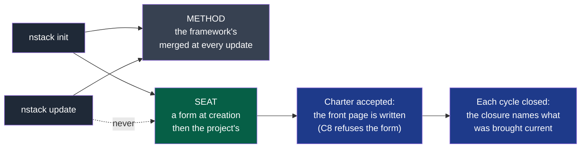
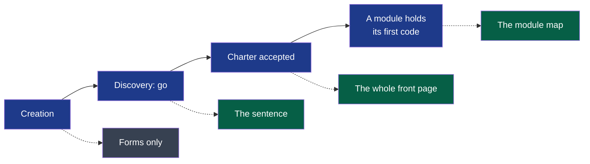

# PDR-0010 — The framework imposes the form, the project writes the content

- **Status**: Accepted (2026-09-22, by the maintainer; the success criterion is observed
  before 2027-03-31); **built by M11l (2026-10-12)** and extended by M11o the same day —
  see the two sections *Corrected in place*; it closes D59 and D60
- **Date**: 2026-09-22
- **Decision makers**: NapkinStack maintainers (`@NapkinStack/maintainers`)
- **Modules affected**: the skeleton's `README.md.jinja` and `.github/ISSUE_TEMPLATE/`,
  `docs/os/06-decisions.md` §9, `docs/os/00-overview.md` §5, `nstack init`, `nstack doctor` (L5)

> The PDR describes **what the product must do and why**, never its implementation.
> The how belongs to the implementation plan and, where structuring, to an ADR.

---

## User problem

`00-overview.md` §5 states the rule this project already holds itself to: three levels —
framework, project, module — and **"the framework never names a stack, a tool or a business
domain"**. Two days of a real project show it breaking that rule in three places, each visible
to anyone who opens the repository.

**The product's front page is the tooling's manual.** On the pilot, `README.md` opens with the
project's own sentence — *"flet lets the administrator of a Discord community curate which
traders its members may copy"* — and then runs 250 lines of NapkinStack installation
instructions, whose own third paragraph says *"Replace it with your project's own README once
the installation is finished"*. Nothing checks it, and nobody deletes a block of documentation
that looks official. A visitor to the product reads how to install its tooling (D59).

**Work that nobody planned has no home.** The framework declares one: `06-decisions.md` §9,
*"Work to be done → Issues / the project board"*, and the skeleton ships five issue forms and a
pull request template saying `Closes #`. The engine reads none of it: it reads
`docs/project/cycles/`, and `K3` requires `Deliverable: D<n>`. Measured on the pilot:
**23 pull requests, 0 issues**. Two things now sit nowhere — the work deferred when a test-sheet
scenario failed, which survives only in the title of a closed pull request, and what a round of
work learned, which survives only in the body of a merged one. In six weeks neither will be
found (D60).

**And the framework says nothing about the documents a product needs.** It ships its own
handbook, its own decision templates and its own project templates — the *method*. It says
nothing about what a serious product's documentation holds, nor how it is written, although
that is precisely the kind of thing a framework may impose without ever writing a line of the
content.

The three have one cause. The framework is imposing **content** where it should impose
**form** — and it has already written down why that is wrong.

## Goal

A project created by NapkinStack looks like that project, not like NapkinStack: the framework
requires the shape, the standard and the places, and writes none of the substance.

## Out of scope

- **Requiring a forge, or requiring issues.** A project that tracks its unplanned work in
  another tool satisfies this decision. P2 stands: the rules stay portable.
- **Removing cycles, or replacing deliverables with issues.** PDR-0002 is untouched. Planned
  work stays in the cycle, with its appetite and its circuit breaker.
- **Shipping a product-documentation template.** Headings and a standard, never a body.
- **D56, D58 and D61**, which need no decision: naming the entries that make a folder
  non-empty, ignoring what an agent's runtime leaves in a project, and completing the checklist
  with the merge method and branch deletion are plain fixes. They ship with this decision's
  implementation and are not argued here.

---

## Prior art

> **Mandatory section.** Minimum two named references.

| Product / reference | Solution chosen | What we keep from it |
|---|---|---|
| **Rails** (`rails new`) | A README stub listing *headings* — Ruby version, system dependencies, configuration, database creation — and no Rails documentation | The generator writes the product's headings and leaves the content |
| **Django** (`django-admin startproject`) | No README at all | Writing nothing is a legitimate answer |
| **create-react-app** | A README about its own scripts, which everybody deletes | The counter-example, and it is ours today |
| **Rust RFCs**, **Python PEPs** | The proposal is a **file reviewed in a pull request**; once accepted, a **tracking issue** follows it | What binds is reviewed; what tracks is an issue. The split we adopt |
| **Shape Up** (Basecamp) | No backlog: work is shaped, bet on for a cycle, and dropped at the circuit breaker | Planned work is not a list of issues — which is why deliverables stay where they are |
| **Diátaxis** (Django, Cloudflare, Gatsby) | Four kinds of document, defined by what the reader is doing; no content prescribed | A framework may impose the shape of documentation and nothing else |

**The convention the user already knows:** a generator leaves the product's front page to the
product; a proposal is reviewed as a change; a tracker holds what arrives unplanned.

**Why depart from it:** we do not. Today's behaviour is the deviation, and it was never
decided — it grew because the README was the only place the installation instructions could
sit when there was no project to hand them to.

---

## Options considered

| Option | What the user experiences | Cost | Chosen? |
|---|---|---|---|
| Do nothing | Every project deletes 250 lines by hand, or ships NapkinStack's manual as its own; unplanned work keeps disappearing into closed pull requests | 0 now, paid by every project forever | No |
| Patch each defect | The README is split, the forms are used, the checklist is completed — with no rule, so the next one recurs | Three small changes | No: the pilot found three in two days; the cause matters more |
| **State the rule and apply it** | A generated project is about itself; unplanned work has one place; documentation has a shape and no imposed content | One decision, three changes, one handbook correction | **Yes** |

## Decision

**1 — The README belongs to the product.** `nstack init` writes a stub: the project's name, the
sentence its team writes, and the headings a product needs — what it is, how to run it, how to
contribute, where its decisions live. The foundation's manual moves to `docs/os/INSTALL.md`,
called by **one line** of the README that the team deletes when it no longer serves. Nothing
new is checked: the manual is not there to be detected, it is simply not written there. `init`
already prints the next steps and the checklist to the terminal, which is where someone who has
just run it is looking.

**2 — What binds is reviewed; what tracks and what arrives is an issue.**

| | Where | Why |
|---|---|---|
| A plan, a decision, a charter, a cycle | **A file, reviewed in a pull request** | An issue is edited in silence: no diff, no code owner, no review. A plan that can change without review is not a plan of record |
| The state of a plan: which workstream is done, its pull requests, the discussion | **An issue**, optional | A file needs a commit to tick a box; this is what a tracker does better |
| A bug, an incident, debt, an architecture question | **An issue, typed — one type, one form** | Unplanned by nature: no plan file exists for it, and four of the five forms already shipped are exactly these |
| What a project must remember: what was tried, what it cost, what was refused | **One named issue per project** — the log | Not "memory in the issues": one place, or `06-decisions.md` §9 is broken again |

`06-decisions.md` §9's row is corrected accordingly: **planned** work is the cycle's
deliverables, **unplanned** work is an issue. The form that competes with a deliverable is
repositioned so that two things never claim the same work.

**3 — The framework requires the shape of documentation, never its content.** It names the
documents a project is expected to hold and the standard they are written to — a diagram with
its legend before prose, a source named for every claim about the outside world, a date on
every decision — and it ships no body. That standard is not new: every page of the handbook
already obeys it. It has simply never been asked of the project's own documents.

---

## Expected behaviour

**Nominal journey:** a team runs `nstack init`, pushes, applies the checklist, and opens its
repository on the forge. The front page describes their product. The foundation's manual is one
click away for whoever installs. When a scenario fails and the work is deferred, they open a
typed issue and it is still findable next month. When they plan, they write a file and have it
reviewed.

**Edge cases and degraded states:**

- A project that wants no issues at all keeps everything in files: it loses the tracking, not a
  rule.
- A project already running keeps its README untouched — see *Impacts*.
- A team that never opens the log issue has lost nothing it had before.

**Business rules:**

- Nothing the framework requires may name a tool, a stack or a domain.
- Nothing that binds the project may live where it can be changed without review.

**Acceptance criteria:**

- [x] Given a project created by `nstack init`, when its `README.md` is read, then it holds the
      project's name, its sentence and its headings, and no installation instructions beyond one
      line pointing at `docs/os/INSTALL.md`.
- [x] Given the same project, when the foundation's manual is looked for, then it is at
      `docs/os/INSTALL.md`, complete and unchanged in substance.
- [x] Given `06-decisions.md` §9, when its row on work to be done is read, then planned and
      unplanned work name different places, and neither contradicts `K3`.
- [x] Given the skeleton's issue forms, when they are listed, then each names a kind of work
      that no deliverable claims.
- [x] Given the handbook, when the documentation standard is looked for, then it is stated once,
      names no tool, and prescribes no content.

- [x] *(added 2026-10-12)* Given a project that already exists, when it takes an update whose
      skeleton rewrote a seat, then that file is byte-identical afterwards.
- [x] *(added 2026-10-12)* Given an accepted charter, when the front page still holds its
      form's words, then the plan check refuses and names them; given a proposed charter, it
      does not.

### Corrected in place, 2026-10-12

The maintainer created a third project on v0.6.2 and read it: 48 Markdown files, three naming
the product. The decision above was right and its criteria were too narrow. Four things are
written into it by M11l, the workstream that builds it:

**Legend** — grey: the method · green: a seat · blue: what brings a seat current — the first a
machine reads, the second owed to the decider.

1. **The defect is the mixed file, and there were five.** A file holding the framework's words
   and waiting for the project's belongs to nobody. Four become **seats** — `README.md`,
   `modules/README.md`, `docs/adr/README.md`, `docs/pdr/README.md` — listed in `copier.yml`
   under `_skip_if_exists`: written once as a form, never merged again. The fifth,
   `contracts/README.md`, held no project content and shrank to a pointer.
2. **The standard has four rules, not three.** A diagram with its legend before the prose, a
   source for every outside claim, a date on every decision — and **current, or deleted**:
   every document names the event that brings it current. Stated once, in `06-decisions.md`
   §10; the tooling profile maps the diagram to a tool.
3. **"Nothing new is checked" held for the manual, not for the form.** One rule is added,
   **C8**: under an accepted charter, a front page still holding its form's words is refused.
   Whether a page is *true* stays owed, and is named owed.
4. **Two forms were removed, not one repositioned.** The Feature form and the Spike form each
   described work a deliverable already claims; a **Request** form carries what arrives and is
   not yet work. Four forms.

**What a running project receives** was measured, not predicted: see M11l's pull request.

### Corrected in place a second time, 2026-10-12 (M11o)

The maintainer read the first correction and said the front page was *one example*: other
files speak of the project, and some can only be written **after** a phase has ended. Both
were true, and the first correction had one rule backwards.

**Legend** — blue: a moment read from the repository · green: what C8 asks for once it has
come · grey: nothing is asked.

1. **A form is not filled before its moment.** `doctor` reported the unwritten sentence as a
   gap from a project's first minute (L5), when nobody could honestly write it. **L5 is
   retired**; C8 asks for each document at the event that makes it writable. The module map
   follows the convention every module rule already had: from the first file of code, so
   that what the scaffolding writes stays green — found by the oracle, which went red on
   `new-module` when the rule read "once a module exists".
2. **A fifth seat: `SECURITY.md`.** It mixed the project's policy — how to report, who
   answers — with the framework's rules, which `playbooks/security.md` already held. It keeps
   the policy, with a default that is true on a public repository.
3. **A module's page is a seat too.** The one `new-module` writes named the engine on four
   lines; it now names the verbs, and holds the place of a diagram.
4. **The standard moved to where agents load it.** Stated in the handbook, it reached humans
   and no agent — the handbook is never loaded into a context, and agents write most of these
   documents. It is `playbooks/documentation.md`, triggered by the kernel; the handbook keeps
   the why, and the table of documents by phase (`06-decisions.md` §10).
5. **Decision records gain the place of a diagram**, as an invitation — "otherwise delete
   this line" — reversing the first correction's refusal: a decision that changes a structure
   is better drawn, and one that does not loses a line.

---

## Success criterion

> We will consider this was the right call if, **before 2027-03-31**, on the pilot and on one
> other project: **each README describes its own product and not NapkinStack**, and **three
> pieces of work deferred or discovered out of cycle, picked at random from six weeks earlier,
> are each found in one place in under a minute**.

How it is observed: the two repositories are opened, and the decider is asked to find the three
items without help.

If the criterion is not met: the README part adjusts — headings are the cheap half. The issue
part is superseded: if unplanned work still disappears, the answer was the wrong one and the
right one is probably that the cycle itself must carry it.

---

## Removal condition

> This decision will be removed if **a team reports that the split makes them maintain the same
> information twice** — a plan in a file and its state in an issue, drifting apart — in which
> case the tracking issue is dropped and the file alone holds the state.

---

## Impacts

- **Existing users**: a project already running **keeps its README**. `nstack update` cannot
  replace a file the team has edited without a conflict, and it should not try: they receive
  `docs/os/INSTALL.md` as a new file and delete from their README whatever they want, when they
  want. Only projects created after this decision get the stub. This is the rename cost
  `CONTRIBUTING.md` warns about, paid deliberately and once.
- **Modules and contracts**: none.
- **Support and documentation**: `06-decisions.md` §9, `00-overview.md` §5 and the skeleton's
  issue forms change; `README.md.jinja` splits in two.
- **Data**: none.
