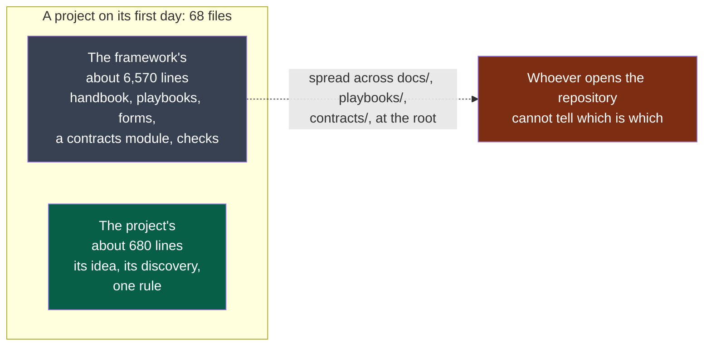
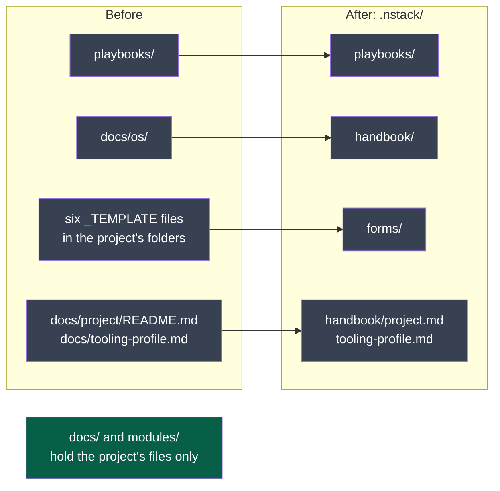

# PDR-0012 — A project's tree is the project's

- **Status**: Accepted (2026-10-12, by the maintainer), with the handbook
  **kept in the project**, under `.nstack/handbook/`. Built the same day by **M11s** (the one folder) and **M11t** (the contracts module created by
  the first contract); see *As built*; clarified on 2026-10-15 (one register of decisions)
- **Date**: 2026-10-12
- **Decision makers**: NapkinStack maintainers (`@NapkinStack/maintainers`)
- **Modules affected**: the skeleton's layout, `copier.yml`, every message and page that
  names a path under `docs/os/` or `playbooks/`, `nstack init`, `nstack update`, a command to
  create the contracts module

> The PDR describes **what the product must do and why**, never its implementation.
> The how belongs to the implementation plan and, where structuring, to an ADR.

---

## User problem

**Legend** — grey: what the framework wrote · green: what the project wrote · red: the
consequence. Measured on the third project on 2026-10-12, after its discovery was decided.

PDR-0010 made five files the project's and gave each document its moment. The maintainer
then opened the same project and said the rest still reads as pollution: what is really
useful, and must live in the projects the framework creates, has to be told apart from the
files that pollute them. Three things are behind that sentence:

- **A handbook of fourteen pages, 3,541 lines, sits in `docs/os/`**, beside the project's own
  decisions. It is the framework's documentation. Nothing the project runs reads it, and no
  agent loads it — the handbook says so itself.
- **Nine playbooks and six forms sit in the project's own folders** — `playbooks/`,
  `docs/adr/`, `docs/pdr/`, `docs/project/`. Agents and commands do read those; they are
  needed. They are not the project's.
- **A whole module, `contracts/`, exists before any contract does**: six files, an owner, a
  runbook, a CI job that runs on nothing. M11o's rule — nothing before its moment — was
  applied to documents and not to this.

## Goal

Whoever opens a project sees the project. What the framework needs there is in one place,
named as the framework's, and no larger than what something in the project reads.

## Out of scope

- **The kernel's place.** `AGENTS.md` stays at the root: it is where every agent looks.
- **What the forge reads by convention**: `README.md`, `SECURITY.md`, `CONTRIBUTING.md`,
  `.github/`.
- **Removing the method from the project altogether.** Considered and refused below: an
  agent with no network, and a project that must be judged by the version it pins, both need
  the files on disk.
- **Folders created empty**, already removed by M11q: `docs/architecture/`,
  `docs/runbooks/` and two placeholders.

---

## Prior art

> **Mandatory section.** Minimum two named references.

| Product / reference | Solution chosen | What we keep from it |
|---|---|---|
| **Django**, **Rails** | The framework's documentation is never copied into a project; a generator writes a piece when it is asked for — `startapp`, `rails generate` | A thing is created by the gesture that needs it; documentation stays with the framework |
| [**BMAD-METHOD**](https://docs.bmad-method.org/start/install-bmad/) | The installer writes one folder, `_bmad`, holding "shared configuration and supporting scripts"; the skills go to each tool's own directory | **One folder, named as the framework's**, beside a project tree it does not touch |
| **Spec Kit** | `specify init` writes a `.specify/` folder for its templates, scripts and memory, and the agent's commands in the agent's folder — *secondary*: third-party pages, the official tree was not read | The same convention, from the most used framework of the field |
| **create-react-app** | Hid its configuration in a dependency, and offered `eject` to copy it into the project for good | The warning: a method that lives outside the project cannot be adapted by it, and the day it is copied in, updates stop |
| **NapkinStack today**, PDR-0001 | The project owns its skeleton: every file is in its tree and merges at each update | What must survive: a project can adapt a playbook, and still receive the next version |

**The convention the user already knows:** a tool's files live in the tool's folder —
`.github/`, `.vscode/`, `.specify/`, `_bmad/`.

**Why depart from it:** we do not. We depart from it today.

---

## Options considered

| Option | What the user experiences | Cost | Chosen? |
|---|---|---|---|
| Do nothing | A project's tree is two-thirds the framework's on its first day | 0 | No |
| A. Take the method out of the project: the handbook and the playbooks ship with the engine | The smallest tree. An agent offline has no playbook; a project cannot adapt one; the pinned version and the installed one can disagree | High, and PDR-0001 reversed | No |
| **B. One folder for the framework, inside the project** | The project's folders hold the project's files. `.nstack/` holds the playbooks, the forms and the handbook; the root keeps `AGENTS.md` and what the forge reads | Medium: every path the engine and the pages name moves once | **Proposed** |
| C. B, and the handbook leaves the project | As B, minus fourteen pages: the handbook is read online, at the project's pinned version | Medium, plus a place to publish each version's handbook | To decide with B: see below |

## Decision

**Accepted on 2026-10-12**: points 1, 2 and 4 as written, and for point 3 the handbook
**stays**, under `.nstack/handbook/` — "leave" is kept for later, when a published site exists.

1. **The framework's files move under `.nstack/`**: `.nstack/playbooks/`, `.nstack/forms/`
   (today's six `_TEMPLATE.md`), and the handbook if it stays. A project's `docs/`,
   `modules/` and `contracts/` then hold only what the project wrote.
2. **The contracts module is created by the first contract**, by a command, as a module is —
   not at `init`.
3. **The handbook: one of two, the maintainer's choice.** *Stay*, under `.nstack/handbook/`:
   every message that names a page keeps working offline. *Leave*: fourteen pages fewer, and
   each message names a page of a published site at the pinned version — which does not
   exist today and must be built first.
4. **A project that already exists is moved by `nstack update`**, once, with the moves named
   in the migration notes and rehearsed on copies of the three real projects before the tag.

---

## Expected behaviour

**Nominal journey:** someone runs `nstack init` and opens the folder. At the root: the
kernel, the front page, the security policy, how to contribute, `.github/`, `.nstack/`,
`docs/` and `modules/`. `docs/` holds `project/`, `adr/`, `pdr/` — empty of anything but
their index. They never open `.nstack/` unless they want to read or adapt the method.

**Edge cases:** a project that adapted a playbook keeps its adaptation through the move. A
message that names a page names its new path. A project with no contract has no
`contracts/` folder, and no CI job for it.

**Acceptance criteria:**

- [x] Given a project created by `nstack init`, when its tree is listed outside `.nstack/`,
      `.github/` and the root files, then every file is one the project wrote or a seat.
- [x] Given the same project, when an agent is triggered on a subject, then it finds the
      playbook at the path the kernel names.
- [x] Given a project created before this decision, when it takes the update, then its
      adapted playbooks are moved with their adaptations, and no file is left in both places.
- [x] Given a project with no contract, when it is created, then it holds no contracts
      module; given its first contract, when the command runs, then the module exists with
      its owner and its checks.
- [x] Given any refusal that names a page, when the page is looked for, then it is found.

### As built (M11s, 2026-10-12)

**Legend** — grey: the framework's files, before and after · green: what is left to the project.

- **Built**: the move, in the skeleton and in the 84 files that named an old address; a test
  that every page a message or a delivered file names exists where it says.
- **Built, and not foreseen by this record**: *a rename loses what a project had adapted.* To
  the tool that merges an update, a moved file is a deletion and an addition; the project's
  change to the old file goes with it, without a conflict. Measured on the pilot's copy before
  any code was written: one line it had added to `docs/project/README.md` was gone. `nstack
  update` now merges each adapted file into its new place, names what it carried, and marks a
  conflict where the framework changed the same lines.
- **Measured on copies of the three real projects**: the third project, clean; the pilot, one
  conflict, in the page it had adapted — shown, where it had been silently dropped;
  `tool-library`, one conflict in a file this decision does not move.
- **Built next, by M11t the same day — criterion 1 in full and criterion 4**: `nstack
  new-contract <name>` creates the contract's first version and, the first time, the module
  that holds every contract. A project is born without `contracts/`. Two things the record
  had not seen: the module must stay green on a contract's page alone, so a page at any depth
  now counts as description — the rule on standard verbs fires at the first schema or test;
  and **an update would have taken the module from under a project's contracts**, since the
  scaffold left the skeleton — it is restored, with its owner, for a project that holds one.
  On copies of the three real projects: the two with no contract lose the empty module, the
  one with a contract keeps it whole.

---

## Success criterion

> We will consider this was the right call if, before **2027-03-31**, on a project created
> after it: someone who did not create the project lists its tree and **names, without
> help, which folder is the framework's** — and names no file outside it as the
> framework's.

If the criterion is not met: the folder's name is wrong, or too much stayed outside it.

## Removal condition

> This decision will be removed if **agents stop finding their playbooks** in a hidden
> folder — some tools skip dot-directories — in which case the folder is renamed to a
> visible one, as BMAD chose, rather than the files scattered again.

---

## Impacts

- **Existing users**: the three projects take one update that moves files. The largest
  change a project has been asked to take.
- **Decisions**: **PDR-0001** is kept — the project still owns and merges its skeleton —
  and narrowed: the skeleton is one folder. **PDR-0010**'s seats are unchanged.
- **Support and documentation**: every path under `docs/os/` and `playbooks/` in the engine's
  messages, the kernel, the playbooks and the rule index.
- **Data**: none.

---

## Clarification of 2026-10-15 — one register of decisions

Added when two projects were found keeping their decisions in two different shapes, both
following the framework, without changing the decision.

**Observation.** The same address, `docs/adr/`, named two places. The handbook made it the
project's register, at the root, with its index. The module scaffold made it a folder of the
module: created empty with a placeholder, named in the module's manifest, and pointed at by the
module's page, *"See `docs/adr/`"*. The third project kept one register at the root; the pilot
opened one per module, where *ADR-0001* named three records its authors told apart by hand, and
where no index listed them, so no review at a criterion's date ever saw them. The empty folder
was also the one thing the scaffold still created empty.

**Clarification.**

- **A project has one register of each kind, at its root**: `docs/adr/` and `docs/pdr/`, each
  with its index. A decision about one module says so in its `Scope` field, which the form
  already has; its number is the project's.
- **The module scaffold writes no `docs/adr/`**, its manifest names no register, and its page
  points at the project's. A module's creation decision is a record of the project's register.
- **A project that already keeps registers per module keeps them**: an update never touches a
  module's files (PDR-0001, R4). The release notes say how to bring them into the root register,
  when the project wants to.

What this does not change: the forms, the indexes, the rule that a replaced decision is
superseded, never rewritten.
