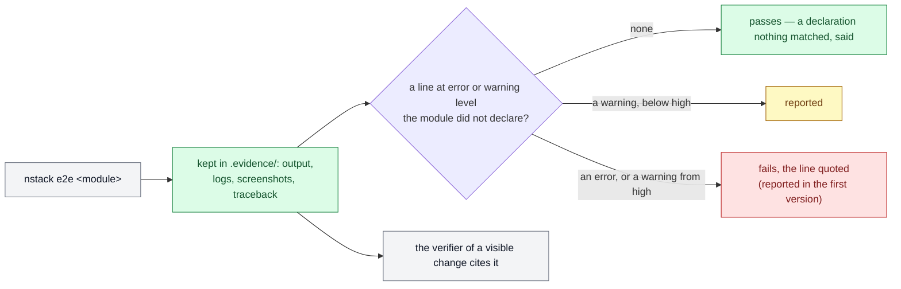

# PDR-0017 — A change's runs show what their logs said

- **Status**: Accepted (2026-10-21, merged with #230 after its independent review); the how in
  ADR-0009. Asked by the third project's decider, watching its
  end-to-end runs: *I sometimes see errors written in red on the interface … are the logs in
  place? do you analyse the logs during each test?* (#224). Reshaped by an independent review
  (#230) before its acceptance. Clarified 2026-10-24 (D144), before any version judged: a
  provoked line is declared even when its scenario asserts it (#245); a run that declares lines
  and wrote no log where they are read fails when judged, and a run that cannot run here says so
  (#246)
- **Date**: 2026-10-21
- **Decision makers**: NapkinStack maintainers (`@NapkinStack/maintainers`)
- **Modules affected**: the engine (`nstack e2e`, `nstack attest`, `nstack manifests`), the
  manifest's `commands`, the skeleton's playbooks (`tests.md`, `verification.md`)

> The PDR describes **what the product must do and why**, never its implementation.
> The how belongs to an ADR.

---

## User problem

A module's end-to-end scenarios pass or fail on what they assert. What the module **said** while
they ran — a warning, an error in its log — is read by nobody.

The framework already names the place for a run's evidence: `.evidence/`, ignored by git, uploaded
by CI's module checks as an artefact kept thirty days, and cited by `tests.md` and `09-platform.md`.
But nothing gives a run that folder, nothing keeps the command's own output — the engine runs it
and lets its output go — and nothing reads what is there. Observed on the third project (#224):

- its window's run writes its logs to a temporary folder and deletes it at the end, reading only
  the few lines it expects — the convention was not followed, because nothing held it;
- the failures it provokes on purpose show in red, and an error nobody provoked would too, with
  nothing to tell them apart;
- its screenshots were never read; verifiers wrote "rendering not seen";
- a scenario that broke off kept no traceback, and failed `nstack attest` twice before its cause
  could be read;
- its end-to-end runs need a desktop: CI says "not run", and they run on a workstation, attested —
  where only the first 64 KiB of a step's output reach the record.

A defect that only logs passes every gate the framework has. Each project invents its own audit,
or none.

## Goal

Every end-to-end run of a module — in CI or attested on a workstation — keeps what it said and
showed, says every error nobody declared, and fails on it; a verifier of a visible change reads
and cites what the run showed. The same way in every project, with no project writing its own
audit and no step a person must take for an update to pass.

## Out of scope

- **A log format or library imposed.** The framework recognises the common ones; a module whose
  lines it cannot classify says how they are read.
- **Unit tests' logs.** End-to-end runs, where a module runs as a user meets it.
- **Production logs and alerting.**
- **Judging a screenshot automatically.** A person, or a verifier session, looks.

---

## Prior art

| Product / reference | Solution chosen | What we keep from it |
|---|---|---|
| [cypress-fail-on-console-error](https://github.com/nils-hoyer/cypress-fail-on-console-error) | A browser console error fails the test — errors by default, warnings opt-in; expected ones listed as patterns | **Fail on undeclared errors; warnings a choice** |
| [pytest `filterwarnings`](https://docs.pytest.org/en/stable/how-to/capture-warnings.html) | `error` turns warnings into failures, `ignore::` declares what is expected — opt-in | **Declare what is expected, judge the rest** |
| [`tracing-test`](https://docs.rs/tracing-test) (Rust) | Logs captured per test and asserted (`logs_contain`); no failure on a level | **Capture first; a level alone decides nothing** |
| [Playwright](https://playwright.dev/docs/api/class-page#page-event-page-error) `pageerror` / `console` events, `expect.soft`, traces kept on failure | Page errors collected during the run; soft assertions judged at its end; evidence kept | **Collect during, judge at the end, keep it** |
| [PHPStan baseline](https://phpstan.org/user-guide/baseline), [detekt baseline](https://detekt.dev/docs/introduction/baseline/) | A new check first lists what exists, then fails on anything new | **Report first, fail at the next step** |
| [`actions/upload-artifact`](https://github.com/actions/upload-artifact) | A job's files kept with the run, for a retention period, counted against storage | **Where CI keeps the evidence** — already in the skeleton |

**The convention the user already knows:** a test run that turns red on an unexpected error, and
the run's screenshots attached to it.

---

## Options considered

| Option | What the user experiences | Cost | Chosen? |
|---|---|---|---|
| Do nothing | Each project audits its logs, or not | 0 | No |
| A. A playbook sentence: "read the logs" | The verifier may; the run never does | Low | Part of the choice |
| B. Every undeclared warning and error fails, from the version that brings it | Every project with end-to-end runs turns red on the update until a person lists its lines — a manual step for every update | Medium | No: against "no manual intervention" |
| B′. Report only, never fail | Lines listed; nothing stops a defect | Low | No: nothing guards |
| **B″. Errors fail, warnings reported (failing from `high`), reported only in the version that brings it — the next minor version judges** | A green update; the audit lists what to declare; then an undeclared error fails | Medium | **Yes** |
| C. B″ plus a dashboard of logs across runs | History | High | No: no reader for it yet |

## Decision

**Option B″.**

1. **Keep.** The engine gives each end-to-end run its evidence folder (`.evidence/`, as the
   framework already names it) and keeps there the command's own output — a traceback included —
   beside the logs and screenshots the module writes into it. CI keeps the folder as the run's
   artefact, as it already does; a run attested on a workstation records the audit's result in
   its record, and where its files stay.
2. **Audit.** After the module's command, the engine reads the log files the run wrote into that
   folder — nowhere else. It recognises the level of JSON lines under the common level keys, and of
   plain lines led by a level word; a module whose lines it cannot classify declares how their
   level is read, or is told its logs were not read. A module declares the warnings and errors its
   scenarios provoke: a pattern, and the scenario that provokes it — named for the reader; the
   engine checks the pattern, not the scenario. A declaration nothing matched is said.
3. **Severity follows consequence** (PDR-0011): an undeclared error fails the run at every
   criticality; an undeclared warning is reported, and fails from `high`.
4. **First report, then judge.** The version that brings the audit reports only, listing each
   undeclared line in the form a declaration takes; the next minor version fails. No update ever
   waits on a person.
5. **What is only shown.** What a module's page reports as an error — an uncaught exception, a
   console error — is written to the run's logs by the module's own scenarios, as `tests.md` says;
   what is only shown on screen is read by *Look*.
6. **Look.** The verification playbook asks the verifier of a change to a visible surface to read
   the run's screenshots and logs, and to cite what they saw — never "rendering not seen" on a
   scenario passed.
7. **One place the audit reads.** A warning or an error a scenario provokes is declared in the
   manifest, the one place the audit reads; the scenario that expects it may assert it too.
   *Clarified 2026-10-24: this rule said "never both", which left the audit red on a line its
   scenario asserted (#245).*

---

## Expected behaviour

**Legend** — grey: what runs and who looks · green: kept, passed · yellow: reported · red: fails.

**Nominal journey.** The window's run provokes a refused key on purpose; the module declares the
warning's pattern, for scenario S3. The run passes; `.evidence/` holds its output, logs and
screenshots; CI keeps them, or the attested record says where they are. A change makes the
recorder log an error at start: in the version that brings the audit, the run lists it, quoted,
with its time, as a declaration would read; from the next, the run fails on it.

**Edge cases and degraded states.** A declared refusal no longer happens: the run passes and says
the declaration matched nothing. The run crashes in scenario S5: its output, the traceback with it,
is in the folder. A module that logs in a form the engine cannot classify: the run says its logs
were not read and how to declare their form — it passes. A module whose run cannot start here (no
desktop) says so — exit 77, as a skipped test says it to Automake and Meson: it is recorded *not
run here*, and passes. A run that declares provoked lines and wrote no log where they are read —
its logs written elsewhere — checked them against nothing: reported in the version that brings
that judgement, it fails from the next minor, as §4 says of every new judgement. A run that declares nothing and writes no log passes, and says nothing was
read. *Clarified 2026-10-24 (#246).*

**Business rules.** The manifest is the one place a provoked warning or error is declared. An
error is never declared away silently: each declaration names its scenario.

**Permissions.** The module's owner declares; the verifier reads; nobody else changes a
declaration but through the module's pull request.

**Acceptance criteria** *(testable)*:

- [ ] Given a module's end-to-end run, then the command's output, a traceback included, is kept in
      its evidence folder; in CI, the folder is the run's artefact.
- [ ] Given an attested run, then its record holds the audit's result and says where the files are.
- [ ] Given JSON log lines with a level key, and plain lines led by a level word, then their level
      is read; given lines it cannot classify, then the run says the logs were not read, and passes.
- [ ] Given an undeclared error, then the run fails, quoting the line — reported only in the
      version that brings the audit.
- [ ] Given an undeclared warning on a module below `high`, then it is reported and the run passes;
      from `high`, it fails as an error does.
- [ ] Given a declared pattern that matched no line, then the run says so and does not fail.
- [ ] Given a malformed declaration in a manifest, then `nstack manifests` fails.
- [ ] Given the verification playbook, then it asks the verifier of a visible change to cite what
      the screenshots and logs showed.

---

## Success criterion

> We will consider this was the right call if **on the third project, every end-to-end run, in
> CI or attested, keeps its evidence and its audit's result; no verifier writes "rendering not
> seen" on a scenario passed; and one defect that only logged is caught by the audit before
> review** is observed before **2027-03-31**.

How it is observed: the attested records and CI artefacts of the third project's pull requests;
its verifiers' sheets; the audit's findings named in a pull request.

If the criterion is not met: adjust the levels or the declaration's form; remove it under the
condition below.

---

## Removal condition

> This feature will be removed if **over two minor versions, declared patterns grow to accept
> every line — the audit then checks nothing — and no defect was caught by it**.

---

## Impacts

- **Existing users**: a project's runs keep passing on the update; the audit lists what to
  declare, in the form a declaration takes; it fails from the next minor version. Nothing to do by
  hand for the update to pass.
- **Modules and contracts**: a module with an end-to-end command writes its logs and screenshots
  into the folder it is given, declares what its scenarios provoke, and, if its log lines are of
  an uncommon form, how their level is read.
- **Support and documentation**: `tests.md` (keep, the one place for an expectation, page errors
  logged), `verification.md` (look), the manifest's comment, the CHANGELOG's two steps.
- **Data**: the evidence holds test data only, never a person's; a public repository's artefacts
  are public; kept thirty days (the skeleton's retention); on a private repository its size counts
  against the Actions storage of the plan. An attested run's files stay on the workstation that
  ran it.
- **The how** — the folder's handing over, the level recognition, the declaration's shape, the
  attest record's field — goes to an ADR.
