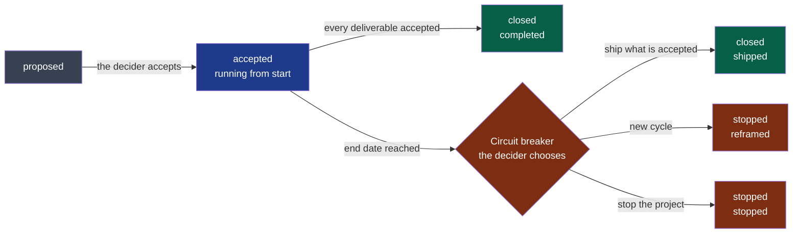
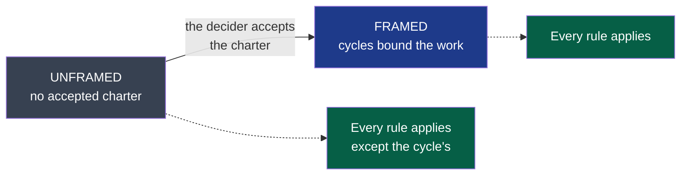

# The project's own folder — `docs/project/`

It holds what the framework cannot know about this project: who it is for, when it is finished,
and what is being delivered now. Every agent session reads the charter and the current
cycle before working (`AGENTS.md` §4).

| File | Holds | Written by | Accepted by |
|---|---|---|---|
| `discovery.md` | An idea tested: evidence, value hypothesis, challenge, decision | The framer, then the challenger (`.nstack/playbooks/discovery.md`) | The decider |
| `charter.md` | Users, problem, constraints, risks, success criteria, out of scope | The framer (`.nstack/playbooks/framing.md`) | The decider |
| `cycles/NN-<slug>.md` | One goal, a finite list of deliverables, an appetite, an end date, the closure | The framer | The decider |
| `rules/<subject>.md`, `rules/always.md` | The project's own rules, read with the playbook of the same name; absent until the project has one | Whoever meets the constraint, the decision or the incident | The foundation team |
| `.nstack/forms/` — `discovery.md`, `charter.md`, `cycle.md`, `rules.md` | The forms these files are copied from; they are the framework's and live in its folder | — | — |



**Legend** — grey: a proposal · blue: the cycle in progress · green: an accepted end ·
red: the circuit breaker and what it can lead to.

## Framed, or unframed



**Legend** — grey: a project that has framed nothing yet, a stage and not a fault · blue:
a project whose charter is accepted · green: what judges a change in each.

The stage is read from this folder, never declared, and every run that judges names it. An
unframed project is held to its boundaries, its contracts, the scope of its pull requests,
the test sheet and the hooks; only the three rules that bound work inside a cycle are silent,
since there is no cycle. **Framing is worth its price when there is something to bound** —
several people, a deadline, a decider who is not the one typing. It is one-way: once the
charter is accepted, a project between two cycles is framed, and is told which cycle is
missing.

## What CI checks

| Check | When | Rules |
|---|---|---|
| The plan, a fitness function | Every push | Formats; one accepted cycle at a time, under an accepted charter; `end` = `start` + the appetite; acceptance criteria once a deliverable is ready; closures recorded; a discovery decided with its decider and date, a charter only after a go. A charter, a cycle or a deliverable still holding the template's words is refused. A decision record due at a closure and not yet read is warned of, never refused (C10) |
| The pull request check | Every pull request changing a module beyond its description — manifest, `AGENTS.md`, `README.md`, `docs/`; not a framework update — **once the charter is accepted** | An accepted cycle; not past its end date; a ready or in-progress deliverable named — and, when someone holds it, delivered by its holder — or the `out-of-cycle` label with its justification |

## A cycle's progress

Read, never kept: `nstack plan` computes it from the accepted cycle's front matter and says it in
one line, then who holds each deliverable.

```
Cycle 03-the-window: 10 of 14 accepted · 2 in progress · 2 ready · day 5 of 21, 17 left (ends 2026-11-07)
Holds in 03-the-window: 3 held, of which 0 stale (from origin; stale after 7 days without work):
```

*Accepted* counts what the decider accepted; a `dropped` deliverable counts in nothing. From its
end date — the first day the cycle is over — the line says the circuit breaker fell and the
decider chooses, and the pull request check refuses delivery work (K2). The project's own
success — the charter's criteria — is recorded at a cycle's closure, and said with the project
below. An agent reporting
progress gives this line, so that one figure circulates.

### On the forge

The same plan, where a person already looks: after every merge to the default branch, and once a
day — so that a new holder shows within a day —, the workflow *Plan on the forge* runs `nstack board`. Each cycle the decider accepted,
closed or stopped is a **milestone** — titled by the cycle file's heading, due on its end date,
its description carrying the line above, counts only — and each deliverable an **issue** in it: its acceptance
criteria as a checklist, its module and state, who holds it, the pull requests that name it.
An issue closes as *completed* when the deliverable is accepted, as *not planned* when it is
dropped, deferred, or left unfinished by a closed cycle.

Nothing is maintained by hand and nothing on the forge is the plan: an issue or a milestone edited
there is put back at the next run, and the run says it updated it — it cannot tell an edit by
hand from the plan moving: the plan is edited in the cycle files, in a pull request. The display
finds its own objects by a marker in their body; an issue or a milestone a person made is never
touched, and a person's milestone already holding a cycle's title is said, not overwritten. What cannot be shown — no token, a refusal, holds unreadable — is said in the
run's summary, never a failed merge. The first run on a project creates an issue per deliverable,
and the repository's watchers get a notification for each.

## The project across its cycles

There is no backlog to measure the project against: framing bounds one cycle at a time, and
what it leaves out waits in that cycle's *Later*. `nstack plan` says the project as it stands,
read from this folder and kept nowhere else — the charter's success criteria, every cycle in one
line, and what the latest cycle left for the next framing:

```
Project: 0 of 3 success criteria met · criterion 1 observed since 2026-10-17 · 3 cycles: 1 accepted, 1 closed, 1 stopped
  01-first-meeting  stopped (reframed) on 2026-10-13 · 1 of 7 accepted · 6 deferred
  02-the-audio      closed (completed) on 2026-10-17 · 9 of 9 accepted
  03-the-window     in progress, ends 2026-11-07 · 18 of 20 accepted · 2 in progress
  Later in 03-the-window, for the next framing: 9 candidates
```

**The project's progress is its charter's success criteria.** A closure records the ones the
decider says it moved, in the cycle's front matter — the charter itself changes only through a
decision:

```yaml
success:
  - criterion: 1          # its number in the charter's list, from 1
    state: observing      # met | observing
    since: 2026-10-17     # observing: the day observation started
```

A criterion's state is its latest record, in the order of the cycles; one never recorded is not
yet met. Numbers follow the charter's list; a criterion still holding the form's words is
listed, never counted. When every criterion is met, the line says the charter's goal is reached,
and the decider says whether the project is finished. A record outside a closure, twice in one,
on a number the charter does not fill, in an unknown state, or observing with no day is refused
(C6).

Each cycle is counted as its own line above counts it. Deliverables are never added up across
cycles: one deferred by a cycle is often framed again in the next, and a total would count it
twice. *Later* is the running cycle's, or between two cycles the last one ended — where the next
framing starts; its candidates are counted when the section is a list, one item each, and prose is
said as prose. A status or an outcome the plan's rules refuse is said as unknown, and a date they refuse is left
out: none is printed raw. The view is `nstack plan`'s alone — `nstack fitness` and CI keep to the cycle in progress.

## Who holds a deliverable

With several contributors, a deliverable is **held** before its first change, so that two of
them never deliver it twice:

```bash
nstack claim D30 --person @alice --session <session>   # held; its first work branch d30-… made, unless one exists
nstack plan                                             # who holds what, since when; what is stale
nstack unclaim D30                                      # given back: by its holder, the decider, anyone once stale
nstack claim D30 --take-over                            # a hold nobody worked on for hold_days
```

The hold is a branch of the shared remote, `nstack/hold/<cycle>/D30`, whose commits are its
events; the remote takes the first of two claims and refuses the second. A hold's last work is
its newest event or commit on a branch `d30-…`; with none for `hold_days` (an answer of the
project, 7 by default) it is **stale**, and anyone may take it over — recorded, with whom it was
taken from; the previous work is kept. The pull request check refuses delivery work for a
deliverable someone else holds (K5): its commits name none of the hold's sessions, and no
author, committer or opener is its person; nobody holds it, it asks nothing. A holder working
from a new session names it on the hold first — `nstack claim D30 --session <it>`. A hold says who is
accountable; it proves nobody's identity.

**A hold lasts its cycle.** Once the cycle is closed or stopped, nothing it guarded can be delivered, and
a deliverable framed again is held afresh, on a branch of the new cycle. `nstack unclaim` says such a
hold ended rather than refusing it. Its branch is never deleted — the ruleset forbids it: it is the
hold's record, and the cycle in its name tells a finished hold from a live one.

The charter changes only through a PDR (`.nstack/handbook/06-decisions.md` §4). A cycle is never
extended: past its end date, delivery work stops until the decider records a decision.
