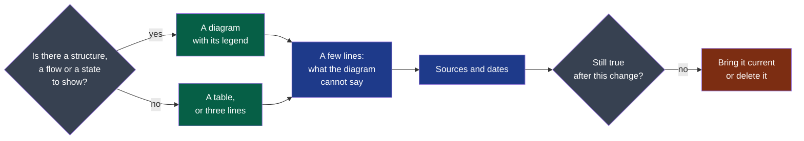

# Playbook — Documentation

> **Trigger.** Load this playbook when you are touching: a document a human will read, a
> pull request's description included: writing or changing one.
>
> **This project's own rules** on the subject, when it has any: `docs/project/rules/documentation.md`
> — read them with this playbook. They add to it or tighten it.

**Legend** — grey: what you ask yourself · green: what the reader sees first · blue: what
follows it · red: the document that no longer says what is true.

---

## The standard — five rules, and no content

1. **Shape first**: a diagram with its legend before the prose, wherever there is a structure,
   a flow or a state to show. A reader who stops after the diagram has understood.
2. **A source for every claim about the outside world** — a market, a law, a tool's
   behaviour, a number.
3. **A date on every decision**, and on every criterion that will judge it.
4. **Current, or deleted.** A stale page costs more than a missing one, because it is
   believed.
5. **A fact has one home.** Its home is the file a check or a command reads — a module's
   manifest for its responsibility, owner and criticality; the cycle for a deliverable's state;
   the charter for the decider. Every other document that needs the fact links to it, never
   copies it: two copies agree on the day they are written, and only on that day.

The framework asks for this form and writes none of the content: what the document says is
the project's.

---

## Drawing the diagram

| Situation | Action | Verification |
|---|---|---|
| Parts and what links them: modules, users, systems | Boxes and arrows, a dozen boxes at most | Someone reading the diagram alone can say what the document is about |
| Things that happen in an order | A sequence, left to right or top to bottom | Every step has one way in |
| Something that changes state | The states and what moves it from one to the next | No state is a dead end unless it is meant to be |
| A choice between paths | A decision tree, the question in the node | Every branch ends on an action |
| A colour or a shape is used | It means one thing, and the legend under the diagram says which | The legend names every colour used, and nothing else |
| The diagram is ready | Written as text in the file, in the notation the tooling profile names — never an image. A drawing of a screen is no diagram: it is an image, frozen (`framing.md` §2) | The pull request shows what changed in it |
| Nothing to show: one fact, a list, a comparison | No diagram. A table, or three lines | A diagram that decorates is removed |
| More than a dozen boxes | Two diagrams, one idea each | Each has its own legend |

## After the diagram

- **Say what the diagram cannot**: the why, the exception, the number. Never describe the
  diagram in words.
- **A table for anything a reader will compare**; a list for anything they will tick.
- **The point first.** A reader who must scroll to find what was decided has been given a
  story instead of a document.
- **Short.** A paragraph a reader skips is a paragraph to delete.

## Which document, and when

Each document of a project has the event that makes it writable; before it, its form stays
a form. The table is `.nstack/handbook/06-decisions.md` §10 — read that one section before writing a
document the project does not hold yet, and never fill a form with what nobody has decided.

---

## Closing checklist

- [ ] The diagram comes first, with its legend — or there is nothing to draw, and no diagram
- [ ] Every claim about the outside world names its source
- [ ] Every decision and every criterion carries its date
- [ ] Every document this change makes untrue is brought current in the same pull request
