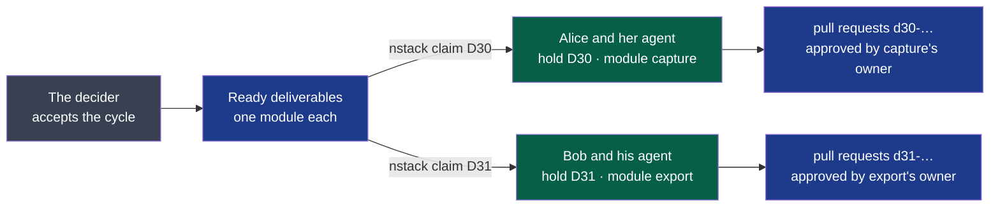
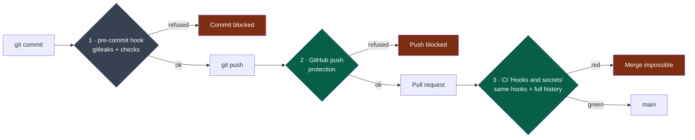

# Contributing

## Before you start

1. Pick a **ready** deliverable of the current cycle (`docs/project/cycles/`) and **take it**:
   `nstack claim D<n>` — or an issue, for what nobody planned: a defect, a debt. A project
   with no accepted charter has no cycle yet: pick the work, the other rules apply
   (`.nstack/handbook/project.md`).
2. Identify **the** target module — exactly one.
3. Read its `MANIFEST.yaml`, then its `AGENTS.md`.
4. `nstack bootstrap <name> && nstack check <name>`
5. `pre-commit install` — once per clone ([install pre-commit](https://pre-commit.com/#install)).

## Working with several contributors

**Legend** — grey: who decides · blue: the work and its review · green: a deliverable held.

- **The work is shared by module.** Each module has an owner — `owner:` in its
  `MANIFEST.yaml`, and `.github/CODEOWNERS` — who approves its changes; a deliverable belongs
  to one module. Two contributors in two modules never meet but through a contract
  (`.nstack/handbook/02-modules.md`, `03-contracts.md`).
- **A deliverable is taken before its first change**, so that nobody delivers it twice:
  `nstack claim D30 --person @you` — and an agent adds `--session <its session>`. `nstack plan`
  says who holds what; a hold nobody works on goes stale and may be taken over
  (`.nstack/handbook/project.md`, *Who holds a deliverable*).
- **Any coding agent works.** It reads `AGENTS.md` at the root and follows it; the skills
  `nstack skills` makes under `.claude/skills/` are one tool's shortcut to the same playbooks
  (`.nstack/playbooks/`). Give
  your agent its own identity and a session name (`.nstack/handbook/07-governance.md` §7).
- **Joining.** The decider invites you on the forge; when you, or your team, own a
  module, a pull request names the owner in its `MANIFEST.yaml` and `.github/CODEOWNERS`; you install the
  engine (`.nstack/handbook/INSTALL.md`) and run `pre-commit install`. Then *Before you start*.
- **Who checks whom.** The author never verifies nor approves their own work: a verifier
  runs the test sheet, the module's owner approves (`.nstack/handbook/05-workflow.md` §10).

## The barriers against leaks

**Legend** — grey: on the workstation, bypassable · green: GitHub side · red: a stop.

Only barriers 1 and 2 act **before** publication. A secret caught by CI is already
public: that is an incident, and it is revoked immediately (`.nstack/playbooks/security.md`).

## While you work

- **Write the oracle first**, watch it fail, then implement
  (`.nstack/handbook/05-workflow.md` §3).
- **Minimal change.** No opportunistic refactoring: it gets its own pull request.
- **Stay in the module.** Need another one? Go through its contract. The contract is not
  enough? That is a contract change, so an expand/contract sequence
  (`.nstack/handbook/03-contracts.md` §4) — never a single pull request.
- `nstack fitness` before every commit.

## Opening the pull request

The template applies the Definition of Done. Three things not to skate over:

- **The summary** — `DONE / VERIFIED / ASSUMED / NOT VERIFIED / RISKS`.
  A summary with nothing under `ASSUMED` and `NOT VERIFIED` is almost always incomplete.
- **The test sheet** — when one is due (`.nstack/handbook/05-workflow.md` §7: a module a user sees,
  from `standard` up, and every `high` or `critical` one): scenarios written before the code,
  results filled in by a verifier who is not you, each with its evidence
  (`.nstack/playbooks/verification.md`).
- **The signals to report** — that is how the system improves
  (`.nstack/handbook/10-measurement.md`).

## Exceptions

| Label | When | Consequence |
|---|---|---|
| `cross-module` | A PR touching several modules, with a justification | Allowed, counted |
| `over-budget` | Generation, mechanical migration, mass rename | Allowed, counted |
| `out-of-cycle` | An incident, a production defect, with "Out of cycle: <reason>" | Allowed, counted |

Exceptions are **visible**, never silent. Their rate is a health indicator for the
boundaries.

## What is not negotiable

- No quality gate bypass: no `skip`, no `--no-verify`, no test disabled without an issue
  and a date.
- No secret in the repository, in any form.
- Never tick "tests passing" without having run them.
