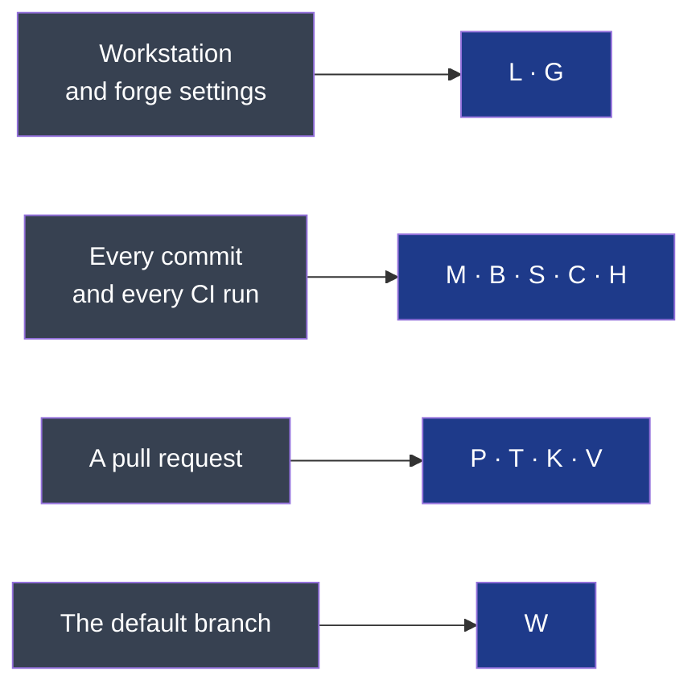

# The rules a check names

Every refusal starts with a code between brackets — `FAIL [K1]`. This page says what each code
refuses and where its reason is written. It defines nothing: the reasons are in the pages it
points at, and the checks are the engine's.

**Legend** — grey: where a check runs · blue: the families of rules judged there. A letter is
a family, a number a rule; a retired rule's number is never reused.

## M — a module's manifest

| Code | Refuses | Why |
|---|---|---|
| `M1` | A module without its manifest | `02-modules.md` §5 |
| `M2` | A required field missing, or still holding its template's words | `02-modules.md` §5 |
| `M3` | An unknown lifecycle or criticality value | `02-modules.md` §6 |
| `M4` | A responsibility that takes two sentences, or joins two capabilities | `02-modules.md` §3 |
| `M5` | A deprecated module with no removal date, or past it | `02-modules.md` §6 |
| `M6` | A deprecated contract with no removal date, or past it | `03-contracts.md` §4 |
| `M7` | A module holding code and declaring no `check` and `test` | `09-platform.md` §2 |
| `M8` | A module of criticality high or critical without a runbook | `05-workflow.md` §7 |
| `M9` | A module missing a file of its envelope | `02-modules.md` §4 |
| `M10` | A module that does not say whether a user sees it | `05-workflow.md` §7 |

## B — the boundaries between modules

| Code | Refuses | Why |
|---|---|---|
| `B1` | A contract read without being declared | `03-contracts.md` §1 |
| `B2` | A reference to another module's code | `02-modules.md` §8 |
| `B3` | A circular dependency between modules | `02-modules.md` §8 |
| `B4` | *(warning)* A contract declared consumed and never read | `03-contracts.md` §6 |
| `B5` | Direct access to another module's data | `08-quality.md` §8 |
| `B6` | A consumed contract nobody provides in that version | `03-contracts.md` §6 |
| `B7` | A provided contract whose document does not exist | `03-contracts.md` §2 |
| `B8` | *(warning)* A contract consumed from a deprecated module | `02-modules.md` §6 |

## S — the playbooks and their skills

| Code | Refuses | Why |
|---|---|---|
| `S1` | A playbook with no entry in the skills configuration | `INSTALL.md`, "Claude Code skills" |
| `S2` | An entry pointing at a playbook that does not exist | `INSTALL.md`, "Claude Code skills" |
| `S3` | Generated skills that no longer match their playbooks | `INSTALL.md`, "Claude Code skills" |
| `S4` | A skill whose name or description breaks the skills specification | `INSTALL.md`, "Claude Code skills" |

## C — the discovery, the charter and the cycles

| Code | Refuses | Why |
|---|---|---|
| `C1` | A framing document whose front matter cannot be read | `docs/project/README.md` |
| `C2` | A charter with an unknown status, no single decider or no success criterion | `docs/project/README.md` |
| `C3` | A cycle with no goal, no appetite, or an end that is not its start plus its appetite | `docs/project/README.md` |
| `C4` | A deliverable with no id, title or state — or ready without acceptance criteria | `05-workflow.md` §3 |
| `C5` | Two accepted cycles, or an accepted cycle under a charter that is not | `docs/project/README.md` |
| `C6` | A closed or stopped cycle with no outcome or no end date | `docs/project/README.md` |
| `C7` | A discovery decided with no decider, date or challenger — or a charter with no go before it | `docs/project/README.md` |
| `C8` | A document left as its form once its moment has come: the front page's sentence at a go, the whole front page at an accepted charter, the module map once a module holds code | `06-decisions.md` §10 |

## H — hygiene

| Code | Refuses | Why |
|---|---|---|
| `H1` | A path rooted in one person's home directory, in any tracked file | `07-governance.md` §3 |

## P — the scope of a pull request

| Code | Refuses | Why |
|---|---|---|
| `P1` | A pull request that changes two modules | `02-modules.md` §7 |
| `P2` | *(warning)* A pull request beyond the review budget | `05-workflow.md` §4 |

## T — the test sheet

| Code | Refuses | Why |
|---|---|---|
| `T1` | A change that owes a test sheet and carries none | `05-workflow.md` §7 |
| `T2` | A sheet with no verifier, a verifier who is an author, or a row left empty | `05-workflow.md` §7 |
| `T3` | A scenario passed with no evidence, or no commit it was verified on | `05-workflow.md` §7 |
| `T4` | Evidence older than the head commit | `05-workflow.md` §7 |
| `T5` | A scenario failed, or left not verified | `05-workflow.md` §7 |

## K — the cycle a change belongs to

These rules bound work inside a cycle. A project with no accepted charter is **unframed**:
it has no cycle, K1 to K3 say nothing there, and every other rule applies.

| Code | Refuses | Why |
|---|---|---|
| `K1` | In a framed project, delivery work with no accepted cycle | `docs/project/README.md` |
| `K2` | Delivery work after the cycle's end date: the circuit breaker | `docs/project/README.md` |
| `K3` | Delivery work that names no ready or in-progress deliverable | `docs/project/README.md` |
| `K4` | The out-of-cycle label with no justification | `docs/project/README.md` |

## V — a contract version someone relies on

| Code | Refuses | Why |
|---|---|---|
| `V1` | A frozen contract version changed without the compatibility proof | `03-contracts.md` §4 |

## W — what reached the default branch

| Code | Records, never refuses | Why |
|---|---|---|
| `W1` | A commit that arrived outside a pull request | `07-governance.md` §7 |

## L — the workstation

| Code | Reports as a gap | Why |
|---|---|---|
| `L1` | An engine that is not the project's version, or is not a published one | `INSTALL.md` |
| `L2` | git or the hook runner missing | `INSTALL.md` |
| `L3` | Hooks not installed in this clone | `INSTALL.md` |
| `L6` | Code owners that do not start with a default owner | `07-governance.md` §7 |
| `L7` | A project created from a path on one machine | `INSTALL.md` |

## G — the forge's settings

The sixteen lines of the checklist, in its order (`INSTALL.md`, "To do once on GitHub").

| Code | Reports as a gap | Why |
|---|---|---|
| `G1` | A direct push to the default branch is possible | `07-governance.md` §7 |
| `G2` | No approving review is required | `07-governance.md` §7 |
| `G3` | No code owner review is required | `07-governance.md` §7 |
| `G4` | A check of the list is not required | `07-governance.md` §8 |
| `G5` | No secret scanning, or no push protection | `08-quality.md` §6 |
| `G6` | No private vulnerability reporting, on a public repository | `SECURITY.md` |
| `G7` | Actions allowed beyond the list | `07-governance.md` §7 |
| `G8` | Actions not pinned to a commit | `07-governance.md` §7 |
| `G9` | A workflow runs for an outside contributor without approval | `07-governance.md` §7 |
| `G10` | A workflow token that writes, or that approves pull requests | `07-governance.md` §7 |
| `G11` | A label of the three exceptions missing | `10-measurement.md` §3 |
| `G12` | Somebody on the bypass list | `07-governance.md` §7 |
| `G13` | An approval that survives a new commit | `07-governance.md` §7 |
| `G14` | Auto-merge not available | `07-governance.md` §7 |
| `G15` | A merge method other than squash | `07-governance.md` §7 |
| `G16` | Merged branches kept | `07-governance.md` §7 |
